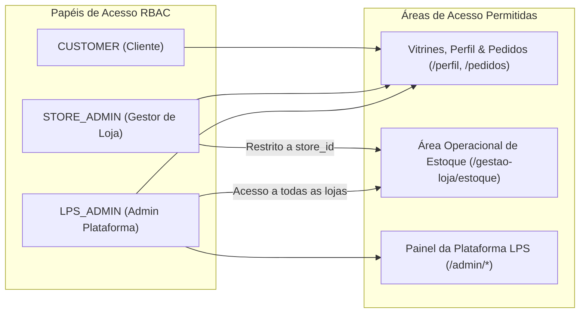

# VitrineFlex — Linha de Produto de Software para E-Commerce Multidomínio

> **VitrineFlex** é uma Linha de Produto de Software (LPS / *Software Product Line*) orientada a comércio eletrônico multidomínio, concebida e implementada com uma arquitetura distribuída de microsserviços em **Python (FastAPI)** e frontend configurável em **React (TypeScript, Vite e Tailwind CSS)**.

O sistema instancia, configura e opera lojas virtuais altamente customizadas para múltiplos domínios de negócio a partir de um **Feature Model formal com 23 features**, garantindo variabilidade dinâmica em tempo de execução, controle de acesso baseado em papéis (RBAC), transações atômicas orquestradas por Saga e estrito isolamento de dados com o padrão **Database-per-Service**.

---

## 🏬 Lojas Demonstrativas & Portal da LPS

O projeto é entregue com um portal inicial neutro e três vitrines pré-configuradas derivadas da mesma linha de produto:

| Espaço / Vitrine | Segmento | Rota Canônica | Características de Variabilidade & Identidade |
| :--- | :---: | :--- | :--- |
| **Portal VitrineFlex** | `PORTAL` | [`/`](http://localhost:5173/) | Entrada neutra e independente, sem herança de temas de lojas, com visão geral da LPS e atalhos para todas as áreas. |
| **Vitrine Moda** | `FASHION` | [`/loja/vitrine-moda`](http://localhost:5173/loja/vitrine-moda) | Tema editorial em tons rosa/bordô (`#EC4899`), seletores de tamanho e cor, guia interativo de medidas corporais e layout de catálogo 3:4. |
| **Vitrine Tech** | `TECH` | [`/loja/vitrine-tech`](http://localhost:5173/loja/vitrine-tech) | Tema tecnológico futurista em tons azul/ciano (`#2563EB`), comparador de especificações lado a lado, filtros facetados e especificações técnicas completas. |
| **Vitrine Books** | `BOOKS` | [`/loja/vitrine-books`](http://localhost:5173/loja/vitrine-books) | Tema acolhedor em tons esmeralda/verde editorial (`#059669`), leitor modal de amostra de capítulos (*reading preview*), ficha catalográfica com ISBN/autores/editoras e alertas de reposição de estoque. |
| **Área Operacional de Estoque** | `STORE_OPS` | [`/gestao-loja/estoque`](http://localhost:5173/gestao-loja/estoque) | Interface operacional exclusiva para gestores de loja (`STORE_ADMIN`) inspecionarem e reporem estoque da sua loja vinculada. |
| **Painel Administrativo da LPS** | `LPS_ADMIN` | [`/admin/dashboard`](http://localhost:5173/admin/dashboard) | Central de controle total da LPS: gestão do ciclo de vida de lojas, configurador de features, regras CTC, microsserviços, bancos e usuários. |

---

## 🧩 Feature Model Formal (23 Features)

A variabilidade arquitetural e funcional da LPS é regida por um modelo formal de **23 features** com restrições CTC (*Cross-Tree Constraints*) validadas dinamicamente pelo **LPS Configuration Service**:

```mermaid
graph TD
    Root["VitrineFlex LPS (Root)"]
    
    Root --> Core["Core Obrigatório (6)"]
    Core --> F_Auth["auth"]
    Core --> F_Catalog["catalog"]
    Core --> F_Cart["cart"]
    Core --> F_Orders["orders"]
    Core --> F_Checkout["checkout"]
    Core --> F_Recom["recommendations"]
    
    Root --> Cross["Engajamento & Descoberta (2)"]
    Cross --> F_RecView["recently_viewed"]
    Cross --> F_BackStock["back_in_stock_alert"]
    
    Root --> Fashion["Extensões de Moda (5)"]
    Fashion --> F_SizeGrid["size_grid"]
    Fashion --> F_ColorVar["color_variants"]
    Fashion --> F_VarSku["variant_sku"]
    Fashion --> F_SizeGuide["fashion_size_guide"]
    Fashion --> F_FavModa["favorites"]
    
    Root --> Tech["Extensões de Tecnologia (4)"]
    Tech --> F_Specs["technical_specs"]
    Tech --> F_Warr["warranty_info"]
    Tech --> F_Comp["product_comparison"]
    Tech --> F_TechFilt["technical_filters"]
    
    Root --> Books["Extensões Editoriais / Livros (6)"]
    Books --> F_Isbn["isbn"]
    Books --> F_Author["author"]
    Books --> F_Pub["publisher"]
    Books --> F_Genre["literary_genre"]
    Books --> F_Edition["edition"]
    Books --> F_Preview["book_preview"]
```



### Derivação em Tempo de Execução via Manifestos

Cada loja instanciada possui um manifesto versionado (`ProductManifest`) persistido no **LPS Configuration Service**. 
- Quando um cliente acessa `/loja/:slug`, o frontend consulta o manifesto via API Gateway e resolve dinamicamente:
  1. A árvore de features habilitadas;
  2. As configurações de tema visual (`primary_color`, `font_family`, `border_radius`);
  3. Os métodos de pagamento e modalidades de entrega suportados;
  4. A visibilidade condicional de componentes (ex: guia de medidas só renderiza se `fashion_size_guide=true`; comparador de produtos só renderiza se `product_comparison=true`).
- No backend, o **Catalog Service** valida se as operações requisitadas respeitam o manifesto da loja e bloqueia acessos a lojas que estejam com status `ARCHIVED` (retornando `410 Gone / STORE_ARCHIVED`).

---

## 🏛️ Arquitetura dos 9 Microsserviços & Portas

O ecossistema é composto por **9 microsserviços autônomos** interconectados via HTTP/REST, protegidos por autenticação mútua e tokens internos:

```
                     ┌────────────────────────────────────────┐
                     │          Browser / Frontend SPA        │
                     │          (React / Vite :5173)          │
                     └───────────────────┬────────────────────┘
                                         │ HTTP / JSON
                                         ▼
                     ┌────────────────────────────────────────┐
                     │              API Gateway               │
                     │            (FastAPI :8000)             │
                     └───────────────────┬────────────────────┘
                                         │
        ┌───────────────┬────────────────┼───────────────┬────────────────┬───────────────┐
        ▼               ▼                ▼               ▼                ▼               ▼
  ┌───────────┐   ┌───────────┐    ┌───────────┐   ┌───────────┐    ┌───────────┐   ┌───────────┐
  │   Auth    │   │LPS Config │    │  Catalog  │   │   Cart    │    │  Orders   │   │ Payments  │
  │  (:8001)  │   │  (:8002)  │    │  (:8003)  │   │  (:8004)  │    │  (:8005)  │   │  (:8006)  │
  └─────┬─────┘   └───────────┘    └───────────┘   └───────────┘    └─────┬─────┘   └───────────┘
        │                                                                 │ (Saga)
        ▼ (Token Interno)                                                 │
  ┌───────────┐   ┌───────────┐                                           │
  │ Shipping  │   │Recommend. │ ◄─────────────────────────────────────────┘
  │  (:8007)  │   │  (:8008)  │
  └───────────┘   └───────────┘
```

### Mapeamento Preciso de Portas

| Serviço | Porta | Banco de Dados | Responsabilidade Principal |
| :--- | :---: | :---: | :--- |
| **API Gateway** | `8000` | *Stateless* | Ponto de entrada unificado, roteamento reverso de rotas `/api/v1/*`, higienização de cabeçalhos de borda e injeção confiável de identidade (`X-User-ID`, `X-Store-ID`). |
| **Auth Service** | `8001` | `auth.db` | Registro de clientes, hash Argon2id, emissão/validação de tokens JWT, RBAC (`CUSTOMER`, `STORE_ADMIN`, `LPS_ADMIN`), vínculo de gestores (`store_id`) e auditoria administrativa. |
| **LPS Configuration Service** | `8002` | `lps.db` | Gestão do Feature Model canônico de 23 features, validação de regras de variabilidade (CTC), ciclo de vida de lojas (`ACTIVE`, `INACTIVE`, `ARCHIVED`) e emissão de manifestos. |
| **Catalog Service** | `8003` | `catalog.db` | Catálogo de produtos, variantes (tamanho/cor/SKU), atributos facetados, favoritos, controle atômico de estoque e notificações de reposição (*Back in Stock*). |
| **Cart Service** | `8004` | `cart.db` | Gestão de carrinhos de compras com persistência por sessão (usuários anônimos e autenticados) e isolamento por loja. |
| **Orders Service** | `8005` | `orders.db` | Gestão do ciclo de vida de pedidos e **Orquestrador da Saga de Checkout** com compensação atômica distribuída em caso de falha. |
| **Payments Service** | `8006` | `payments.db` | Processamento idempotente de transações financeiras (PIX, Cartão de Crédito e Boleto) com simulação de compensação/estorno. |
| **Shipping Service** | `8007` | `shipping.db` | Cálculo de frete e prazos por CEP com modalidades Padrão (`DELIVERY`), Expressa e Retirada na Loja (`PICKUP`). |
| **Recommendation Service** | `8008` | `recommendations.db` | Motor de recomendações personalizadas baseado em eventos de navegação (`VIEW`), produtos vistos recentemente e histórico. |
| **Frontend Web** | `5173` | *LocalStorage / Context* | SPA React 18 com suporte multitema em tempo de execução, catálogo reativo, carrinho em drawer e layouts isolados. |

---

## 🔒 Padrão Database-per-Service & Orquestração Saga

Para garantir desacoplamento estrito e alta coesão:
1. **Database-per-Service:** Cada um dos 8 microsserviços com persistência possui seu próprio arquivo de banco de dados SQLite operando em modo **WAL (*Write-Ahead Logging*)**, localizado na pasta `data/`. Nenhum microsserviço acessa diretamente as tabelas de outro serviço.
2. **Saga de Checkout:** A criação de pedidos segue uma **Saga Orquestrada** gerenciada pelo `orders-service`:
   - Passo 1: Reserva atômica de estoque no `catalog-service` via endpoint interno `/internal/v1/inventory/decrement`;
   - Passo 2: Processamento financeiro no `payments-service` via `/internal/v1/payments/process`;
   - Passo 3: Confirmação do pedido no `orders-service`.
   - **Compensação Automática:** Se o pagamento falhar ou for recusado, o orquestrador aciona imediatamente a compensação idempotente no catálogo (`/internal/v1/inventory/restore`), garantindo que o estoque não fique retido.

---

## 🛡️ Controle de Acesso Baseado em Papéis (RBAC)

O sistema implementa uma camada dupla de segurança (Frontend Route Guards + Backend Endpoint Authorization) fundamentada em três papéis:



### Matriz de Permissões e Acesso

| Papel | Escopo de Acesso | Vínculo de Loja (`store_id`) | Operações Permitidas | Rotas Bloqueadas |
| :--- | :--- | :---: | :--- | :--- |
| **`CUSTOMER`** | Consumidor final | `None` (universal) | Navegar nos catálogos, favoritar produtos, adicionar ao carrinho, checkout, acompanhar seus pedidos (`/pedidos`) e gerenciar perfil (`/perfil`). | `/admin/*`, `/gestao-loja/*`, reposição de estoque. |
| **`STORE_ADMIN`** | Gestor operacional de loja | Obrigatório (`store-tech`, etc.) | Acessar a área operacional `/gestao-loja/estoque`, inspecionar produtos da sua loja e repor estoque exclusivamente de produtos pertencentes à sua loja vinculada. | `/admin/*` (redireciona para `/acesso-negado`). Tentativas de repor estoque de outra loja retornam `403 Forbidden`. |
| **`LPS_ADMIN`** | Administrador global da LPS | `None` (irrestrito) | Gerenciar todo o ciclo de vida da LPS (lojas, manifestos, regras CTC, microsserviços, auditoria, banco de dados e gestão de usuários/RBAC). Acesso a `/admin/*` e permissão global para repor estoque de qualquer loja. | Nenhuma. |

---

## 🔑 Contas de Demonstração

Para facilitar a exploração e avaliação acadêmica, o script de inicialização do projeto cadastra automaticamente três contas representativas:

| Papel | Nome | E-mail | Senha | Vínculo / Loja | Rota Inicial Sugerida |
| :--- | :--- | :--- | :--- | :--- | :--- |
| **`CUSTOMER`** | Cliente Demonstração | `cliente.demo@example.com` | `ClienteDemo2026!` | Nenhuma (todas as lojas) | [`/loja/vitrine-moda`](http://localhost:5173/loja/vitrine-moda) ou [`/perfil`](http://localhost:5173/perfil) |
| **`STORE_ADMIN`** | Gestor Vitrine Tech | `gerente.demo@example.com` | `LojaDemo2026!` | `store-tech` (Vitrine Tech) | [`/gestao-loja/estoque`](http://localhost:5173/gestao-loja/estoque) |
| **`LPS_ADMIN`** | Administrador Plataforma | `admin.demo@example.com` | `AdminDemo2026!` | Global (toda a plataforma) | [`/admin/dashboard`](http://localhost:5173/admin/dashboard) |

> [!NOTE]
> **Idempotência & Segurança do Seed:** O script `seed_demo_stores.py` nunca duplica contas e preserva senhas já alteradas. Para restaurar as credenciais originais de demonstração a qualquer momento, execute `python scripts/seed_demo_stores.py --reset-demo-users`.

---

## 🚪 Mecanismo de Logout Consistente

O VitrineFlex oferece encerramento de sessão explícito em todas as interfaces da aplicação:
- **Nos Cabeçalhos das Lojas (Moda, Tech, Books e Portal Neutro):** Ícone de saída e opção "Sair" disponíveis tanto no menu desktop quanto no drawer de navegação mobile.
- **No Painel Administrativo (`/admin/*`):** Barra superior exibe o nome e papel do operador logado (`LPS_ADMIN`) com botão "Sair".
- **Na Área Operacional de Estoque (`/gestao-loja/estoque`):** Barra superior identifica o gestor e a loja ativa, com botão "Sair".
- **Higienização de Estado:** O logout limpa completamente o token JWT e os dados do usuário no `localStorage` e no `AuthContext`, invalidando o acesso imediato a rotas protegidas e redirecionando para `/login`.

---

## 🖼️ Armazenamento e Otimização de Imagens Locais

Todos os 75 produtos dos catálogos demonstrativos utilizam **imagens locais em formato WebP otimizado**, armazenadas diretamente no diretório do frontend:
```
apps/web/public/images/products/
├── fashion/   # 25 imagens de vestuário e calçados
├── tech/      # 25 imagens de hardware, smartphones e notebooks
└── books/     # 25 capas de livros de literatura, técnica e clássicos
```
- **Disponibilidade 100% Offline:** Nenhuma imagem depende de serviços de mock externos ou CDNs sujeitas a bloqueios de rede.
- **Componente Resiliente (`ProductImage`):** Caso qualquer arquivo apresente falha de carregamento, o componente exibe um placeholder SVG com gradiente específico do tema da loja e as iniciais do produto.

---

## 📋 Pré-requisitos de Instalação

- **Python 3.10 ou superior** (testado e homologado em Python 3.11, 3.12 e 3.15)
- **Node.js 18 ou superior** (com `npm`)
- **Git**

---

## 🚀 Como Executar o VitrineFlex Localmente

Siga o passo a passo abaixo para rodar o ambiente completo no seu sistema operacional:

### 1. Clonar o Repositório

```bash
git clone https://github.com/leonardobrrs/VitrineFlex.git
cd VitrineFlex
```

### 2. Configurar o Ambiente Virtual Python

**No Windows (PowerShell):**
```powershell
python -m venv .venv
.\.venv\Scripts\Activate.ps1
pip install -r requirements.txt
```

**No Linux / macOS (Bash):**
```bash
python3 -m venv .venv
source .venv/bin/activate
pip install -r requirements.txt
```

### 3. Executar a Carga Inicial de Dados (Seed)

O comando abaixo cria as tabelas SQLite em `data/`, popula as 3 lojas demonstrativas, os manifestos de features, os 75 produtos enriquecidos e as 3 contas de teste:

```bash
python scripts/seed_demo_stores.py
```

*(Opcional: para resetar senhas caso já tenham sido alteradas, use `python scripts/seed_demo_stores.py --reset-demo-users`)*.

### 4. Iniciar os 9 Microsserviços Backend

Utilize o orquestrador unificado que inicia o API Gateway e todos os serviços em segundo plano com logs monitorados:

```bash
python scripts/start_all.py
```

> **Verificação de Saúde:** Abra o navegador ou use `curl http://localhost:8000/health` para conferir o status `UP` do gateway.

### 5. Iniciar a Aplicação Frontend (React)

Abra outro terminal, acesse a pasta da aplicação web e inicialize o servidor de desenvolvimento Vite:

```bash
cd apps/web
npm install
npm run dev
```

Acesse a aplicação no navegador em:
👉 **`http://localhost:5173`**

---

## 🧪 Validação & Testes Automatizados

O VitrineFlex conta com uma suíte abrangente de testes automatizados com **Pytest** cobrindo contratos de microsserviços, isolamento entre lojas, Saga de pedidos, controle de concorrência e RBAC:

```bash
# Executar a suíte completa de testes de unidade e integração (excluindo E2E de serviços vivos)
pytest tests/ -k "not e2e"
```

### Resultados dos Testes Automatizados

A execução da suíte de testes em ambiente limpo apresenta o seguinte resultado:

```
==================== test session starts ====================
platform win32 -- Python 3.15.0, pytest-9.2.0, pluggy-1.7.0
rootdir: VitrineFlex
collected 96 items / 14 deselected / 82 selected

tests\test_admin_management.py .............          [ 15%]
tests\test_api_gateway.py ....                        [ 20%]
tests\test_auth_service.py ....                       [ 25%]
tests\test_cart_service.py ....                       [ 30%]
tests\test_catalog_service.py ........                [ 40%]
tests\test_demo_accounts_and_rbac.py .............    [ 56%]
tests\test_gateway_auth_integration.py ..             [ 58%]
tests\test_lps_config_service.py ......               [ 65%]
tests\test_lps_evolution_features.py ....             [ 70%]
tests\test_manifest_provider.py .                     [ 71%]
tests\test_orders_service.py ..                       [ 74%]
tests\test_payments_service.py .......                [ 82%]
tests\test_python_common.py .....                     [ 89%]
tests\test_shipping_service.py ...                    [ 92%]
tests\test_sprint3_saga_integration.py ......         [100%]

==================== 82 passed, 14 deselected in 158s ====================
```

- **`82 passed`:** 100% de sucesso em todos os testes unitários, de integração interserviços e de segurança RBAC.
- **`14 deselected`:** Testes ponta-a-ponta (`test_sprint2_e2e_integration.py` e `test_sprint4_recommendations_and_e2e.py`) desenhados especificamente para serem executados contra os 9 processos de microsserviços ativos em paralelo.

---

## 📁 Estrutura do Repositório

```
VitrineFlex/
├── apps/
│   └── web/                     # Frontend SPA React 18 (TypeScript, Vite, Tailwind CSS)
│       ├── public/images/       # 75 imagens WebP otimizadas locais organizadas por loja
│       └── src/
│           ├── components/      # Componentes UI (Headers, Layouts, Guards, Drawer)
│           ├── context/         # AuthContext, StoreContext, CartContext
│           ├── pages/           # Lojas, Produtos, Perfil, Pedidos, Admin, Gestão de Loja
│           └── services/        # Cliente Axios com interceptores e rotas da API
├── data/                        # Diretório dos 8 bancos SQLite isolados (Database-per-Service)
├── docs/                        # Documentação arquitetural, ADRs e especificações
│   ├── adr/                     # Architectural Decision Records (ADR-001 a ADR-008)
│   └── feature_model/           # Especificação formal do Feature Model da LPS
├── packages/
│   └── python-common/           # Biblioteca compartilhada (segurança, JWT, DB, erros)
├── scripts/
│   ├── seed_demo_stores.py      # Seed de bancos, manifestos, produtos e contas de teste
│   └── start_all.py             # Orquestrador local para inicializar os 9 microsserviços
├── services/                    # Código-fonte independente dos 9 microsserviços FastAPI
│   ├── api-gateway/
│   ├── auth-service/
│   ├── cart-service/
│   ├── catalog-service/
│   ├── lps-config-service/
│   ├── orders-service/
│   ├── payments-service/
│   ├── recommendation-service/
│   └── shipping-service/
├── tests/                       # Suíte de testes automatizados com Pytest
├── requirements.txt             # Dependências unificadas do ecossistema Python
└── README.md                    # Esta documentação
```

---

## ⚠️ Limitações Conhecidas e Escopo Acadêmico

- **Persistência Baseada em SQLite Local:** Adequada e eficiente para desenvolvimento, testes e avaliação local da disciplina. Em um cenário corporativo de alta concorrência em produção multirregião, a arquitetura prevê migração de cada banco para instâncias dedicadas de PostgreSQL.
- **Cache de Borda:** A resolução de manifestos da LPS utiliza cache local em memória nos processos com invalidação temporal. Em produção massiva, o Gateway integraria uma camada de cache distribuído em Redis.
- **Gateway em Processo Único:** O gateway opera em processo local escutando em `:8000`. Em produção, estaria atrás de um load balancer com terminação TLS (como Nginx ou Traefik).

---

## 👥 Autoria e Contexto Acadêmico

Projeto desenvolvido no âmbito da disciplina:
**Tópicos em Engenharia de Software: Projetando Linhas de Produção de Software (2026.2)**  
**Instituto de Computação (IC) — Universidade Federal de Alagoas (UFAL)**  
Autores: 
    Leonardo Barbosa Barros
    Luiz Guilherme Coutinho Braz
    Morgana Cavalcante Batista
