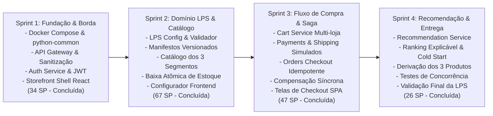

# VitrineFlex — Sprint Backlogs e Planejamento de Execução

**Documento:** 08_SPRINT_BACKLOGS.md  
**Versão:** 1.1.3 (Conclusão Integral do Projeto — Sprints 1, 2, 3 e 4)  
**Disciplina:** Tópicos em Engenharia de Software — Projetando Linhas de Produto de Software (UFAL 2026.2)  
**Total Auditado:** 174 Story Points distribuídos em 4 Sprints (Sprint 1: 34 SP, Sprint 2: 67 SP, Sprint 3: 47 SP, Sprint 4: 26 SP)  
**Status de Implementação:** 174 SP implementados (100% dos Story Points planejados nas 29 histórias de usuário)  
**Status dos Critérios de Conclusão (DoD):** 24 de 25 critérios validados (`[x]`) | 1 critério não executado (`[ ]` - execução de contêineres Docker Compose na Sprint 1, mantido desmarcado pela ausência do Docker CLI no host)

---

## 1. Visão Geral do Plano de Sprints

O desenvolvimento do **VitrineFlex** está estruturado em **quatro sprints incrementais**. O sequenciamento respeita rigorosamente as dependências técnicas e funcionais, garantindo que cada ciclo produza uma fatia vertical executável e demonstrável.

> [!NOTE]
> **Calibração de Capacidade e Contabilidade de Fechamento:**  
> - **Story Points Implementados:** 174 SP de 174 SP planejados ($34 + 67 + 47 + 26 = 174\text{ SP}$), cobrindo integralmente as 29 histórias de usuário do Product Backlog.  
> - **Critérios de Conclusão (DoD) Efetivamente Validados:** 24 de 25 critérios aprovados (`[x]`) por meio de testes automatizados e compilação do frontend (Sprint 1: 5/6, Sprint 2: 6/6, Sprint 3: 8/8, Sprint 4: 5/5).  
> - **Critérios de Conclusão (DoD) Não Executados:** 1 critério mantido desmarcado (`[ ]` - inicialização operacional de contêineres via `docker compose up --build` na Sprint 1, em razão da indisponibilidade do binário Docker CLI no ambiente de desenvolvimento do host).

---

## 2. Sprint 1: Fundação Arquitetural, Camada de Borda e Identidade de Acesso

### 2.1 Objetivo da Sprint
Estabelecer o esqueleto do monorepo, a conteinerização dos primeiros serviços com Docker Compose, a biblioteca técnica compartilhada `python-common` com configuração obrigatória de persistência SQLite WAL, o API Gateway como ponto único de borda higienizada, o microsserviço de autenticação e a casca (*shell*) inicial da aplicação frontend.

### 2.2 Histórias Selecionadas do Product Backlog
- **PB-01:** Setup do Monorepo, Docker Compose e Banco SQLite WAL (5 SP)
- **PB-02:** Implementação do API Gateway com Roteamento por Prefixos (5 SP)
- **PB-03:** Higienização de Cabeçalhos e Injeção de Contexto Confiável (5 SP)
- **PB-04:** Cadastro de Usuários e Autenticação com Senha Argon2id (5 SP)
- **PB-05:** Gestão de Perfis de Usuário e Categorias de Interesse (3 SP)
- **PB-22:** Storefront Shell, Design System Tailwind e Roteamento SPA (8 SP)
- **PB-27:** Painel de Saúde dos Serviços e Exibição de Portas Locais (3 SP)  
**Total da Sprint 1:** **34 Story Points**

### 2.3 Tarefas Técnicas Decompostas
1. Criar estrutura de pastas do monorepo (`apps/web`, `services/`, `packages/python-common`, `infra/`).
2. Implementar `packages/python-common` contendo:
   - `DatabaseEngineFactory` com listeners para `PRAGMA journal_mode=WAL` e `PRAGMA busy_timeout=5000` (ADR-005).
   - Schema uniforme de resposta de erro `APIErrorResponse`.
3. Desenvolver o `services/api-gateway` em FastAPI:
   - Roteador reverso assíncrono para os prefixos determinísticos `/api/v1/*` (ADR-002).
   - Middleware de sanitização: remoção de `X-User-ID`, `X-User-Role` e `X-Internal-Token` vindos do cliente (ADR-007).
   - Validador de JWT para injeção de identidade confiável.
   - Endpoint de saúde agregada `/api/v1/system/services` reportando estado de todos os 9 serviços catalogados.
4. Desenvolver o `services/auth-service` em FastAPI com banco `auth.db`:
   - Schemas de registro e login com hash de senha via `argon2-cffi`.
   - Geração e assinatura de JWT contendo `user_id`, `email` e `role`.
   - Endpoints `/api/v1/auth/me` e atualização de interesses em `/api/v1/auth/me/preferences`.
   - Endpoint interno protegido `/internal/v1/auth/users/{user_id}/preferences`.
5. Inicializar o frontend em `apps/web`:
   - Configuração de Vite, React 18, TypeScript, Tailwind CSS, TanStack Query e Lucide React (ADR-008).
   - **PB-22 (Fase Sprint 1):** Casca visual do Storefront com fixture mock local (`vitrine-fixture-dev.json`) para validação de layout dinâmico sem dependência do LPS Config Service.
   - Componentes de layout: `StoreHeader`, `StoreFooter` e painel de diagnóstico de saúde dos serviços.
   - **PB-27 (Fase Sprint 1):** Painel de diagnóstico renderiza os 9 microsserviços mapeados: Gateway (:8000) e Auth (:8001) como `UP`, e os outros 7 serviços como `NOT_STARTED` (portas 8002 a 8008).
6. Configurar `infra/docker-compose.yml` para orquestrar Gateway, Auth e Frontend com volumes isolados.

### 2.4 Critérios de Conclusão (*Definition of Done - DoD*)
- [ ] O comando `docker compose up --build` sobe Gateway (:8000), Auth (:8001) e Frontend (:5173). *(Nota de Governança: Especificação do `infra/docker-compose.yml` e Dockerfiles 100% implementada e sintaticamente válida; contudo, a inicialização em contêineres não pôde ser executada no ambiente do host por ausência do binário Docker CLI. A validação operacional e testes foram integralmente comprovados via ASGI/Uvicorn e Pytest local, preservando os 34 SP da história).*
- [x] Testes unitários do Auth Service validam login com sucesso e rejeição com credenciais erradas.
- [x] O endpoint `/api/v1/system/services` e o painel de diagnóstico frontend reportam Gateway e Auth com status `UP`, e os 7 serviços subsequentes com status `NOT_STARTED`.
- [x] O Storefront Shell consome a fixture local `vitrine-fixture-dev.json` sem falhas na ausência do LPS Config Service.
- [x] O frontend permite criar conta, fazer login e exibir os dados do perfil autenticado.
- [x] Cabeçalhos forjados são filtrados comprovadamente pelo Gateway.

### 2.5 Entregável Demonstrável
Ambiente local integrado onde é possível registrar e autenticar um usuário pelo frontend através do Gateway, verificar a gravação segura no banco SQLite WAL e visualizar o painel de saúde das portas dos serviços em execução.

---

## 3. Sprint 2: Engenharia de Domínio da LPS e Catálogo Multissetorial

### 3.1 Objetivo da Sprint
Implementar o motor central de Engenharia de Domínio da LPS no `LPS Configuration Service`, o configurador de derivação no frontend, o versionamento de manifestos, o mecanismo de cache local de features no backend e o `Catalog Service` com os três modelos de atributos específicos para Moda, Tecnologia e Livros, incluindo as operações atômicas de estoque e os módulos opcionais de Favoritos e Comparação de Produtos.

### 3.2 Histórias Selecionadas do Product Backlog
- **PB-06:** Catálogo Formal de Features e Motor de Validação de Regras (8 SP)
- **PB-07:** Persistência de Lojas e Emissão de ProductManifest Versionado (5 SP)
- **PB-08:** Gestão de Produtos Comuns e Isolamento por Store ID (5 SP)
- **PB-09:** Modelagem de Variantes para o Segmento Moda (Tamanho e Cor) (5 SP)
- **PB-10:** Especificações Técnicas e Garantia para Tecnologia (5 SP)
- **PB-11:** Metadados Bibliográficos para o Segmento Livros (5 SP)
- **PB-12:** Operações Atômicas de Decremento e Restauração de Estoque (8 SP)
- **PB-13:** Gestão de Produtos Favoritos com Bloqueio de Tenant (5 SP)
- **PB-14:** Comparador de Produtos Exclusivo para Tecnologia (5 SP)
- **PB-23:** Painel Administrativo Configurador de Lojas da LPS (8 SP)
- **PB-25:** Pontos de Extensão Variáveis dos Três Segmentos no Frontend (8 SP)  
**Total da Sprint 2:** **67 Story Points**

### 3.3 Tarefas Técnicas Decompostas
1. Desenvolver o `services/lps-config-service` com banco `lps.db`:
   - Motor de regras de validação estrita da LPS: verificação obrigatória de features essenciais (`REQUIRED_CORE_FEATURES`: auth, catalog, cart, orders, checkout, recommendations) e obrigatórias por segmento (`REQUIRED_FEATURES_BY_SEGMENT`), rejeitando booleanos `false`, tipos não booleanos ou features desconhecidas com `422 UNPROCESSABLE_ENTITY`.
   - Motor de regras de inferência validando restrições cruzadas `CTC-01` a `CTC-11`.
   - Persistência de instâncias de loja e `ProductManifest` versionado (ADR-006).
   - Endpoints públicos por slug e endpoints internos `/internal/v1/lps/stores/{id}/manifest`.
2. Implementar `FeatureManifestProvider` em `packages/python-common` com cache local em memória e **TTL de 30 segundos** (ADR-004).
3. Desenvolver o `services/catalog-service` com banco `catalog.db`:
   - Modelagem de produtos comuns e isolamento estrito por `store_id` (RNF-04).
   - Tabela `product_variants` para Moda (tamanho, cor, SKU).
   - Tabela `product_attributes` para especificações técnicas (Tech) e ficha bibliográfica (Livros).
   - Contratos internos: `GET /internal/v1/catalog/products/{product_id}` (consumido por Cart) e `GET /internal/v1/catalog/stores/{store_id}/products/active` (consumido por Recommendation).
   - Endpoints internos de baixa atômica (`/internal/v1/inventory/decrement`) e restauração idempotente (`/internal/v1/inventory/restore`) com tabela `inventory_movements` (ADR-003).
   - Módulo público de Favoritos (`/api/v1/catalog/favorites`) com guarda de feature ativa.
   - Endpoint público de Comparação de Produtos (`/api/v1/catalog/products/compare`) protegido com validação de segmento `TECH`.
4. Implementar no Frontend (`apps/web`):
   - Tela de criação/configuração de produtos derivados (`/admin/configurador`).
   - **Integração Real do Storefront:** Migração do Storefront Shell (PB-22) da fixture local para consumo real do manifesto em `GET /api/v1/lps/stores/{slug}/manifest`.
   - Pontos de extensão dinâmicos (PB-25): `FashionVariantSelector`, `TechnicalSpecificationsTable`, `BookMetadataPanel`, `ProductComparisonModal` e `FavoriteHeartButton`.

### 3.4 Critérios de Conclusão (*Definition of Done - DoD*)
- [x] O validador rejeita configurações sem features obrigatórias ou com booleanos `false` (ex: `cart: false`, Moda sem `size_grid`).
- [x] O configurador rejeita combinações ilegais (ex: Comparador em Moda, Reviews/Coupons) com erro 422.
- [x] É possível derivar lojas de Moda, Tecnologia e Livros com manifestos persistidos.
- [x] O frontend em `/loja/{slug}` carrega dinamicamente o manifesto real do LPS Config e exibe os atributos corretos do segmento.
- [x] Chamada direta de favoritar em loja com a feature desligada retorna `403 FEATURE_NOT_ENABLED`.
- [x] Teste concorrente de baixa de estoque comprova atualização condicional atômica sem race condition.

### 3.5 Entregável Demonstrável
Painel da LPS capaz de validar e criar lojas virtuais, com navegação pelas vitrines geradas exibindo componentes e atributos específicos de Moda, Tecnologia ou Livros, com bloqueio comprovado de features não habilitadas.

---

## 4. Sprint 3: Fluxo de Compra, Checkout Idempotente e Serviços Auxiliares

### 4.1 Objetivo da Sprint
Implementar o carrinho de compras multi-loja com endpoints internos para Orders, os microsserviços auxiliares de pagamento e frete simulados com validação de manifesto via `FeatureManifestProvider`, a orquestração completa do checkout no `Orders Service` através de uma Saga com compensação síncrona e tratamento de timeout em `PAYMENT_PENDING_CONFIRMATION`, além das interfaces de compra no frontend.

### 4.2 Histórias Selecionadas do Product Backlog
- **PB-15:** Gestão de Carrinho Isolado por Cliente e Loja (5 SP)
- **PB-16:** Processador de Pagamentos Simulados com Idempotência (5 SP)
- **PB-17:** Cotação Simulada de Frete por Faixa de CEP e Retirada (5 SP)
- **PB-18:** Orquestração do Checkout com Saga e Compensação Síncrona (13 SP)
- **PB-19:** Consulta de Histórico de Pedidos e Snapshots Imutáveis (3 SP)
- **PB-24:** Componentes Comuns de Catálogo, Vitrine e Carrinho Drawer (8 SP)
- **PB-26:** Frontend do Checkout, Seletores Dinâmicos e Telas de Pedidos (8 SP)  
**Total da Sprint 3:** **47 Story Points**

### 4.3 Tarefas Técnicas Decompostas
1. Desenvolver o `services/cart-service` com banco `cart.db`:
   - Gestão de itens de carrinho indexados obrigatoriamente por `(user_id, store_id)`.
   - Endpoints internos para Orders: `GET /internal/v1/cart/{store_id}/{user_id}` e `DELETE /internal/v1/cart/{store_id}/{user_id}` com `X-Internal-Token`.
2. Desenvolver o `services/payments-service` com banco `payments.db`:
   - Endpoint interno `/internal/v1/payments/simulate` aceitando apenas métodos habilitados no manifesto via `FeatureManifestProvider`.
   - Endpoint interno `/internal/v1/payments/attempts/{idempotency_key}` para conciliação de status.
   - Registro de `PaymentAttempt` associado a `idempotency_key` com resultado simulado.
3. Desenvolver o `services/shipping-service` com banco `shipping.db`:
   - Cálculo determinístico de frete por faixas de CEP e taxa fixa validando modalidades no manifesto.
   - Disponibilização de retirada quando habilitada no manifesto.
4. Desenvolver o `services/orders-service` com banco `orders.db`:
   - Implementação da Saga síncrona de checkout orquestrada (ADR-003):
     1. Persistência prévia obrigatória da entidade `CheckoutOperation` com status `STARTED`, `request_payload_hash` (SHA-256) e restrição `UNIQUE(store_id, user_id, idempotency_key)` antes de qualquer efeito colateral.
     2. Recuperação do carrinho via rota interna no Cart Service com `X-Internal-Token`.
     3. Chamada interna ao Catalog para baixa atômica de estoque com `X-Internal-Token`.
     4. Chamada interna ao Payments para simulação da cobrança (`Idempotency-Key` + `X-Internal-Token`).
     5. Em aprovação: transição para `PAID`, atualização de `CheckoutOperation` para `COMPLETED`, gravação de snapshot imutável e limpeza interna do carrinho.
     6. Em recusa: acionamento imediato de compensação idempotente de estoque no Catalog, transição para `PAYMENT_FAILED` e `CheckoutOperation` para `FAILED`.
     7. Em timeout/ambiguidade: retenção do estado `PAYMENT_PENDING_CONFIRMATION` e estoque retido, aguardando reconciliação via chave idempotente.
   - Consulta de histórico de compras com filtro estrito de tenant e cliente.
5. Desenvolver no Frontend (`apps/web`):
   - `CartDrawer.tsx` com atualização de quantidade em tempo real.
   - `CheckoutStepper.tsx` contendo seleção dinâmica de pagamento (PIX, Cartão, Boleto) e entrega/retirada.
   - Tela de confirmação e página "Meus Pedidos" com linha do tempo de status.

### 4.4 Critérios de Conclusão (*Definition of Done - DoD*)
- [x] O mesmo usuário possui carrinhos totalmente separados em lojas diferentes.
- [x] O fluxo de checkout executa ponta a ponta com sucesso usando pagamento simulado e grava `CheckoutOperation`.
- [x] Repetir o envio do checkout com a mesma `Idempotency-Key` e payload não duplica o pedido nem decrementa o estoque duas vezes.
- [x] Reenvio com a mesma chave e payload diferente é rejeitado com HTTP 409 `IDEMPOTENCY_CONFLICT`.
- [x] Duas requisições simultâneas com a mesma chave são contidas pela restrição de unicidade sem disparar duas reservas de estoque.
- [x] Simulação de pagamento recusado restaura o estoque atomicamente no Catálogo.
- [x] Timeout de pagamento mantém o pedido em `PAYMENT_PENDING_CONFIRMATION` com estoque retido; a compensação de estoque só é executada se a tentativa for confirmada como definitivamente falha (`PAYMENT_DECLINED`), prevenindo liberação prematura de estoque.
- [x] Pedido pago preserva snapshots históricos de produto e preço.

### 4.5 Entregável Demonstrável
Fluxo completo de compra funcional na interface: o usuário escolhe produtos específicos do segmento, adiciona ao carrinho, prossegue para o checkout, simula o pagamento pelos métodos configurados na loja e visualiza o pedido fechado em seu perfil.

---

## 5. Sprint 4: Recomendação Personalizada, Derivação dos Três Produtos e Validação Final

### 5.1 Objetivo da Sprint
Implementar o `Recommendation Service` com pontuação explicável e tratamento de cold start, canais públicos para VIEW e internos para PURCHASE, derivar formalmente os três produtos representativos (**Vitrine Moda**, **Vitrine Tech** e **Vitrine Books**), popular catálogos demonstrativos com dados sintéticos ricos, executar os testes integrados de variabilidade e concorrência, e validar a documentação completa para entrega acadêmica.

### 5.2 Histórias Selecionadas do Product Backlog
- **PB-20:** Registro de Interações Comportamentais do Usuário (5 SP)
- **PB-21:** Algoritmo Explicável de Recomendação com Fallback Cold Start (8 SP)
- **PB-28:** Suíte de Testes Automatizados de Variabilidade e Concorrência (8 SP)
- **PB-29:** Demonstração e Massa de Dados dos Três Produtos Derivados (5 SP)  
**Total da Sprint 4:** **26 Story Points**

### 5.3 Tarefas Técnicas Decompostas
1. Desenvolver o `services/recommendation-service` com banco `recommendations.db`:
   - Endpoint público `/api/v1/recommendations/interactions` para visualizações (`VIEW`) disparadas pelo navegador.
   - Endpoint interno `/internal/v1/recommendations/interactions` para compras (`PURCHASE`) disparadas por Orders com `X-Internal-Token`.
   - Consulta interna de interesses do perfil via `GET /internal/v1/auth/users/{user_id}/preferences`.
   - Implementação da fórmula de afinidade:
     $$\text{score} = 4I + \min(5P, 15) + \min(3F, 9) + \min(V, 5) + 2T$$
   - Tratamento de *cold start* retornando itens populares por categoria para clientes novos.
   - Endpoint público `/api/v1/recommendations` retornando produtos sugeridos e justificativa textual (`reason`).
2. Integrar carrossel de recomendações (`RecommendationCarousel.tsx`) na home e na página de detalhes da SPA.
3. Criar scripts de carga de demonstração (`scripts/seed_demo_stores.py`):
   - Derivar `vitrine-moda` (Vestuário, variantes de tamanho/cor, PIX/Card, Entrega/Retirada, Favoritos ativado).
   - Derivar `vitrine-tech` (Eletrônicos, specs técnicas, PIX/Card/Boleto, Entrega, Favoritos e Comparador ativados).
   - Derivar `vitrine-books` (Livros, ISBN/Autor, PIX/Boleto, Entrega/Retirada, Favoritos e Comparador desativados).
4. Implementar testes automatizados de ponta a ponta e regressão em `tests/`:
   - Teste de regressão de variabilidade (bloqueio 403 e 422 em chamadas de API inválidas).
   - Teste de concorrência com threads simulando checkouts simultâneos na última unidade com SQLite WAL.
5. Auditoria final de consistência com os materiais de orientação da UFAL 2026.2.

### 5.4 Critérios de Conclusão (*Definition of Done - DoD*)
- [x] O Recommendation Service altera as sugestões após uma compra ou visualização de produto.
- [x] Visitantes novos recebem produtos populares sem erros (cold start).
- [x] Os três produtos derivados funcionam simultaneamente com identidades, regras e catálogos distintos.
- [x] A suíte de testes automatizados passa com 100% de sucesso.
- [x] O painel de diagnóstico lista as 9 portas mapeadas (:8000 a :8008), com validação individual de endpoints de saúde via HTTP/ASGI.

### 5.5 Entregável Demonstrável
Plataforma completa funcional com código pronto para Docker Compose, três lojas virtuais operacionais derivadas pela LPS, configurador administrativo ativo, sistema de recomendação personalizado, painel de diagnóstico de portas e suíte de testes 100% aprovada.
