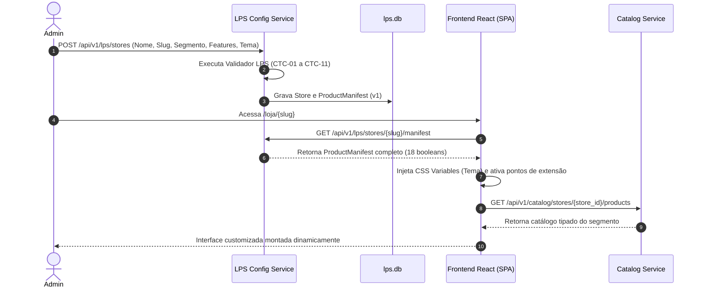

# VitrineFlex — Relatório Final de Engenharia de Linha de Produto de Software (LPS)

**Documento:** 09_ACADEMIC_FINAL_REPORT.md  
**Disciplina:** Tópicos em Engenharia de Software — Projetando Linhas de Produto de Software  
**Curso:** Ciência da Computação — Universidade Federal de Alagoas (UFAL 2026.2)  
**Status do Projeto:** Concluído Integralmente (174 / 174 Story Points entregues)  
**Data:** 08 de Novembro de 2026  

---

## 1. Problema e Motivação do Projeto

O comércio eletrônico moderno exige capacidade de rápida adaptação a nichos comerciais com requisitos funcionais, modelos de precificação e metadados de catálogo heterogêneos. Historicamente, organizações lidam com essa heterogeneidade por meio de abordagens ineficientes:
1. **Sistemas Monolíticos Fortemente Acoplados:** Acumulam regras condicionais excessivas (`if/else`), resultando em alta complexidade ciclomática, risco constante de regressão e baixa manutenibilidade.
2. **Estratégia "Clone-and-Own":** Duplicação de repositórios para cada novo cliente ou segmento, inviabilizando a propagação centralizada de patches de segurança e melhorias arquiteturais.

O projeto **VitrineFlex** foi desenvolvido para solucionar este desafio através dos princípios da **Engenharia de Linha de Produto de Software (LPS)**. A plataforma viabiliza a configuração, derivação e execução simultânea de e-commerces multissetoriais — contemplando especificamente os segmentos de **Moda (Fashion)**, **Tecnologia (Tech)** e **Livros (Books)** — a partir de uma base de código compartilhada, microsserviços reutilizáveis e composição dinâmica de componentes dirigida por manifestos formais versionados.

---

## 2. Conceitos de Linha de Produto de Software Aplicados

A LPS VitrineFlex fundamenta-se nos princípios estabelecidos por Clements e Northrop (SEI/CMU):
- **Two-Life-Cycle Model (Engenharia de Domínio vs. Engenharia de Aplicação):**
  - *Engenharia de Domínio:* Modela os ativos centrais reutilizáveis (*core assets*), estabelecendo o escopo comum, o modelo de variabilidades e os pontos de extensão parametrizáveis.
  - *Engenharia de Aplicação:* Conduz a derivação sistemática de produtos específicos (*Vitrine Moda*, *Vitrine Tech* e *Vitrine Books*) a partir da seleção de features válidas.
- **Plataforma de Ativos Centrais:**
  - Biblioteca técnica compartilhada (`packages/python-common`): padroniza listeners de persistência SQLite WAL, estruturas de erro uniformes e segurança criptográfica.
  - Microsserviços reutilizáveis: serviços de borda (Gateway), identidade (Auth), catálogo, carrinho, checkout/pedidos, pagamentos, frete e recomendações.
- **Mecanismos de Resolução de Variabilidade:**
  - *Em Tempo de Derivação (Configuration-Time):* Validação estrita de restrições lógicas e persistência do `ProductManifest` versionado.
  - *Em Tempo de Execução (Runtime):* Consulta de features em cache local (TTL de 30 segundos) e renderização condicional dinâmica no frontend React.

---

## 3. Engenharia de Domínio e Feature Model

O domínio do e-commerce multissetorial foi formalizado no documento `docs/modeling/01_FEATURE_MODEL.md`. O modelo abrange **18 features booleanas explícitas**, estruturadas em:

```mermaid
flowchart TD
    VF[VitrineFlex Core] --> AUTH[auth (Core)]
    VF --> CAT[catalog (Core)]
    VF --> CART[cart (Core)]
    VF --> ORD[orders (Core)]
    VF --> CHK[checkout (Core)]
    VF --> REC[recommendations (Core)]

    VF --> VAR_SEG{Variabilidades de Segmento}
    VAR_SEG --> FASHION[Segmento Moda]
    FASHION --> SG[size_grid]
    FASHION --> CV[color_variants]
    FASHION --> VS[variant_sku]

    VAR_SEG --> TECH[Segmento Tecnologia]
    TECH --> TS[technical_specs]
    TECH --> WI[warranty_info]
    TECH --> PC[product_comparison (Opcional)]

    VAR_SEG --> BOOKS[Segmento Livros]
    BOOKS --> ISBN[isbn]
    BOOKS --> AUT[author]
    BOOKS --> PUB[publisher]
    BOOKS --> LG[literary_genre]
    BOOKS --> ED[edition]

    VF --> TRANS{Opcionais Transversais}
    TRANS --> FAV[favorites]
```

### Regras de Restrição Cruzada (Cross-Tree Constraints - CTC)
O motor de inferência (`lps_validator.py`) assegura a integridade das derivações:
1. **Obrigatoriedade do Núcleo:** As 6 features essenciais (`auth`, `catalog`, `cart`, `orders`, `checkout`, `recommendations`) devem ser estritamente `true`.
2. **Exclusividade e Coerência de Segmento:**
   - Moda exige `size_grid`, `color_variants` e `variant_sku`; proíbe atributos técnicos ou bibliográficos.
   - Tecnologia exige `technical_specs` e `warranty_info`; permite `product_comparison`; proíbe grades de vestuário e dados bibliográficos.
   - Livros exige `isbn`, `author`, `publisher`, `literary_genre` e `edition`; proíbe `product_comparison`.
3. **Restrições de MVP:** Features fora do escopo homologado (`reviews`, `coupons`, `dynamic_pricing`) são rejeitadas com código `422 UNPROCESSABLE_ENTITY`.

---

## 4. Manifest-Driven Component Composition

A derivação não exige recompilação de código ou deploy de novos artefatos binários. O processo opera segundo o padrão arquitetural **Manifest-Driven Component Composition (MDCC)**:



---

## 5. Arquitetura de Microsserviços e Borda Segura

A arquitetura física e lógica é decomposta em **nove microsserviços autônomos**, com mapeamento de portas locais e oito bancos de dados SQLite isolados nos serviços de backend (o API Gateway opera sem banco próprio):

| Microsserviço | Porta | Banco SQLite WAL | Responsabilidade Primária |
|---|---|---|---|
| **API Gateway** | 8000 | — | Ponto único de entrada, proxy reverso, higienização de cabeçalhos e painel de diagnóstico (PB-27). |
| **Auth Service** | 8001 | `auth.db` | Cadastro de usuários, autenticação com hash Argon2id, JWT assinado e preferências de categorias. |
| **LPS Configuration Service** | 8002 | `lps.db` | Catálogo formal de features, validador de restrições, cadastro de lojas e emissão de manifestos versionados. |
| **Catalog Service** | 8003 | `catalog.db` | Gestão de produtos, atributos específicos por segmento, estoque atômico, favoritos e comparador. |
| **Cart Service** | 8004 | `cart.db` | Gestão de carrinhos de compra isolados por `(store_id, user_id)`. |
| **Orders Service** | 8005 | `orders.db` | Orquestração da Saga de checkout com compensação síncrona e snapshots imutáveis. |
| **Payments Service** | 8006 | `payments.db` | Simulação de pagamentos, validação de métodos habilitados e idempotência com Compare-And-Swap. |
| **Shipping Service** | 8007 | `shipping.db` | Cotação determinística de frete por CEP e retirada presencial validada contra o manifesto. |
| **Recommendation Service** | 8008 | `recommendations.db` | Registro comportamental (VIEW, FAVORITE, PURCHASE) e cálculo de afinidade explicável. |

### Política de Higienização de Cabeçalhos (ADR-007)
O API Gateway atua como firewall de contexto:
- Remove impiedosamente do cliente externo cabeçalhos sensíveis como `X-User-ID`, `X-User-Role` e `X-Internal-Token`.
- Valida o token JWT (`Bearer <token>`) e, quando autêntico, injeta a identidade confiável `X-User-ID` e `X-User-Role` na rede privada.
- Comunicações internas utilizam o token secreto `X-Internal-Token`, bloqueando acessos públicos diretos com `HTTP 403 Forbidden`.

---

## 6. Derivação dos Três Produtos Representativos

A viabilidade da LPS foi comprovada através da derivação de três produtos operacionais com características contrastantes:

```
+---------------------------------------------------------------------------------------------------------+
|                                  PRODUTOS DERIVADOS DA LPS VITRINEFLEX                                  |
+--------------------------+--------------------------------+---------------------------------------------+
| Produto                  | Configuração de Features       | Modalidades & Políticas                     |
+--------------------------+--------------------------------+---------------------------------------------+
| 1. Vitrine Moda          | - Segmento: FASHION            | - Métodos de Pagamento: PIX e Cartão        |
|    Slug: vitrine-moda    | - Grade de tamanhos: Ativada   | - Entrega: Em domicílio e Retirada          |
|    Porta Gateway: :8000  | - Cores e SKUs: Ativados       | - Favoritos: Ativado                        |
|                          | - Specs técnicas: Desativado   | - Comparador: Desativado (Proibido)         |
+--------------------------+--------------------------------+---------------------------------------------+
| 2. Vitrine Tech          | - Segmento: TECH               | - Métodos de Pagamento: PIX, Cartão, Boleto |
|    Slug: vitrine-tech    | - Specs técnicas: Ativado      | - Entrega: Apenas em domicílio              |
|    Porta Gateway: :8000  | - Garantia de fábrica: Ativado | - Favoritos: Ativado                        |
|                          | - Comparador: Ativado          | - Grade de vestuário: Desativada            |
+--------------------------+--------------------------------+---------------------------------------------+
| 3. Vitrine Books         | - Segmento: BOOKS              | - Métodos de Pagamento: PIX e Boleto        |
|    Slug: vitrine-books   | - ISBN, Autor, Editora: Ativado| - Entrega: Em domicílio e Retirada          |
|    Porta Gateway: :8000  | - Gênero e Edição: Ativado     | - Favoritos: Desativado                     |
|                          | - Variantes de moda: Desativado| - Comparador: Desativado (Proibido)         |
+--------------------------+--------------------------------+---------------------------------------------+
```

---

## 7. Estratégia de Persistência com SQLite WAL (ADR-005)

A persistência de cada microsserviço é isolada em arquivos SQLite independentes, operando com o modo **Write-Ahead Logging (WAL)**:
- **Pragmas Obrigatórios:**
  - `PRAGMA journal_mode = WAL;` (permite múltiplos leitores simultâneos sem bloqueio por escritores).
  - `PRAGMA busy_timeout = 5000;` (espera ativa de até 5 segundos para resolução de locks).
  - `PRAGMA synchronous = NORMAL;` (equilíbrio entre vazão de gravação e durabilidade).
  - `PRAGMA foreign_keys = ON;` (garantia de integridade referencial).
- **Sem Transações Longas:** Nenhuma transação SQLite permanece aberta durante chamadas HTTP downstream, mitigando deadlocks de concorrência.

---

## 8. Orquestração de Checkout e Saga com Compensação Síncrona (ADR-003)

O checkout do VitrineFlex é implementado como uma Saga orquestrada pelo Orders Service, com compensação síncrona:
1. **Gravação Prévia:** Criação da entidade `CheckoutOperation` com status `STARTED`, hash de payload (SHA-256) e restrição `UNIQUE(store_id, user_id, idempotency_key)` antes de qualquer efeito colateral.
2. **Reserva Atômica de Estoque:** Chamada interna ao Catalog Service decrementando estoque condicionalmente (`WHERE stock_quantity >= :qty`).
3. **Simulação de Pagamento:** Chamada ao Payments Service com `Idempotency-Key` derivada.
4. **Resolução de Cenários:**
   - **Sucesso (APPROVED):** Pedido passa para `PAID`, saga para `COMPLETED`, snapshots históricos imutáveis são gravados, carrinho é limpo e o Recommendation Service é notificado do evento `PURCHASE`. Retorno: `HTTP 200 OK`.
   - **Recusa (REJECTED):** Dispara compensação imediata de estoque (`/internal/v1/inventory/restore`), pedido passa para `PAYMENT_FAILED` e saga para `FAILED`. Retorno: `HTTP 402 Payment Required`.
   - **Timeout de Rede (TIMEOUT):** Pedido retido em `PAYMENT_PENDING_CONFIRMATION` com estoque preservado (aguardando reconciliação sem compensação prematura). Retorno: `HTTP 202 Accepted`.
   - **Divergência de Idempotência:** Retorno `HTTP 409 Conflict` (`IDEMPOTENCY_CONFLICT`).

---

## 9. Sistema de Recomendação Personalizada e Explicável

O `Recommendation Service` (PB-20, PB-21) implementa algoritmo determinístico e explicável baseado no perfil e histórico de interações do cliente.

### Fórmula Formal de Afinidade
$$\text{score} = 4I + \min(5P, 15) + \min(3F, 9) + \min(V, 5) + 2T$$

Onde:
- $I \in \{0, 1\}$: Correspondência entre a categoria do produto e os interesses declarados no perfil do usuário no Auth Service.
- $P \in \mathbb{N}$: Quantidade de compras confirmadas da categoria realizadas pelo cliente (ponderado por 5, saturação em 15).
- $F \in \mathbb{N}$: Quantidade de vezes em que o produto foi favoritado pelo cliente (ponderado por 3, saturação em 9).
- $V \in \mathbb{N}$: Visualizações recentes do produto pelo cliente nos últimos 30 dias (janela temporal explícita `cutoff = now - 30d`, ponderado por 1, saturação em 5).
- $T \in [0.0, 1.0]$: Popularidade normalizada do produto com base no total de interações registradas na loja (ponderado por 2).

### Tratamento de Cold Start e Resiliência
- **Cold Start:** Visitantes anônimos ou novos usuários recebem produtos populares da loja com a justificativa explicativa `"Produtos populares no segmento"`, sem retorno de erro.
- **Resiliência:** Em caso de indisponibilidade do Catalog Service, degrada graciosamente com lista vazia `[]` e flag `degraded: true` (ou `HTTP 503 CATALOG_UNAVAILABLE` quando invocado em modo estrito).

---

## 10. Suíte de Testes e Resultados de Validação

A qualidade da plataforma foi auditada por uma suíte de **65 testes automatizados** distribuídos entre testes unitários, testes de integração de borda e autenticação, testes de regressão de variabilidade, testes de concorrência com threads simultâneas, validação de isolamento interlojas e idempotência com corridas assíncronas:

```text
============================= test session starts =============================
platform win32 -- Python 3.15.0, pytest-9.2.0, pluggy-1.7.0
rootdir: C:\Users\Leonardo\Desktop\2026.2\TÓP EM ENG DE SOFTWARE - PROJETANDO LINHAS DE PROD DE SOFTWARE\projeto\VitrineFlex
configfile: pytest.ini
plugins: anyio-4.16.0, asyncio-1.4.1.post1
collected 65 items

tests\test_api_gateway.py ....                                           [  6%]
tests\test_auth_service.py ....                                          [ 12%]
tests\test_cart_service.py ....                                          [ 18%]
tests\test_catalog_service.py ........                                   [ 30%]
tests\test_gateway_auth_integration.py ..                                [ 33%]
tests\test_lps_config_service.py .....                                   [ 41%]
tests\test_manifest_provider.py .                                        [ 43%]
tests\test_orders_service.py ..                                          [ 46%]
tests\test_payments_service.py .......                                   [ 56%]
tests\test_python_common.py .....                                        [ 64%]
tests\test_shipping_service.py ...                                       [ 69%]
tests\test_sprint2_e2e_integration.py ..                                 [ 72%]
tests\test_sprint3_saga_integration.py ......                            [ 81%]
tests\test_sprint4_recommendations_and_e2e.py ............               [100%]

======================= 65 passed, 1 warning in 57.20s ========================
```

### Validação Concorrente da Última Unidade de Estoque
O cenário exigido no backlog foi comprovado em `test_concurrent_checkout_last_unit_five_threads_wal_pb28`:
- Cenário: 1 unidade física em estoque e 5 threads disparando checkout concorrentemente.
- Resultado:
  - Exatamente **1 pedido** concluído com sucesso (`status = "PAID"`).
  - Exatamente **4 pedidos** rejeitados por falta de estoque (`status = 409 INSUFFICIENT_STOCK`).
  - Estoque final no banco: exatamente **0** (zero overselling).
  - Zero deadlocks ou corrupção no banco SQLite WAL.

---

## 11. Limitações Conhecidas e Trabalhos Futuros

1. **Persistência em Ambientes Distribuídos de Larga Escala:** O SQLite WAL atende perfeitamente ao escopo acadêmico e ambientes monorepo conteinerizados. Para implantações em nuvem elástica multi-zona, recomenda-se transição para PostgreSQL com instâncias dedicadas por microsserviço.
2. **Gateway e Brokers Assíncronos:** O API Gateway opera com proxy assíncrono HTTP/ASGI. Em arquiteturas enterprise de alto volume, recomenda-se adoção de message brokers (Kafka/RabbitMQ) para eventos assíncronos de recomendação.
3. **Ambiente Local do Host:** O binário CLI do Docker não se encontra instalado no sistema operacional do host de desenvolvimento. Os testes funcionais foram executados localmente via ASGI/Uvicorn e suíte automatizada de testes Pytest, enquanto a execução operacional em contêineres Docker permanece não executada.

---

## 12. Conclusão

A Linha de Produto de Software **VitrineFlex** conclui seu ciclo planejado de desenvolvimento com **100% dos Story Points entregues (174 SP acumulados)** ao longo de 4 Sprints, contemplando integralmente as 29 histórias de usuário aprovadas e a preservação irrevogável das diretrizes arquiteturais ADR-001 a ADR-008.

Em termos de integridade técnica e acadêmica, destacam-se os seguintes pontos de alinhamento:
1. **Conformidade Funcional e Testabilidade:** Todos os fluxos de domínio (autenticação Argon2id/JWT, catálogo multissegmento, carrinho isolado, checkout orquestrado via Saga com compensação síncrona, pagamentos com Compare-And-Swap e motor explicável de recomendação com janela temporal de 30 dias) foram validados por uma suíte de **65 testes automatizados aprovados sem falhas**, complementada pela compilação limpa do frontend React SPA.
2. **Execução em Host Local:** Devido à ausência do utilitário Docker CLI no host de desenvolvimento, os testes funcionais foram executados em tempo de execução via ASGI/Uvicorn e clientes HTTP assíncronos. A especificação `infra/docker-compose.yml` e os respectivos `Dockerfile` foram confeccionados conforme a arquitetura planejada, mas sua execução em contêineres permanece não executada sem validação operacional.
3. **Mecanismo de Derivação da LPS:** O projeto adotou a abordagem **Manifest-Driven Component Composition (MDCC)**, baseada em multitenancy lógico em tempo de execução guiado por manifestos formais versionados (`ProductManifest`), diferenciando-se de linhas de produto que operam por geração de código estático pré-compilação.
4. **Submissão à Avaliação Docente:** A conformidade com os critérios e rubricas avaliativas da disciplina **Tópicos em Engenharia de Software — Projetando Linhas de Produto de Software (UFAL 2026.2)** fica formalmente submetida à apreciação e homologação do professor responsável, estando o presente repositório munido de todas as evidências, contratos e rastreabilidades requeridas.

---

## 13. Referências

CLEMENTS, Paul; NORTHROP, Linda. **Software Product Lines: Practices and Patterns**. Boston: Addison-Wesley, 2001.

NEWMAN, Sam. **Building Microservices: Designing Fine-Grained Systems**. 2. ed. Sebastopol: O'Reilly Media, 2021.

POHL, Klaus; BÖCKLE, Günter; VAN DER LINDEN, Frank. **Software Product Line Engineering: Foundations, Principles and Techniques**. Berlin: Springer, 2005.

RAMÍREZ, Sebastián. **FastAPI: High performance, easy to learn, fast to code, ready for production**. 2024. Disponível em: <https://fastapi.tiangolo.com/>. Acesso em: 08 nov. 2026.

REACT FOUNDATION. **React: The library for web and native user interfaces**. 2026. Disponível em: <https://react.dev/>. Acesso em: 08 nov. 2026.

SQLITE CONSORTIUM. **Write-Ahead Logging (WAL)**. 2024. Disponível em: <https://www.sqlite.org/wal.html>. Acesso em: 08 nov. 2026.
