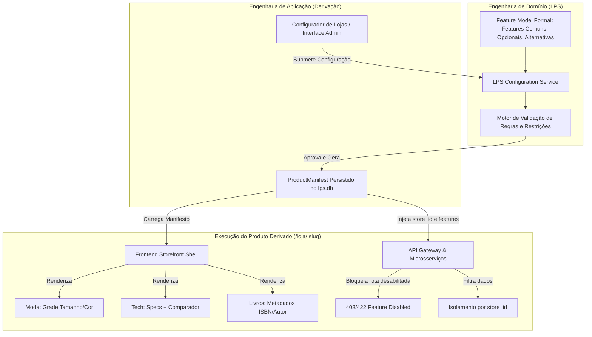

# VitrineFlex — Revisão Crítica da Baseline Arquitetural (v1.0)

**Documento:** Análise Crítica, Avaliação de LPS e Levantamento de Inconsistências  
**Data:** 08 de novembro de 2026  
**Status:** Baseline analisada — aguardando aprovações para implementação  
**Referência Principal:** `docs/VitrineFlex_Documento_Tecnico_v1.0.md`

---

## 1. Resumo da Arquitetura Compreendida

O projeto **VitrineFlex** propõe uma **Linha de Produto de Software (LPS)** voltada para e-commerce multissetorial, com o objetivo de derivar lojas para três segmentos de mercado iniciais:
1. **Moda (Vestuário e Acessórios):** caracterizada por grade de variações (tamanho, cor, SKU específico) e atributos físicos de vestuário.
2. **Tecnologia (Eletrônicos e Informática):** caracterizada por especificações técnicas tabulares, informações de garantia e recurso opcional de comparação de produtos.
3. **Livros (Livraria e Publicações):** caracterizada por metadados bibliográficos obrigatórios (ISBN, autor, editora, gênero literário, edição).

### 1.1 Modelo Arquitetural
A solução é concebida como um **Monorepo** composto por:
- **Frontend SPA:** Desenvolvido em **React + TypeScript + Vite**, organizado em um *Storefront Shell* com componentes comuns de catálogo e comércio, pontos de extensão variáveis para atributos de segmento e slots para features opcionais.
- **Camada de Entrada (Edge/Acesso):** Um **API Gateway** em FastAPI (porta `8000`), responsável por roteamento reverso, validação inicial de formato JWT, injeção de rastreabilidade (`X-Request-ID`), CORS e agregação de *health checks*.
- **Microsserviços de Domínio (8 serviços independentes):**
  - `Auth Service` (`:8001`): Gestão de usuários, papéis (`CUSTOMER`, `STORE_ADMIN`, `LPS_ADMIN`), preferências de categoria e autenticação via JWT/Argon2id.
  - `LPS Configuration Service` (`:8002`): Engenharia de domínio da LPS. Validação formal do modelo de features, regras de dependência/exclusão e geração do `ProductManifest`.
  - `Catalog Service` (`:8003`): Núcleo de produtos, categorias, variações, inventário e esquemas variáveis de atributos por segmento.
  - `Cart Service` (`:8004`): Gestão de estado do carrinho de compras indexado por cliente e loja.
  - `Orders Service` (`:8005`): Orquestrador do checkout, persistência do histórico e snapshot de itens.
  - `Payments Service` (`:8006`): Processador simulado de pagamentos (PIX, Cartão, Boleto).
  - `Shipping Service` (`:8007`): Motor de cotação simulada de frete e gestão de retirada física.
  - `Recommendation Service` (`:8008`): Algoritmo determinístico/explicável de recomendação baseado em interações (visualizações, favoritos, compras) e preferências de perfil.
- **Persistência Poliglota/Desacoplada:** Cada microsserviço gerencia seu próprio banco SQLite independente (`*.db`), isolado física e logicamente, sem junções (*joins*) ou chaves estrangeiras trans-serviço.

---

## 2. Pontos Consistentes da Baseline

A documentação técnica apresenta maturidade e excelente direcionamento acadêmico nos seguintes tópicos:
1. **Atendimento Rígido aos Requisitos da Disciplina:** A decomposição em 9 microsserviços (com portas explícitas e painel de status), a inclusão mandatória do serviço de recomendação e o uso de componentes reutilizáveis alinham-se estritamente às normas do curso de Ciência da Computação (UFAL).
2. **Desacoplamento de Dados:** Cada microsserviço possui banco e modelos isolados, referenciando entidades externas apenas por identificadores opacos (UUIDs), respeitando o padrão *Database-per-Service*.
3. **Separação Explícita de Responsabilidades de Domínio:** O Gateway não implementa regras de negócio; a persistência de catálogo e pedidos é dissociada; o cálculo de frete e o processamento de pagamento são serviços autônomos.
4. **Modelo de Recomendação Realista e Explicável:** A fórmula de pontuação proposta (`score = 4I + min(5P, 15) + min(3F, 9) + min(V, 5) + 2T`) é perfeitamente viável, testável deterministicamente e evita complexidades desnecessárias de modelos generativos ou redes neurais opacas no escopo de um MVP.
5. **Rastreabilidade e Segurança Básica:** Adoção de Argon2id para hashing de senhas, JWT assinado, segregação de segredos via variáveis de ambiente e correlação de requisições via `X-Request-ID`.

---

## 3. Problemas Encontrados (Classificados por Gravidade)

A análise aprofundada da baseline identificou inconsistências e lacunas técnicas que exigem correção e padronização antes da implementação.

### 3.1 Gravidade Alta (Crítica — Impedem a Implementação Consistente)

#### [BUG-ARCH-01] Omissão de Microsserviços e Entidades Proprietárias para Features Opcionais
- **Descrição:** O documento lista como features opcionais: `reviews` (avaliações), `coupons` (cupons de desconto), `favorites` (favoritos) e `product_comparison` (comparação de produtos). No entanto, na Seção 10.1 (Entidades lógicas por serviço):
  - **Reviews:** Não há entidade `Review` em nenhum serviço (nem em `Catalog`, nem em `Orders`).
  - **Coupons:** Não há entidade `Coupon` nem em `Orders`, nem em `Cart`.
  - **Favorites:** Está ambíguo entre `Auth` (que armazena categorias de interesse genéricas) e `Recommendation` (que armazena `UserInteraction` com tipo `FAVORITE`). Nenhum serviço possui a entidade ou o endpoint para expor a lista "Meus Produtos Favoritos" para renderização no frontend.
- **Impacto:** Se o configurador permitir ligar `reviews: true` ou `coupons: true`, o frontend chamará endpoints inexistentes no backend, quebrando a integridade funcional da LPS.
- **Justificativa da Correção:** As entidades devem ser explicitamente alocadas aos serviços correspondentes (`Catalog` para Reviews; `Orders` para Coupons; `Catalog` ou `Auth` para Favorites) ou tais features devem ser formally postergadas/delimitadas.

#### [BUG-ARCH-02] Ambiguidade de Roteamento no API Gateway e Conflito `slug` vs. `store_id`
- **Descrição:** O contrato de API proposto (Seção 9) define rotas públicas como:
  - `GET /stores/{slug}/configuration` -> LPS Configuration Service (`:8002`)
  - `GET /stores/{slug}/products` -> Catalog Service (`:8003`)
  - `POST /admin/stores/{store_id}/products` -> Catalog Service (`:8003`)
- **Problema:** 
  1. O API Gateway precisaria inspecionar sub-recursos profundos sob `/stores/*` para saber se despacha para o serviço de LPS ou para o de Catálogo, gerando regras frágeis de roteamento.
  2. O `Catalog Service` é obrigado a resolver `slug` para `store_id`. Se o Catálogo não mantém o `slug` (pois a posse é do `LPS Configuration Service`), o Catálogo teria que fazer uma chamada síncrona HTTP para a LPS a cada visualização de vitrine ou manter dados duplicados.
- **Impacto:** Acoplamento em tempo de execução, latência dobrada nas consultas mais frequentes (catálogo) e risco de inconsistência.
- **Justificativa da Correção:** O Gateway deve padronizar prefixos por serviço (ex: `/api/v1/lps/...`, `/api/v1/catalog/...`) ou resolver o `slug` -> `store_id` no próprio Gateway (ou frontend) e injetar o cabeçalho padronizado `X-Store-ID`.

#### [BUG-ARCH-03] Ausência de Protocolo de Reserva e Atomicidade de Estoque no Checkout
- **Descrição:** Na Seção 8.2 (Fluxo de Checkout), o `Orders Service` revalida produtos e estoque no `Catalog Service` no passo 3, e solicita pagamento no passo 5. Não há fase de *reserva de estoque* (*hold/reservation*) nem especificação do momento exato do decremento do inventário.
- **Problema:** 
  1. Se dois clientes finalizarem simultaneamente o checkout para a última unidade disponível de um produto, ambos passarão pela validação e terão cobrança simulada aprovada (*overbooking*).
  2. Se o pagamento for recusado, ou a transação falhar a meio caminho, não há fluxo de reversão de estoque definido.
- **Impacto:** Inconsistência imediata de estoque, um dos pilares de avaliação de e-commerce.
- **Justificativa da Correção:** O `Catalog Service` deve expor operações de `POST /inventory/reserve` (com TTL/expiração) e `POST /inventory/commit` / `POST /inventory/release`, ou o `Orders Service` deve decrementar o estoque atomicamente logo após a confirmação do pagamento com tratamento explícito de concorrência.

#### [BUG-ARCH-04] Ausência de Mecanismo de Enforcement de Features no Backend
- **Descrição:** A Seção 6.4 estipula acertadamente: *"esconder um botão na interface não será considerado controle suficiente"*. Porém, não é especificado como os microsserviços de domínio (`Catalog`, `Cart`, `Orders`, etc.) validam se a funcionalidade solicitada está habilitada para aquela loja.
- **Problema:** Se o `Catalog Service` recebe uma requisição para comparar produtos em uma loja de Moda, ele precisa saber se `product_comparison` está ativo no manifesto daquela loja. Fazer com que cada microsserviço consulte o `LPS Configuration Service` via HTTP a cada requisição individual gerará gargalo severo e ponto único de falha (*chattiness* excessiva).
- **Impacto:** Risco de não validação real no backend (violando a regra fundamental de LPS) ou degradação drástica de performance.
- **Justificativa da Correção:** Definir um mecanismo de cache local do `ProductManifest` nos microsserviços com invalidação por evento/TTL, ou fazer o Gateway validar e repassar as features autorizadas via claims no contexto de requisição.

---

### 3.2 Gravidade Média (Importante — Riscos Operacionais e de Domínio)

#### [WARN-ARCH-05] Riscos de Concorrência e Bloqueio do SQLite sob Cargas Simultâneas em FastAPI
- **Descrição:** O SQLite opera por bloqueio de arquivo completo para operações de escrita (`exclusive write lock`). O FastAPI opera em loop assíncrono com múltiplas requisições simultâneas.
- **Problema:** Sob execução de checkout ou registro concorrente de interações de recomendação, o erro `sqlite3.OperationalError: database is locked` ocorrerá se a conexão não for devidamente configurada.
- **Impacto:** Falhas intermitentes nos testes automatizados e na demonstração da aplicação.
- **Justificativa da Correção:** Padronizar a inicialização do SQLite em modo **WAL (Write-Ahead Logging)**, ajustar `busy_timeout = 5000ms` e utilizar conexões síncronas dedicadas com pool limitado no SQLAlchemy (`NullPool` ou `StaticPool` para SQLite).

#### [WARN-ARCH-06] Contexto de Loja não Explicitado no Gerenciamento de Carrinho
- **Descrição:** Os contratos do `Cart Service` (`GET /cart`, `POST /cart/items`) utilizam apenas o identificador do cliente autenticado via token.
- **Problema:** Um cliente autenticado pode acessar a loja *Vitrine Moda* e a loja *Vitrine Tech* no mesmo navegador. Se o carrinho for indexado puramente por `user_id`, os itens de moda e tecnologia serão misturados no mesmo carrinho, violando o isolamento de catálogo e checkout por loja.
- **Impacto:** Falha grave de isolamento funcional e comercial entre lojas derivadas.
- **Justificativa da Correção:** Todas as operações de carrinho devem obrigatoriamente exigir o identificador da loja (via rota `/stores/{store_id}/cart` ou cabeçalho obrigatório `X-Store-ID`).

#### [WARN-ARCH-07] Ausência de Política de Imutabilidade e Versionamento de Manifestos de Loja
- **Descrição:** A Seção 7.4 (LPS Configuration) cita que o serviço "impede alteração de features incompatíveis com dados já utilizados", mas não define como o sistema se comporta caso um administrador tente alterar atributos ou desligar recursos após haver pedidos registrados.
- **Problema:** Se uma loja foi derivada com suporte a variantes (tamanho/cor) e pedidos já foram fechados, a alteração de configuração pode corromper telas de histórico e inventário.
- **Impacto:** Inconsistência de integridade referencial histórica.
- **Justificativa da Correção:** O manifesto de uma loja deve ser imutável após a primeira transação comercial, ou suportar versionamento semântico (`manifest_version: 1, 2, ...`), exigindo derivação de uma nova loja para mudanças estruturais incompatíveis.

---

### 3.3 Gravidade Baixa (Melhorias de Refinamento e Contrato)

#### [INF-ARCH-08] Ausência de Paginação e Critérios de Ordenação Padronizados
- **Descrição:** Os endpoints de listagem (`GET /products`, `GET /orders`, `GET /recommendations`) não definem parâmetros obrigatórios de paginação (`page`, `page_size`) nem ordenação (`sort_by`, `order`).
- **Impacto:** Risco de retorno de payloads desordenados ou excessivos quando o seed de dados for ampliado.
- **Recomendação:** Padronizar metadados de paginação no envelope JSON de resposta: `{ "items": [...], "total": 120, "page": 1, "page_size": 20 }`.

#### [INF-ARCH-09] Indefinição do Formato Padronizado de Erros HTTP
- **Descrição:** O documento menciona que haverá padronização (`code`, `message`, `details`, `request_id`), mas não apresenta o schema OpenAPI/Pydantic que todos os serviços devem retornar em situações 4xx e 5xx.
- **Impacto:** Tratamento heterogêneo de exceções no frontend React.
- **Recomendação:** Criar o schema `APIErrorResponse` no pacote compartilhado `python-common`.

---

## 4. Riscos Técnicos e Mitigações

| ID | Risco Identificado | Probabilidade | Impacto | Estratégia de Mitigação Proposta |
|---|---|:---:|:---:|---|
| **R-01** | Complexidade operacional excessiva com 9 microsserviços locais | Alta | Médio | Criar scripts no Makefile (`make up`, `make seed`, `make test`) e orquestração Docker Compose com *health checks* encadeados. |
| **R-02** | Bloqueios de concorrência com múltiplos bancos SQLite | Média | Alto | Configurar modo WAL (`PRAGMA journal_mode=WAL;`), timeout adequado e isolamento de arquivos em volumes Docker persistentes. |
| **R-03** | Quebra de contratos REST entre microsserviços durante o desenvolvimento | Alta | Alto | Utilizar modelos Pydantic centralizados ou testes de contrato com `pytest` + `httpx`. |
| **R-04** | Falha de isolamento (*data leakage*) entre lojas derivadas | Média | Crítico | Implementar middleware obrigatório em todos os serviços de domínio para validar a presença e consistência do `store_id`. |
| **R-05** | Demonstração acadêmica sem evidência visual clara de LPS | Baixa | Alto | Desenvolver um rodapé/painel de diagnóstico na interface que exibe dinamicamente o manifesto ativo, features ligadas/desligadas e serviços consultados. |

---

## 5. Avaliação da Estratégia de Linha de Produto de Software (LPS)

### 5.1 Coerência Teórica com o Conceito de LPS
A abordagem adotada pelo VitrineFlex é classificada na literatura de Engenharia de Software como uma **Dynamic Software Product Line (DSPL)** ou **Linha de Produto de Software Configurável em Tempo de Execução**.
- Ao invés de usar geração de código ou diretivas de compilação condicional (*build-time variability* via pré-processadores ou branches git separadas), o VitrineFlex utiliza **composição dinâmica orientada a componentes e manifestos de produto (*manifest-driven component composition*)**.
- Essa estratégia é **plenamente coerente e academicamente válida**, pois:
  1. Preserva a reutilização máxima de código (*core assets* comuns) no frontend e backend.
  2. Concentra a engenharia de domínio em um serviço especializado (`LPS Configuration Service`) que atua como o validador de regras de variabilidade (restrições XOR, dependências `requires` e incompatibilidades `excludes`).
  3. Permite demonstrar, em um único ambiente integrado, múltiplos produtos derivados com identidades, regras e comportamentos visivelmente distintos.

### 5.2 Como Garantir o Comportamento Rigoroso da LPS

Para que o projeto atenda plenamente aos critérios de avaliação da disciplina e não seja classificado como "apenas um e-commerce multi-tenant genérico", as seguintes garantias técnicas devem ser implementadas:

1. **Garantia de Ativação Real das Features Selecionadas:**
   - O frontend React deve possuir um *Feature Provider* / *Extension Point Context*.
   - A presença de uma feature no `ProductManifest` deve montar fisicamente as rotas e injetar os componentes correspondentes (ex: o painel de especificações técnicas só existe na árvore de componentes se `segment == 'TECH'`).
2. **Garantia de Bloqueio Efetivo das Features Desabilitadas:**
   - O backend não pode se fiar na omissão de botões no frontend.
   - Todo endpoint associado a uma feature opcional ou restrita (ex: `/products/compare`, `/coupons/apply`, `/reviews`) deve validar se a feature está `true` no manifesto da loja correspondente. Se desabilitada, deve retornar `403 Forbidden` ou `422 Unprocessable Entity` com mensagem de violação de variabilidade (`FEATURE_NOT_ENABLED`).
3. **Reúso Efetivo de Componentes (*Core Assets*):**
   - Os componentes fundamentais de comércio (`ProductCard`, `ProductGrid`, `CartDrawer`, `CheckoutStepper`, `PriceDisplay`) devem ser compartilhados entre os três produtos.
   - As especificidades dos produtos derivados devem ser injetadas exclusivamente em **pontos de variação pré-definidos** (*Extension Points*), por exemplo:
     - Moda: `FashionVariantSelector` (grade de tamanhos e cores).
     - Tecnologia: `TechnicalSpecificationsTable` e botão `Compare`.
     - Livros: `BookMetadataCard` (ficha catalográfica).
4. **Diferenciação Demonstrável entre os Produtos Derivados:**
   - As três lojas devem operar simultaneamente e apresentar catálogos com esquemas de dados diferentes:
     - **Vitrine Moda (`/loja/vitrine-moda`):** Vende camisetas/calças com seleção dinâmica de tamanho/cor, estoque por SKU variante, sem ficha técnica ou comparação.
     - **Vitrine Tech (`/loja/vitrine-tech`):** Vende laptops/smartphones com especificações detalhadas (RAM, processador, garantia) e tela de comparação lado a lado entre itens; sem grade de vestuário.
     - **Vitrine Books (`/loja/vitrine-books`):** Vende títulos literários com busca por autor, editora e ISBN; sem comparador técnico e sem grade de tamanhos.
5. **Persistência e Recuperação Segura:**
   - A configuração de cada produto derivado deve ser persistida como um `ProductManifest` estruturado no banco `lps.db`, imutável ou versionado, garantindo recuperação instantânea a qualquer reinicialização do sistema.

---

## 6. Melhorias Arquiteturais Recomendadas

1. **Unificação de Prefixo de Roteamento no Gateway:**
   - Padronizar rotas para evitar conflitos:
     - `/api/v1/lps/*` -> LPS Configuration Service
     - `/api/v1/auth/*` -> Auth Service
     - `/api/v1/catalog/*` -> Catalog Service
     - `/api/v1/cart/*` -> Cart Service
     - `/api/v1/orders/*` -> Orders Service
     - `/api/v1/payments/*` -> Payments Service
     - `/api/v1/shipping/*` -> Shipping Service
     - `/api/v1/recommendations/*` -> Recommendation Service
2. **Injeção do Cabeçalho de Contexto `X-Store-ID`:**
   - O frontend ou Gateway, ao resolver `/loja/{slug}`, obtém o `store_id` e o anexa em todas as chamadas internas subsequentes via cabeçalho `X-Store-ID`.
3. **Formalização do Pacote Compartilhado `packages/python-common`:**
   - Conter modelos Pydantic de erro (`APIErrorResponse`), validação de cabeçalhos de contexto (`store_id`, `user_id`, `request_id`), utilitários de log estruturado e configuração padrão de conexão SQLite WAL.
4. **Delimitação Explícita de Escopo para Features Opcionais:**
   - Definir claramente quais features opcionais entrarão no MVP (ex: `favorites` e `product_comparison`) e quais serão postergadas (ex: `reviews` e `coupons`), garantindo coerência absoluta entre os diagramas, entidades e endpoints implementados.
