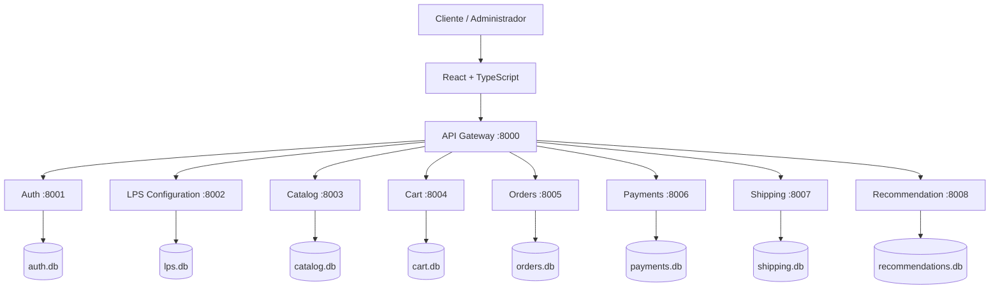
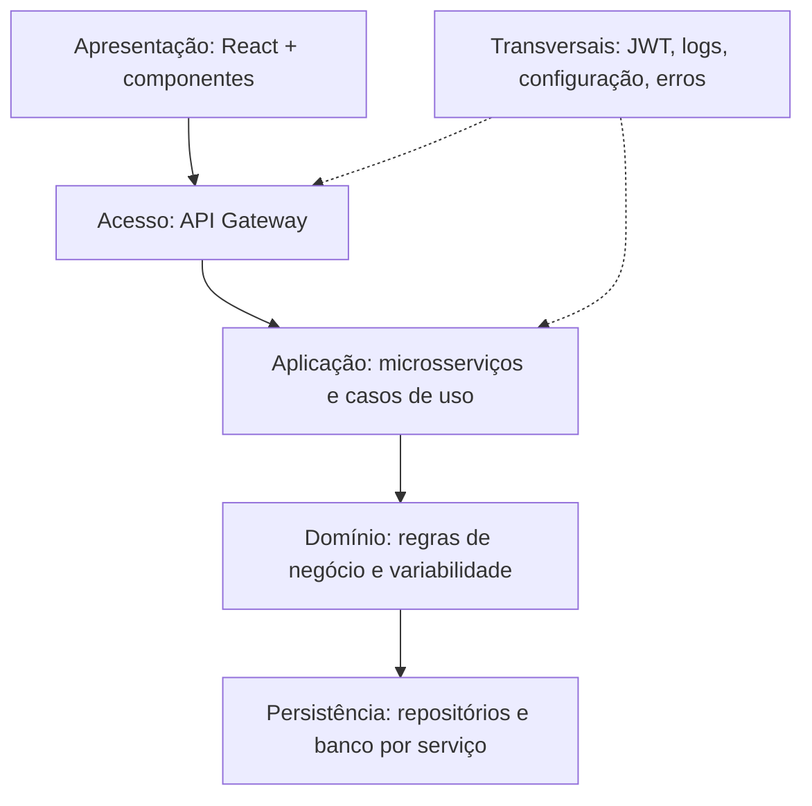
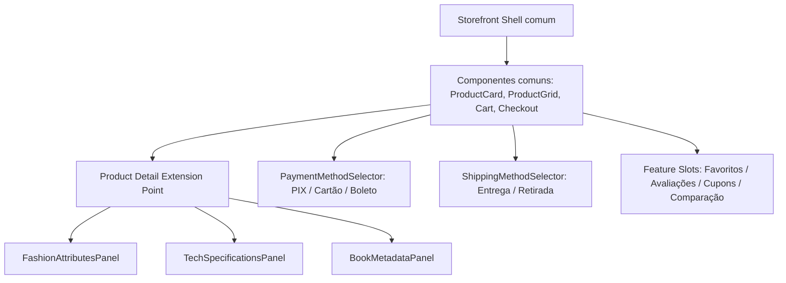

# VitrineFlex — Documento Técnico de Visão e Especificação

**Linha de Produto de Software para Sistemas de E-commerce Multissetoriais Baseada em Microsserviços e Componentes de Software**

- **Versão:** 1.0
- **Data:** 08 de novembro de 2026
- **Status:** proposta técnica inicial para revisão antes da implementação
- **Disciplina:** Tópicos em Engenharia de Software — Projetando Linhas de Produto de Software
- **Curso:** Ciência da Computação — Universidade Federal de Alagoas (UFAL)
- **Equipe:** a definir

> **Natureza deste documento.** Esta é uma baseline de projeto proposta, não um registro de implementação concluída. As decisões aqui descritas devem ser revisadas antes da codificação e podem ser ajustadas mediante justificativa e registro de decisão arquitetural.

## 1. Resumo executivo

O VitrineFlex será uma Linha de Produto de Software (LPS) para e-commerces multissetoriais. A plataforma terá um núcleo comum reutilizável e um conjunto de funcionalidades variáveis, permitindo derivar lojas virtuais para três segmentos iniciais: **Moda**, **Tecnologia/Informática** e **Livros**.

O objetivo não é manter três aplicações independentes. Será mantida uma base de código comum, com componentes de interface, módulos de domínio e microsserviços reutilizados. Um administrador configurará um novo produto por meio de um seletor de features. O configurador validará as regras de variabilidade, persistirá um manifesto de configuração e disponibilizará uma loja derivada em uma rota própria (`/loja/{slug}`). A aplicação carregará o manifesto e ativará os módulos e componentes correspondentes.

O sistema será implementado como um monólito de repositório (monorepo) organizado em serviços independentes, com APIs REST, API Gateway e bancos de dados separados por serviço. O microsserviço de recomendação será obrigatório e utilizará preferências do perfil e histórico de interações/compras para personalizar sugestões.

## 2. Base acadêmica e decisões de projeto

### 2.1 Exigências identificadas nos materiais da disciplina

O documento de orientação do projeto 2026.2 exige modelagem e implementação de uma LPS usando microsserviços e componentes de software. O uso de Agentic AI é opcional e Python é sugerido como linguagem. O material lista e-commerce como um dos temas permitidos [1][2].

O roteiro do relatório exige, entre outros itens: metodologia ágil; técnicas de reúso; Product Backlog e Sprint Backlogs; diagrama de features; arquitetura em camadas; diagramas de variabilidade; diagrama de componentes; tela de configuração e derivação de um novo produto; arquitetura de microsserviços; API Gateway; especificação de cada serviço; serviço de recomendação baseado no perfil/histórico; tela que mostre as portas dos serviços em execução; tecnologias; telas da aplicação; GitHub e referências [1].

### 2.2 Referências de trabalhos anteriores

O relatório Guacaloka apresenta um e-commerce de comida mexicana, com catálogo, autenticação, carrinho, pedidos, frete e recomendação, e inclui modelagem de features, camadas, componentes e variabilidade [3]. O relatório SmartClass demonstra uma separação por serviços, API Gateway, documentação de endpoints, Docker, SQLite, JWT e serviço de recomendação [4]. Esses trabalhos são referências de organização e cobertura acadêmica; o VitrineFlex terá domínio, regras, componentes e implementação próprios.

### 2.3 Classificação das decisões

- **Obrigatório pela disciplina:** LPS, microsserviços, componentes reutilizáveis, recomendação baseada em perfil/histórico e itens de modelagem/implementação descritos na seção 2.1.
- **Decisão proposta para o VitrineFlex:** três segmentos (Moda, Tecnologia e Livros), stack React/FastAPI, serviços e portas definidos neste documento, isolamento lógico por loja e derivação por manifesto de features.
- **Pendente de validação:** aprovação do tema/escopo pelo docente; tamanho da equipe; cronograma real das sprints; versões exatas das dependências e eventuais ajustes solicitados em aula.

## 3. Visão, objetivos e escopo

### 3.1 Problema

Pequenos e médios comerciantes de segmentos diferentes precisam de lojas virtuais, mas funcionalidades específicas de um segmento nem sempre são necessárias em outro. Desenvolver lojas separadas aumenta duplicação e esforço de manutenção; por outro lado, uma loja genérica sem variabilidade não demonstra adequadamente o conceito de LPS.

### 3.2 Objetivo geral

Projetar, modelar e implementar uma LPS de e-commerce que permita configurar e derivar lojas virtuais para segmentos comerciais distintos, reutilizando componentes de software e microsserviços, com recomendação personalizada baseada em dados do usuário.

### 3.3 Objetivos específicos

1. Identificar funcionalidades comuns, opcionais e alternativas entre os segmentos.
2. Definir regras de dependência e incompatibilidade entre features.
3. Implementar um configurador que valide e persista a configuração de cada loja derivada.
4. Reutilizar componentes visuais e módulos de domínio no frontend.
5. Implementar serviços REST independentes, acessados externamente por meio de um API Gateway.
6. Manter dados de cada loja logicamente isolados por `store_id`.
7. Implementar recomendações que considerem interesses declarados, visualizações, favoritos e compras.
8. Demonstrar pelo menos três produtos derivados com configurações diferentes.

### 3.4 Escopo incluído

- Painel administrativo da LPS para criar lojas derivadas.
- Três segmentos iniciais: Moda, Tecnologia/Informática e Livros.
- Cadastro/login de clientes e perfil com interesses.
- Catálogo, busca, filtros, detalhes e variantes de produtos.
- Carrinho, checkout, pedidos e histórico.
- Pagamentos simulados: PIX, cartão e boleto.
- Entrega em domicílio e/ou retirada, com cotação simulada.
- Recomendações personalizadas e fallback para produtos populares.
- Recursos opcionais: favoritos, avaliações, cupons e comparação de produtos (comparação restrita a Tecnologia).
- Painel de saúde dos serviços e visualização de portas/URLs.
- Dados demonstrativos e instruções locais de execução.

### 3.5 Fora do escopo inicial

- Integração financeira real com bancos, adquirentes ou gateways de pagamento.
- Armazenamento ou processamento de dados reais de cartão.
- Integração com transportadoras, cálculo fiscal ou emissão de nota fiscal.
- Integração real com e-mail, SMS ou WhatsApp.
- Aplicativo nativo para Android/iOS.
- Integração com ERP/estoque de terceiros.
- Recomendação baseada em redes neurais ou modelos generativos.
- Alta disponibilidade, escalabilidade multi-região ou implantação produtiva em nuvem.

## 4. Produtos derivados e usuários

### 4.1 Produtos de referência

| Produto derivado | Segmento | Variabilidade específica |
|---|---|---|
| Vitrine Moda | Vestuário e acessórios | Tamanho, cor, grade de variantes e atributos de vestuário |
| Vitrine Tech | Eletrônicos e informática | Especificações técnicas, garantia e comparação de produtos |
| Vitrine Books | Livros | ISBN, autor, editora, gênero e edição |

Os nomes são identificadores de demonstração. O administrador poderá informar nome comercial, slug e identidade visual ao criar uma loja.

### 4.2 Perfis de usuário

- **Visitante:** navega pelo catálogo e consulta detalhes; precisa autenticar-se para ações pessoais ou finalizar compra.
- **Cliente:** mantém perfil, interesses, carrinho, pedidos, favoritos e avaliações conforme features habilitadas.
- **Administrador da loja:** gerencia catálogo, estoque, pedidos e informações da loja à qual possui acesso.
- **Administrador da LPS:** cria produtos derivados por meio do configurador e consulta a saúde da infraestrutura.

No MVP, os papéis de administrador da loja e administrador da LPS poderão ser atribuídos a uma conta de demonstração, mas as permissões serão diferenciadas no backend.

## 5. Requisitos funcionais

| ID | Requisito | Prioridade |
|---|---|---|
| RF-01 | Registrar clientes e autenticar com e-mail e senha | Must |
| RF-02 | Manter perfil e categorias de interesse do cliente | Must |
| RF-03 | Criar uma loja derivada escolhendo segmento, identidade e features | Must |
| RF-04 | Validar dependências, alternativas e incompatibilidades no configurador | Must |
| RF-05 | Persistir manifesto e disponibilizar a loja em `/loja/{slug}` | Must |
| RF-06 | Exibir catálogo, busca, filtros e detalhes de produtos | Must |
| RF-07 | Manter produtos, categorias, variantes e estoque por loja | Must |
| RF-08 | Adicionar, alterar quantidade e remover itens do carrinho | Must |
| RF-09 | Calcular resumo e finalizar compra | Must |
| RF-10 | Simular pagamento pelos métodos habilitados | Must |
| RF-11 | Calcular cotação de entrega ou disponibilizar retirada | Must |
| RF-12 | Registrar pedidos, status e histórico do cliente | Must |
| RF-13 | Recomendar produtos utilizando perfil e histórico do cliente | Must |
| RF-14 | Exibir status e portas dos microsserviços em execução | Must |
| RF-15 | Habilitar/desabilitar favoritos por configuração | Should |
| RF-16 | Habilitar avaliações por configuração | Should |
| RF-17 | Habilitar cupons por configuração | Should |
| RF-18 | Comparar produtos somente na loja de Tecnologia | Could |
| RF-19 | Permitir ao administrador gerenciar catálogo e pedidos | Must |
| RF-20 | Exibir visualmente quais módulos/serviços estão ativos na loja | Must |

### 5.1 Requisitos não funcionais

- **RNF-01 — Usabilidade:** interface responsiva para desktop e dispositivos móveis, com navegação consistente.
- **RNF-02 — Manutenibilidade:** separar frontend, gateway e serviços por responsabilidade e manter documentação de execução.
- **RNF-03 — Segurança:** armazenar senhas com hash Argon2id; autenticar por JWT; aplicar autorização por papel, usuário e loja.
- **RNF-04 — Isolamento:** toda consulta a dados comerciais deve considerar `store_id`; um usuário não deve acessar dados de outra loja sem autorização.
- **RNF-05 — Contratos:** APIs REST versionadas em `/api/v1`, com validação de entrada e documentação OpenAPI.
- **RNF-06 — Testabilidade:** regras de variabilidade, cálculo, autorização e recomendação devem possuir testes automatizados.
- **RNF-07 — Observabilidade:** cada serviço deve expor `/health` e registrar logs com identificador de requisição.
- **RNF-08 — Configuração:** segredos e URLs devem ser fornecidos por variáveis de ambiente; não versionar `.env` real.
- **RNF-09 — Portabilidade local:** subir o ambiente acadêmico por Docker Compose com um comando documentado.
- **RNF-10 — Desempenho de demonstração:** operações comuns devem responder em tempo adequado em ambiente local e com volume de dados de demonstração; limites quantitativos serão definidos após teste de carga simples.

## 6. Modelo de features e variabilidade

### 6.1 Features obrigatórias

- Núcleo da loja e identidade visual.
- Cadastro, autenticação e perfil do cliente.
- Catálogo, busca e detalhes de produtos.
- Carrinho, checkout, pedidos e histórico.
- Pelo menos um método de pagamento simulado.
- Pelo menos uma modalidade de atendimento/entrega.
- Recomendação personalizada (serviço obrigatório para atender ao enunciado).
- Painel administrativo básico e isolamento por loja.

### 6.2 Grupos alternativos e opcionais

**Segmento (XOR — exatamente um):**
- Moda: variantes de tamanho/cor e atributos de vestuário.
- Tecnologia: especificações técnicas e garantia; comparação opcional.
- Livros: ISBN, autor, editora, gênero e edição.

**Pagamento (OR — pelo menos um):** PIX simulado, cartão simulado, boleto simulado.

**Atendimento/entrega (OR — pelo menos um):** entrega em domicílio, retirada no local.

**Opcionais:** favoritos, avaliações, cupons e comparação de produtos.

### 6.3 Restrições de variabilidade

1. Exatamente um segmento deve ser selecionado.
2. Recomendações, autenticação, catálogo, carrinho, pedidos e checkout não podem ser desabilitados no produto acadêmico mínimo.
3. Pelo menos um meio de pagamento deve estar habilitado.
4. Pelo menos uma modalidade de atendimento/entrega deve estar habilitada.
5. Comparação de produtos exige o segmento Tecnologia.
6. Atributos de tamanho/cor são aplicáveis ao segmento Moda.
7. ISBN/autor/editora são aplicáveis ao segmento Livros.
8. Especificações técnicas/garantia são aplicáveis ao segmento Tecnologia.
9. Favoritos e avaliações exigem cliente autenticado.
10. Cupons são aplicados somente no checkout e precisam ter regra de validade.
11. Retirada não exige endereço de entrega; entrega em domicílio exige endereço/CEP válido no escopo simulado.

### 6.4 Estratégia de derivação

A derivação será baseada em **configuração e composição em tempo de execução**, sem geração de código-fonte nem criação de um container por loja no MVP. O configurador produzirá um manifesto (`ProductManifest`) persistido com segmento, features, métodos de pagamento, modalidades de entrega, tema, nome e slug. O frontend carregará esse manifesto e ativará módulos/rotas/componentes. O backend também verificará as features em cada operação sensível; esconder um botão na interface não será considerado controle suficiente.

Cada produto derivado será uma instância lógica de loja com `store_id` e `slug` próprios. A mesma aplicação servirá as três lojas, com dados comerciais filtrados por `store_id`. Essa decisão limita a complexidade operacional e permite demonstrar três produtos derivados sobre uma base reutilizada. Não significa que cada loja terá infraestrutura física independente.

### 6.5 Exemplo de manifesto do produto

O manifesto é o artefato persistente que materializa uma configuração válida. Exemplo simplificado para uma loja de tecnologia:

```json
{
  "schema_version": "1.0",
  "store": {"name": "Vitrine Tech", "slug": "vitrine-tech", "segment": "TECH"},
  "features": {
    "auth": true, "catalog": true, "cart": true,
    "checkout": true, "recommendations": true,
    "favorites": true, "reviews": false,
    "coupons": false, "product_comparison": true
  },
  "payment_methods": ["PIX", "CARD"],
  "fulfillment_modes": ["DELIVERY", "PICKUP"],
  "theme": {"primary_color": "#245B8F"}
}
```

## 7. Arquitetura geral

### 7.1 Estilo arquitetural

- Frontend SPA em React + TypeScript.
- Backend organizado em microsserviços REST independentes.
- API Gateway como único ponto de entrada recomendado para o frontend.
- Comunicação síncrona HTTP/JSON entre serviços no MVP.
- Banco de dados por serviço, sem leitura direta de tabelas pertencentes a outro serviço.
- Monorepo para simplificar desenvolvimento, integração e avaliação acadêmica.

### 7.2 Diagrama lógico



O Gateway encaminha requisições e aplica verificações transversais. As regras de negócio permanecem nos serviços proprietários. Chamadas entre serviços são feitas por APIs internas autenticadas; nenhum serviço acessa diretamente o banco de outro.

### 7.3 Microsserviços e responsabilidade

| Serviço | Porta | Responsabilidade | Banco inicial |
|---|---:|---|---|
| API Gateway | 8000 | Roteamento, validação inicial de token, CORS, correlação e health agregado | Sem banco |
| Auth | 8001 | Usuários, senha, login, papéis e preferências/interesses | `auth.db` |
| LPS Configuration | 8002 | Modelo de features, validação, manifesto e criação de loja derivada | `lps.db` |
| Catalog | 8003 | Produtos, categorias, atributos por segmento, variantes e estoque | `catalog.db` |
| Cart | 8004 | Carrinhos e itens por cliente/loja | `cart.db` |
| Orders | 8005 | Checkout, pedidos, snapshots de itens e histórico de status | `orders.db` |
| Payments | 8006 | Tentativas e resultados de pagamentos simulados | `payments.db` |
| Shipping | 8007 | Métodos disponíveis, retirada e cotação simulada de entrega | `shipping.db` |
| Recommendation | 8008 | Interações, afinidade por categoria e ranking de recomendações | `recommendations.db` |

As portas são propostas para execução local e poderão ser alteradas se houver conflito com aplicações do computador.

### 7.4 Detalhamento dos serviços

**API Gateway**
- Encaminha `/api/v1/auth/*`, `/stores/*`, `/products/*`, `/cart/*`, `/orders/*`, `/payments/*`, `/shipping/*` e `/recommendations/*` para os serviços correspondentes.
- Valida presença/formato do JWT quando a rota exige autenticação e encaminha contexto de usuário/loja.
- Gera/propaga `X-Request-ID`, normaliza erros de upstream e disponibiliza `/health` e consulta agregada de serviços.
- Não implementa regras de catálogo, checkout ou recomendação.

**Auth Service**
- Registra clientes e administradores.
- Autentica e emite JWT de acesso.
- Retorna usuário e papéis atuais.
- Mantém interesses/categorias preferidas do cliente.
- Implementa hash de senha Argon2id, validação e autorização de recursos próprios.

**LPS Configuration Service**
- Mantém definição versionada de features e restrições.
- Valida segmento exclusivo, dependências e combinações obrigatórias.
- Cria `store_id`, `slug` e `ProductManifest`.
- Retorna a configuração pública necessária para inicializar a loja.
- Impede alteração de features incompatíveis com dados/recursos já utilizados; no MVP, mudanças estruturais podem exigir nova versão/derivação.

**Catalog Service**
- Gerencia produtos, categorias, preço, imagens por URL local/demonstração, variantes e estoque.
- Usa um núcleo de produto comum e atributos tipados/validados segundo o segmento.
- Moda: tamanhos, cores e SKU por variante.
- Tecnologia: fabricante, modelo, especificações e garantia.
- Livros: ISBN, autor, editora, gênero e edição.
- Filtra todas as operações administrativas e de leitura pela loja.

**Cart Service**
- Mantém carrinho por cliente e loja.
- Adiciona, atualiza e remove itens.
- Consulta o Catalog para conferir produto, preço e disponibilidade.
- Não é a fonte oficial de preço/estoque; o checkout sempre revalida dados.

**Orders Service**
- Orquestra o checkout no MVP.
- Recupera o carrinho, revalida itens no Catalog, solicita cotação ao Shipping quando aplicável e cria tentativa no Payments.
- Persiste pedido e snapshot de nome, SKU, quantidade e preço para preservar o histórico.
- Atualiza status de pedido e notifica Recommendation em caso de compra aprovada.
- Limpa o carrinho somente após confirmação de pagamento simulado.

**Payments Service**
- Aceita apenas métodos habilitados no manifesto da loja.
- Simula aprovação ou recusa com dados fictícios; não captura, transmite ou armazena número real de cartão.
- Persiste identificador, método, valor e status da tentativa.

**Shipping Service**
- Retorna modalidades habilitadas para a loja.
- Calcula cotação fictícia usando faixas/zonas de CEP e regras locais definidas no sistema.
- Disponibiliza retirada quando habilitada.
- Não consulta transportadora nem promete prazo real de entrega.

**Recommendation Service**
- Recebe eventos de visualização, favorito e compra.
- Consulta interesses do perfil no Auth e produtos candidatos no Catalog.
- Calcula pontuação por categoria/interesse e histórico, retornando produtos e justificativas simples.
- Para cliente sem histórico, usa popularidade por segmento/categoria (cold start).
- Não utiliza IA generativa nem rede neural no MVP.

### 7.5 Arquitetura em camadas

A organização em camadas complementa a decomposição em microsserviços. Dentro de cada serviço, rotas/API, casos de uso, regras de domínio e repositórios devem permanecer separados. A camada de apresentação não acessa bancos diretamente; o Gateway não concentra regras específicas de negócio.



## 8. Fluxos principais

### 8.1 Derivação de loja

1. Administrador acessa o painel da LPS.
2. Informa nome, slug, segmento e identidade visual.
3. Seleciona métodos de pagamento e modalidades de entrega.
4. Ativa/desativa features opcionais.
5. O LPS Configuration Service valida as restrições.
6. Se válido, persiste o manifesto e cria a instância lógica da loja.
7. O frontend acessa `/loja/{slug}`, recupera a configuração e monta a navegação, rotas e componentes correspondentes.
8. O administrador cadastra produtos ou utiliza catálogo demonstrativo do segmento.

### 8.2 Checkout

1. Cliente autenticado solicita checkout pelo Gateway.
2. Orders recupera o carrinho no Cart.
3. Orders revalida produtos, preços e estoque no Catalog.
4. Se houver entrega em domicílio, consulta Shipping; se retirada, registra essa modalidade.
5. Orders solicita ao Payments a simulação do método habilitado.
6. Orders atualiza o pedido para `PAID` ou `PAYMENT_FAILED`.
7. Em caso de aprovação, limpa o carrinho e envia evento de compra ao Recommendation.

Não haverá transação distribuída ACID entre bancos. O fluxo será implementado como orquestração simples, com status explícitos, idempotência no endpoint de checkout e tratamento de falhas parciais. Compensações mais sofisticadas ficam fora do MVP.

### 8.3 Recomendação personalizada

O cliente terá preferências por categoria no perfil. O Recommendation armazenará interações com tipo, produto, categoria, data, usuário e loja. Uma pontuação inicial e explicável poderá ser: `score = 4I + min(5P, 15) + min(3F, 9) + min(V, 5) + 2T`, onde I indica correspondência com interesse declarado (0 ou 1), P é a quantidade de compras na categoria, F a quantidade de favoritos, V as visualizações recentes e T é popularidade normalizada entre 0 e 1. Os pesos e janelas temporais são parâmetros iniciais, sujeitos a teste e ajuste. Produtos inativos, sem estoque ou de outra loja serão excluídos. Para cliente sem histórico, usa-se popularidade por segmento/categoria (cold start). Não será apresentado como modelo de machine learning treinado. O endpoint retornará produtos, pontuação e motivo resumido da recomendação.

## 9. Contratos de API propostos

Todas as rotas públicas ficarão sob `/api/v1` no Gateway. Os serviços terão documentação OpenAPI própria para desenvolvimento.

| Serviço | Endpoint principal | Finalidade |
|---|---|---|
| Auth | `POST /auth/register` | Criar usuário |
| Auth | `POST /auth/login` | Autenticar e emitir token |
| Auth | `GET /auth/me` | Consultar perfil autenticado |
| Auth | `PUT /auth/me/preferences` | Atualizar interesses |
| LPS Config | `POST /admin/products/validate` | Validar configuração antes de criar |
| LPS Config | `POST /admin/products` | Derivar loja |
| LPS Config | `GET /stores/{slug}/configuration` | Obter manifesto público |
| Catalog | `GET /stores/{slug}/products` | Listar/filtrar produtos |
| Catalog | `GET /products/{product_id}` | Consultar detalhe |
| Catalog | `POST /admin/stores/{store_id}/products` | Cadastrar produto |
| Cart | `GET /cart` | Consultar carrinho |
| Cart | `POST /cart/items` | Adicionar item |
| Cart | `PATCH /cart/items/{item_id}` | Atualizar quantidade/variante |
| Cart | `DELETE /cart/items/{item_id}` | Remover item |
| Orders | `POST /orders/checkout` | Finalizar compra |
| Orders | `GET /orders` | Listar histórico |
| Orders | `GET /orders/{order_id}` | Consultar pedido |
| Payments | `POST /payments/simulate` | Simular pagamento (chamada interna) |
| Shipping | `POST /shipping/quote` | Cotar entrega (chamada interna) |
| Recommendation | `GET /recommendations` | Listar recomendações do usuário |
| Recommendation | `POST /interactions` | Registrar visualização/favorito |
| Gateway | `GET /system/services` | Estado agregado e portas dos serviços |

Os nomes são contratos propostos; poderão ser refinados durante o desenho detalhado. Respostas de erro seguirão formato JSON padronizado (`code`, `message`, `details`, `request_id`). Listas terão paginação e filtros documentados.

## 10. Dados e isolamento

### 10.1 Entidades lógicas por serviço

| Serviço | Entidades principais |
|---|---|
| Auth | User, Role, StoreMembership, UserPreference, UserAddress |
| LPS Configuration | Store, ProductManifest, FeatureDefinition, FeatureConstraint |
| Catalog | Product, Category, ProductVariant, ProductAttribute, Inventory |
| Cart | ShoppingCart, CartItem |
| Orders | Order, OrderItemSnapshot, OrderStatusHistory |
| Payments | PaymentAttempt, PaymentResult |
| Shipping | ShippingMethod, ShippingQuote, PickupLocation |
| Recommendation | UserInteraction, CategoryAffinity, RecommendationResult |

### 10.2 Estratégia de persistência

No MVP, cada serviço terá um arquivo SQLite próprio, isolado em volume Docker. A separação por serviço evita que um serviço dependa do esquema interno do outro. IDs de usuário, loja e produto serão referências externas (UUID/string), sem chaves estrangeiras cruzando bancos. Cada serviço validará referências por API quando necessário.

Todas as tabelas de domínio comercial devem incluir `store_id` ou ser relacionadas a um registro que o contenha. Consultas e comandos sempre aplicarão escopo de loja. Usuários poderão pertencer a mais de uma loja por meio de associações/membership.

Para evolução além do ambiente acadêmico, a migração natural é um PostgreSQL por serviço ou schemas/instâncias isoladas, conforme a escala. SQLite é uma escolha de simplicidade para execução local e demonstração, não uma afirmação de adequação para produção multiusuário de grande porte.

## 11. Componentes e estratégia de reúso

### 11.1 Reúso no frontend

**Componentes de interface:** Button, Input, Select, Modal, Badge, Alert, Skeleton, EmptyState, Pagination.

**Componentes de layout:** StoreHeader, CategoryNavigation, SearchBar, Breadcrumbs, StoreFooter, AdminSidebar.

**Componentes de comércio:** ProductCard, ProductGrid, PriceDisplay, ProductGallery, QuantitySelector, CartDrawer, CartSummary, AddressForm, CheckoutSteps, OrderStatusBadge, RecommendationCarousel.

**Pontos de extensão variáveis:** ProductAttributesPanel por segmento; ProductVariantSelector para Moda; TechnicalSpecificationsPanel para Tecnologia; BookMetadataPanel para Livros; PaymentMethodSelector conforme métodos ativados; ShippingMethodSelector conforme modalidades; slots de Reviews, Favorites, Coupons e ProductComparison.

### 11.2 Reúso no backend

Será permitido compartilhar bibliotecas técnicas pequenas: configuração, logging, correlação de requisições, validação de token, cliente HTTP interno e formato de erros. Regras de negócio e modelos de persistência permanecem nos serviços proprietários para evitar acoplamento indevido.

### 11.3 Feature Registry

O frontend terá um registro central de features, alimentado pelo manifesto. Guardas de rota e componentes condicionais usarão esse registro. O backend terá verificadores equivalentes para proteger endpoints e operações. A definição de features e restrições no serviço LPS Configuration será a fonte de verdade.

### 11.4 Componentes e pontos de variabilidade

A seleção de segmento habilita exatamente um painel de atributos. Pagamento e entrega utilizam seletores compostos por adaptadores; opcionais ocupam slots de extensão. A mesma estrutura de página e componentes comuns é compartilhada entre produtos derivados.



## 12. Tecnologias e ferramentas

| Área | Tecnologia proposta | Motivo |
|---|---|---|
| Linguagem backend | Python 3.12 ou superior compatível | Linguagem sugerida pela disciplina e ecossistema de APIs |
| API | FastAPI + Pydantic | APIs REST, validação e OpenAPI |
| Persistência | SQLAlchemy 2.x + SQLite | ORM e banco leve para ambiente acadêmico |
| Migrações | Alembic | Evolução controlada de esquema |
| Autenticação | JWT + Argon2id | Tokens de acesso e hash de senha |
| Frontend | React + TypeScript + Vite | Interface modular e tipagem |
| Navegação/estado remoto | React Router + TanStack Query (proposta) | Rotas e sincronização com APIs |
| Estilo | Tailwind CSS ou CSS Modules | Consistência visual; decisão final na inicialização |
| Containers | Docker + Docker Compose | Execução reproduzível de serviços |
| Testes backend | Pytest + HTTPX | Testes unitários e de API |
| Testes frontend | Vitest + React Testing Library | Componentes e comportamento de features |
| E2E | Playwright (desejável) | Fluxos completos do usuário |
| Documentação API | OpenAPI/Swagger | Contratos navegáveis |
| Versionamento | Git + GitHub | Histórico, branches e entrega acadêmica |

As versões exatas serão fixadas no início da implementação em arquivos de dependências/lock. Não se deve usar automaticamente a versão mais recente de cada pacote sem verificar compatibilidade entre Python, FastAPI, Pydantic, SQLAlchemy, Node e bibliotecas do frontend.

## 13. Segurança e privacidade

- Hash Argon2id para senhas; jamais armazenar senha em texto puro.
- JWT com expiração e segredo configurado por ambiente.
- Papéis `CUSTOMER`, `STORE_ADMIN` e `LPS_ADMIN`.
- Conferência de propriedade do recurso e `store_id` no backend.
- Validação de features habilitadas no servidor, não apenas no frontend.
- Segredos em `.env` local não versionado; fornecer somente `.env.example`.
- CORS restrito às origens necessárias no ambiente de execução.
- Chamadas serviço-a-serviço autenticadas por credencial interna em variável de ambiente; não confiar em cabeçalhos de identidade enviados livremente pelo navegador.
- Em desenvolvimento, serviços poderão ter portas publicadas somente em loopback (`127.0.0.1`) para inspeção acadêmica; em implantação pública, apenas o Gateway será exposto.
- Logs sem senha, token ou informação de pagamento sensível.
- Pagamentos exclusivamente simulados; nenhuma captura de cartão real.
- Dados sintéticos para usuários, pedidos e catálogo de demonstração.

## 14. Interface e telas previstas

1. **Página inicial da loja:** identidade, categorias, destaques e recomendações.
2. **Catálogo:** busca, filtros, paginação e ProductCard reutilizado.
3. **Detalhe do produto:** galeria, preço, atributos do segmento, variante e disponibilidade.
4. **Carrinho:** quantidade, remoção e resumo.
5. **Checkout:** endereço/retirada, cotação, método de pagamento e confirmação simulada.
6. **Pedidos:** histórico, status e detalhes.
7. **Perfil:** dados e interesses do cliente.
8. **Painel administrativo:** catálogo, estoque e pedidos.
9. **Configurador da LPS:** seleção de segmento, identidade, features, pagamentos e entrega; validação e criação.
10. **Painel de serviços:** lista de serviços, portas, URLs, estado de saúde e horário da última verificação.

A interface principal deverá identificar de forma discreta os módulos/microsserviços utilizados, por exemplo em uma área de diagnóstico/rodapé técnico, para facilitar a demonstração e atender ao roteiro da disciplina.

## 15. Derivação de produto — passo a passo demonstrável

1. Executar a plataforma e autenticar como `LPS_ADMIN`.
2. Abrir “Criar nova loja”.
3. Informar nome comercial e slug único.
4. Selecionar exatamente um segmento: Moda, Tecnologia ou Livros.
5. Escolher features opcionais.
6. Selecionar um ou mais métodos de pagamento simulados.
7. Selecionar uma ou mais modalidades de atendimento/entrega.
8. Solicitar validação; exibir erros e dependências caso a configuração seja inválida.
9. Confirmar criação; o serviço persiste o manifesto e retorna a URL da loja.
10. Abrir a loja derivada e verificar que navegação, atributos, páginas e ações correspondem às features selecionadas.
11. Cadastrar produtos ou carregar dados de demonstração do segmento.
12. Realizar uma compra simulada e observar a atualização do histórico/recomendação.

A comprovação acadêmica deverá incluir pelo menos três lojas derivadas com manifests distintos e evidência de que as diferenças alteram o produto em execução.

## 16. Metodologia e plano de entregas

Será utilizada uma adaptação de Scrum, com Product Backlog priorizado, Sprints curtas, incremento demonstrável e revisão ao final de cada ciclo. O tamanho e a duração serão ajustados ao calendário real e à quantidade de integrantes. O uso de Antigravity será apoio à implementação; as decisões, revisões e validações permanecem sob responsabilidade da equipe.

### 16.1 Macro-backlog inicial

| Épico | Conteúdo | Prioridade |
|---|---|---|
| E1 — Fundação | monorepo, ambiente, padrões, Docker Compose | Must |
| E2 — Identidade e acesso | Auth, papéis, perfil e interesses | Must |
| E3 — LPS Configurator | modelo de features, regras, manifesto e loja derivada | Must |
| E4 — Catálogo variável | catálogo comum e atributos dos três segmentos | Must |
| E5 — Compra | carrinho, checkout, pedidos e histórico | Must |
| E6 — Serviços auxiliares | pagamentos e entrega simulados | Must |
| E7 — Recomendação | eventos, perfil, ranking e fallback | Must |
| E8 — Interface e reúso | design system, componentes e telas | Must |
| E9 — Opcionais | favoritos, avaliações, cupons e comparação | Should/Could |
| E10 — Qualidade e entrega | testes, documentação, painel de portas e GitHub | Must |

### 16.2 Sprints propostas

- **Sprint 0 — Modelagem:** fechar requisitos, feature model, diagramas, contratos e ADRs; sem assumir implementação antes da aprovação desta baseline.
- **Sprint 1 — Fundação:** monorepo, Docker Compose, API Gateway, Auth, shell React e health checks.
- **Sprint 2 — LPS e catálogo:** configurador, validação de features, criação de lojas, Catalog e três modelos de atributos por segmento.
- **Sprint 3 — Fluxo de compra:** Cart, Orders, interface de catálogo/detalhe/carrinho/checkout e histórico.
- **Sprint 4 — Pagamento, entrega e recomendação:** Payments, Shipping, interesses, eventos e ranking de recomendações.
- **Sprint 5 — Produto derivado e qualidade:** demonstrar três produtos, recursos opcionais, painel de serviços, testes integrados, documentação e GitHub.

## 17. Estrutura sugerida do repositório

```text
vitrineflex/
├── apps/
│   └── web/                       # React + TypeScript
├── services/
│   ├── api-gateway/
│   ├── auth-service/
│   ├── lps-config-service/
│   ├── catalog-service/
│   ├── cart-service/
│   ├── orders-service/
│   ├── payments-service/
│   ├── shipping-service/
│   └── recommendation-service/
├── packages/
│   └── python-common/             # utilidades técnicas compartilhadas
├── infra/
│   └── docker-compose.yml
├── scripts/                       # seed, smoke tests e utilitários
├── tests/
│   ├── integration/
│   └── e2e/
├── docs/                          # especificação, diagramas e ADRs
├── .env.example
├── .gitignore
├── Makefile
└── README.md
```

Cada serviço terá seu próprio `pyproject.toml`, configuração, modelos, schemas, rotas, camada de serviço, repositório e testes. O frontend manterá componentes compartilhados em `src/components` e módulos de feature/segmento em `src/features` e `src/segments`.

## 18. Execução local e operação

- Pré-requisitos: Git, Docker Engine/Desktop com Compose, Node.js em versão LTS compatível e Python conforme versão definida no projeto.
- Configuração: copiar `.env.example` para `.env` e preencher segredos locais de desenvolvimento.
- Inicialização proposta: `docker compose -f infra/docker-compose.yml up --build`.
- Verificação: consultar `GET /api/v1/system/services` e os endpoints `/health` de cada serviço.
- Frontend e documentação: URLs serão registradas no README; portas locais propostas: frontend `5173`, Gateway `8000`, serviços `8001` a `8008`. No Compose local, os serviços podem ser publicados somente em `127.0.0.1` para inspeção; em implantação pública, apenas o Gateway será exposto.
- Encerramento: `docker compose -f infra/docker-compose.yml down`.

Os comandos finais poderão mudar quando os arquivos reais forem criados. O README deverá registrar os comandos efetivamente testados, não apenas os planejados.

## 19. Estratégia de testes e critérios de aceite

### 19.1 Testes

- **Unitários:** regras de feature, dependências, validação de manifesto, cálculo de frete, total do carrinho, transições de status e pontuação do recomendador.
- **Integração:** endpoints de cada serviço, acesso ao próprio banco, autenticação, autorização, comunicação interna e rotas do Gateway.
- **Frontend:** renderização condicional por feature, campos específicos do segmento, formulários e estados de erro/loading.
- **Ponta a ponta:** derivar loja, cadastrar/logar cliente, navegar, adicionar item, checkout simulado, consultar pedido e observar recomendação.
- **Regressão de variabilidade:** garantir que uma feature desabilitada não apareça na interface e não possa ser invocada diretamente via API.

### 19.2 Critérios de aceite do projeto

1. O ambiente sobe por Docker Compose conforme README.
2. Gateway e todos os microsserviços respondem em suas portas e possuem health check.
3. O painel lista nome, porta e status de todos os serviços.
4. O configurador rejeita combinações inválidas e explica o motivo.
5. Pelo menos três lojas são derivadas com manifests e features distintos.
6. Cada loja apresenta atributos próprios do segmento e dados isolados.
7. Cliente consegue completar fluxo de compra com pagamento simulado.
8. Histórico é persistido e aparece no perfil do cliente.
9. Recommendation altera resultados com base em interesses e compras registradas.
10. Componentes compartilhados são usados pelos três produtos; variantes não duplicam a aplicação inteira.
11. Há testes automatizados para regras centrais e fluxos integrados.
12. Repositório GitHub contém código, documentação, `.env.example` e instruções verificadas.

## 20. Riscos, limitações e mitigação

| Risco | Impacto | Mitigação proposta |
|---|---|---|
| Escopo grande para o prazo | Alto | Priorizar núcleo obrigatório e limitar features opcionais |
| Microsserviços com acoplamento excessivo | Alto | Definir propriedade dos dados e contratos REST antes de codificar |
| Configurador apenas visual | Alto | Testar criação de manifesto e diferença real no produto derivado |
| Vazamento entre lojas | Alto | Testes de isolamento por `store_id` em todos os serviços de domínio |
| Falhas parciais no checkout | Médio/alto | Status explícitos, idempotência e tratamento de falhas |
| Recomendação sem histórico suficiente | Médio | Fallback de popularidade e interesses iniciais |
| Muitas bibliotecas/versões incompatíveis | Médio | Fixar versões compatíveis e evitar dependências desnecessárias |
| SQLite sob concorrência elevada | Médio | Limitar ao cenário acadêmico; documentar migração futura |

## 21. Decisões arquiteturais pendentes (ADR)

Antes da implementação, confirmar:

1. Aprovação do tema e dos três segmentos pelo docente.
2. Quantidade de integrantes e calendário real das sprints.
3. Identidade visual e nome final do produto (VitrineFlex é provisório).
4. Se SQLite por serviço será aceito como persistência do projeto ou se há preferência por PostgreSQL.
5. Se as lojas serão instâncias lógicas no mesmo runtime (proposta deste documento) ou se o docente exige implantação independente de cada produto.
6. Qual nível de feature opcional será viável sem comprometer o núcleo obrigatório.
7. Estratégia final de autenticação interna e gerenciamento de segredos.

Toda mudança estrutural deverá ser registrada em `docs/adr/` com contexto, decisão, alternativas e consequências.

## 22. Mapeamento para o relatório da disciplina

| Item do roteiro | Evidência prevista no VitrineFlex |
|---|---|
| Enunciado e objetivos | Seções 1 e 3 |
| Metodologia ágil e reúso | Seções 11 e 16 |
| Product/Sprint Backlog | Seção 16 |
| Diagrama de Features | Seção 6 e diagrama do projeto |
| Arquitetura em camadas/variabilidade | Seções 6 e 7; diagrama específico a detalhar |
| Componentes/variabilidade | Seção 11 e catálogo de componentes |
| Seletor e novo produto | Seções 6, 15 e tela do configurador |
| Arquitetura de microsserviços | Seção 7 |
| API Gateway e especificação dos serviços | Seções 7 e 9; OpenAPI e código comentado |
| Recomendação por perfil/histórico | Seções 7.4 e 8.3 |
| Portas dos serviços | Seções 7.3 e 18; painel de saúde |
| Tecnologias e bancos por serviço | Seções 7.3 e 12 |
| Telas e funcionamento | Seção 14 e capturas da aplicação implementada |
| GitHub e referências | README e seção 23 |

O roteiro também solicita que a capa do relatório contenha título, nomes da equipe e link do GitHub. O vídeo de demonstração é obrigatório para LPS de jogos e opcional para os demais temas; o link do site é opcional conforme aviso complementar da disciplina [5].

## 23. Referências e materiais consultados

[1] UNIVERSIDADE FEDERAL DE ALAGOAS. **Elementos do Relatório do Projeto — Tópicos em Engenharia de Software: Projetando Linhas de Produto de Software.** Material de orientação da disciplina, 2026.2.

[2] UNIVERSIDADE FEDERAL DE ALAGOAS. **Temas do Projeto de 2026.2.** Material de orientação da disciplina. Lista de temas permitidos e tecnologias sugeridas.

[3] SILVA, Leonardo Vinicius Wanderley Jatobá da; HOLANDA, Vinícius Maia de. **Linha de Produto de Software para E-commerce — Guacaloka!** Relatório de projeto, Universidade Federal de Alagoas, 2025.

[4] DUARTE, Abraão Melo Santana; SILVA, Gustavo Alexandre dos Santos; SENA, Mariáh Lins. **Projeto SmartClass: Relatório do Projeto.** Engenharia de Software 2024.2, 2025.

[5] UNIVERSIDADE FEDERAL DE ALAGOAS. **Aviso — elementos obrigatórios da capa do Relatório do Projeto.** Material complementar da disciplina.

---

**Fim do documento — VitrineFlex v1.0.** A implementação deve começar somente após revisão desta especificação, aprovação do escopo e registro das decisões pendentes.
