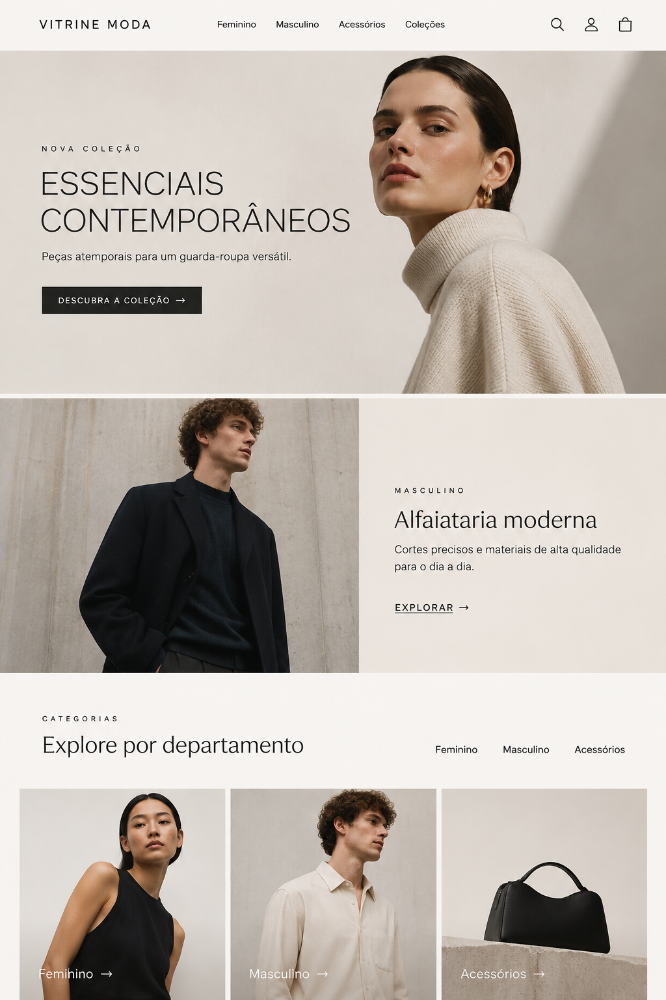
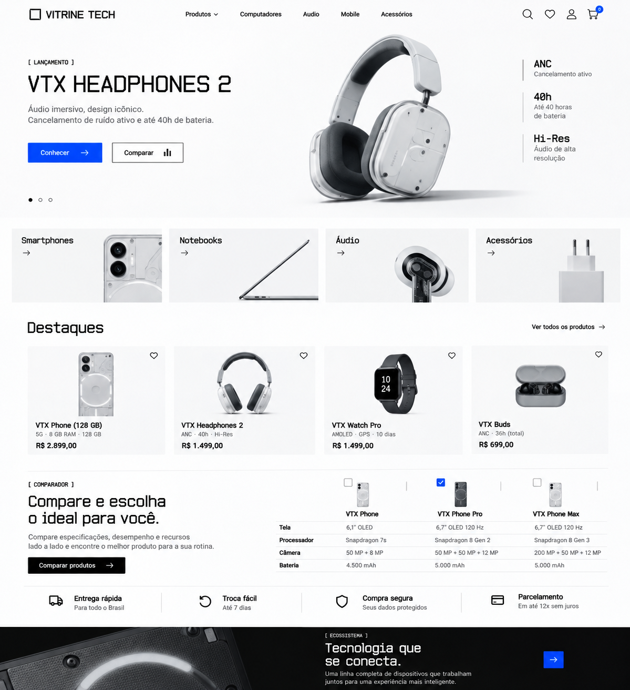
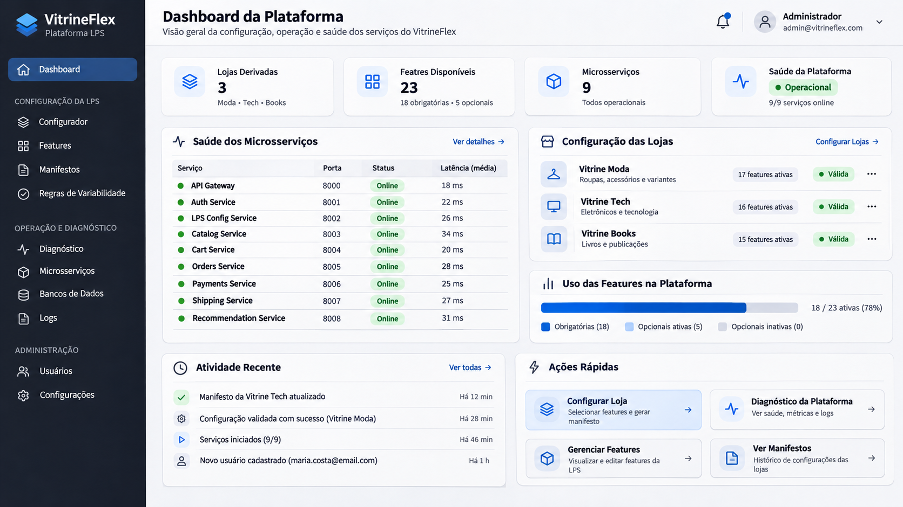

# VitrineFlex — Design Guide

**Versão:** 1.0  
**Data:** 09/11/2026  
**Status:** Especificação visual para implementação  
**Escopo:** experiência de compra das lojas Vitrine Moda, Vitrine Tech e Vitrine Books, além do painel administrativo VitrineFlex.

---

## 1. Objetivo e princípios

Este documento define a direção visual e as regras de experiência de usuário para a evolução da interface do VitrineFlex. Ele deve ser utilizado em conjunto com as imagens de referência desta pasta e com a implementação já existente no repositório.

O VitrineFlex é uma plataforma de Linha de Produto de Software (LPS) que deriva três lojas a partir de uma base compartilhada:

- **Vitrine Moda** (`vitrine-moda`, segmento `FASHION`): roupas, acessórios e moda.
- **Vitrine Tech** (`vitrine-tech`, segmento `TECH`): eletrônicos e tecnologia.
- **Vitrine Books** (`vitrine-books`, segmento `BOOKS`): livros e publicações.

As lojas devem parecer marcas distintas, e não três cópias do mesmo template com cores diferentes. Ao mesmo tempo, devem continuar compartilhando a estrutura técnica, os componentes e os comportamentos comuns que fazem parte da plataforma.

### 1.1. Princípios obrigatórios

1. **Identidade por segmento:** cada loja possui paleta, composição, tratamento de imagens e hierarquia visual próprios.
2. **Consistência dentro de cada loja:** header, catálogo, produto, carrinho, checkout e perfil precisam parecer partes da mesma marca.
3. **Reutilização sem uniformização:** compartilhar lógica e componentes quando isso ajudar, mas não forçar a mesma composição visual em todos os segmentos.
4. **Inter funcional:** utilizar exclusivamente a família tipográfica Inter em toda a aplicação, inclusive em Books e no painel administrativo.
5. **Conteúdo real:** preços, produtos, estoque, avaliações, métricas e histórico devem vir dos dados e serviços existentes. Não apresentar conteúdo fictício como dado real.
6. **Variabilidade preservada:** a apresentação deve respeitar a configuração da loja e as features habilitadas no manifesto.
7. **Acessibilidade e responsividade:** o visual precisa continuar legível, navegável e utilizável em telas menores e por teclado.
8. **Mudança visual, não reconstrução:** não reescrever serviços, regras de negócio ou fluxos funcionais como parte deste trabalho.

### 1.2. O que este documento não autoriza

- Não adicionar features booleanas apenas para representar temas, cores ou estilos.
- Não alterar as restrições de variabilidade CTC ou o Feature Model para implementar as identidades visuais.
- Não criar dados de demonstração para preencher indicadores administrativos.
- Não substituir funcionalidades reais por telas estáticas ou protótipos.
- Não mudar a lógica de autenticação, carrinho, checkout, pedidos, pagamentos, entregas ou recomendações.
- Não introduzir outra família tipográfica.

---

## 2. Referências visuais

As imagens abaixo são referências de direção artística e composição. São conceitos visuais gerados para orientar a implementação, não telas finais, contratos de dados ou fontes de conteúdo comercial.

### 2.1. Vitrine Moda



**O que observar:** fundo off-white, fotografia editorial, tipografia limpa, bastante respiro, composição ampla no hero, blocos assimétricos e categorias apresentadas por imagens. A loja deve transmitir moda contemporânea e curadoria.

### 2.2. Vitrine Tech



**O que observar:** fundo claro, composição precisa, produtos isolados, informações técnicas organizadas, azul usado de forma pontual e destaque para comparação de especificações. A loja deve transmitir clareza, precisão e confiança.

### 2.3. Vitrine Books


**O que observar:** tons de papel, verde profundo e vinho, capas de livros valorizadas, coleções editoriais, chamadas para autores e organização por gêneros. A loja deve transmitir acolhimento e curadoria de livraria.

### 2.4. Painel administrativo



**O que observar:** sidebar escura, conteúdo claro, cartões discretos, indicadores organizados, navegação técnica e hierarquia de informações. O painel deve ter identidade neutra e profissional, independente das lojas.

### 2.5. Limites das referências

Não copiar literalmente textos, preços, produtos, autores, métricas, usuários, e-mails, latências ou status que apareçam nas imagens. Esses elementos são ilustrativos. A interface implementada deve utilizar os dados existentes no VitrineFlex e apresentar estados vazios ou indisponíveis quando não houver informação.

---

## 3. Sistema visual global

### 3.1. Tipografia

**Família única:** Inter.

Não utilizar fontes serifadas em Books nem fontes futuristas em Tech. A diferenciação entre as lojas deve vir da composição, escala, peso, espaçamento e uso das cores.

Escala tipográfica de referência:

| Token | Tamanho | Peso sugerido | Uso |
|---|---:|---:|---|
| `text-xs` | 12 px | 400–500 | Metadados, auxiliares e legendas |
| `text-sm` | 14 px | 400–500 | Texto secundário, labels e navegação compacta |
| `text-base` | 16 px | 400 | Texto corrido e campos |
| `text-lg` | 18 px | 500 | Subtítulos e chamadas pequenas |
| `text-xl` | 20 px | 500–600 | Títulos de cards e seções menores |
| `text-2xl` | 24 px | 600 | Títulos de seção |
| `text-3xl` | 30 px | 600 | Títulos de página |
| `text-4xl` | 36 px | 600 | Hero em telas menores ou títulos destacados |
| `display` | 48–64 px | 400–600 | Hero desktop, apenas quando a composição comportar |

Regras:

- Corpo de texto preferencialmente entre 14 e 16 px.
- Não utilizar textos longos em caixa alta.
- Usar letter-spacing com moderação em labels editoriais e pequenos overlines.
- Evitar títulos excessivamente pesados ou comprimidos.
- Em telas pequenas, reduzir a escala de títulos sem causar quebras ou sobreposição.

### 3.2. Espaçamento

Utilizar uma escala consistente baseada em múltiplos de 4 px:

`4, 8, 12, 16, 20, 24, 32, 40, 48, 64, 80, 96 px`.

Diretrizes:

- Conteúdo de página: gutters laterais de aproximadamente 24–32 px no desktop.
- Conteúdo mobile: gutters laterais de 16–20 px.
- Seções principais: separação vertical de 48–80 px no desktop e 32–48 px no mobile.
- Elementos relacionados devem ficar visualmente próximos; seções distintas devem ter separação suficiente.
- Evitar tanto a interface comprimida quanto espaços vazios sem função.

### 3.3. Containers e grid

- Utilizar um container centralizado com largura máxima aproximada de 1440 px, respeitando a estrutura atual do projeto.
- Usar grid fluido para produtos e categorias.
- Desktop: normalmente 4 colunas de produtos; usar 3 quando o card ou a imagem precisar de mais espaço.
- Tablet: normalmente 2 ou 3 colunas, conforme a largura disponível.
- Mobile: normalmente 2 colunas para catálogo; usar 1 coluna quando o conteúdo exigir cards mais informativos.
- Evitar larguras fixas que provoquem overflow.

### 3.4. Bordas, raios e sombras

Os raios devem ser discretos e coerentes com o segmento:

| Elemento | Diretriz |
|---|---|
| Botões | 2–8 px, conforme o tema |
| Inputs | 4–8 px |
| Cards de produto | Preferencialmente 0–8 px; a imagem pode não ter raio |
| Painéis e modais | 8–12 px |
| Badges | Formato compacto; pílula somente quando fizer sentido |

Usar bordas de baixo contraste para separar áreas. Sombras devem ser sutis e reservadas a elementos que precisam de elevação, como dropdowns, drawers e modais. Não aplicar sombra forte em todos os cards.

### 3.5. Ícones

- Utilizar Lucide, já adotado no projeto.
- Manter tamanhos consistentes, normalmente 16, 18, 20 ou 24 px.
- Não utilizar emojis como ícones de navegação ou ação.
- Ícones de ação devem ter rótulo acessível ou tooltip quando sua função não for evidente.
- Manter a mesma espessura visual dentro de cada contexto.

### 3.6. Estados globais de interface

Todos os componentes que dependem de dados ou ações devem possuir os estados aplicáveis:

- Carregando: skeleton ou indicador discreto, sem deslocamentos bruscos do layout.
- Vazio: mensagem objetiva e, quando apropriado, uma ação para continuar.
- Erro: mensagem compreensível e opção de tentar novamente quando possível.
- Sucesso: confirmação visível, sem bloquear desnecessariamente o fluxo.
- Desabilitado: aparência claramente distinta, sem parecer um botão ativo.
- Foco: contorno visível para navegação por teclado.

Não mostrar dados antigos como se fossem atuais quando uma consulta falhar. Não substituir falhas de API por métricas ou produtos inventados.

---

## 4. Tema visual: Vitrine Moda

### 4.1. Personalidade

Editorial, contemporânea, minimalista, elegante e comercial. A fotografia e os produtos são protagonistas. A interface deve dar espaço para a campanha e para as peças, sem competir visualmente com elas.

### 4.2. Paleta proposta

Os valores abaixo são tokens iniciais de design. Devem ser aplicados e revisados visualmente no navegador, inclusive quanto ao contraste dos textos.

| Token | HEX | Aplicação |
|---|---|---|
| `--fashion-bg` | `#F6F4F0` | Fundo principal |
| `--fashion-surface` | `#FFFFFF` | Cards e superfícies |
| `--fashion-surface-muted` | `#ECE8E1` | Blocos secundários |
| `--fashion-text` | `#191918` | Texto principal |
| `--fashion-text-muted` | `#69655F` | Texto secundário |
| `--fashion-border` | `#DED9D1` | Divisórias e bordas |
| `--fashion-accent` | `#222220` | Botão primário e ações |
| `--fashion-accent-hover` | `#3A3936` | Hover de ações |
| `--fashion-focus` | `#526B7A` | Indicador de foco |

Não adicionar rosa ou roxo como cores principais. Tons das fotografias podem introduzir variação cromática sem alterar a paleta da interface.

### 4.3. Fotografia e imagens

- Priorizar fotografias editoriais de pessoas usando as peças e fotografias de produto com boa iluminação.
- Usar proporção vertical próxima de 3:4 para cards de vestuário quando o acervo permitir.
- Utilizar `object-fit: cover` em imagens editoriais, cuidando do enquadramento.
- Não cortar partes relevantes do produto ou rosto por causa de um crop automático.
- Evitar fundos coloridos artificiais, colagens excessivas ou imagens genéricas que não correspondam ao produto.
- Quando não houver imagem, apresentar um placeholder elegante e neutro, sem simular uma fotografia real.

### 4.4. Header e navegação

- Header claro, com logo à esquerda e navegação central ou alinhada conforme a largura.
- Links de departamento discretos.
- Pesquisa, conta e carrinho em ícones consistentes.
- Evitar barra superior muito alta ou excesso de menus.
- No mobile, utilizar navegação compacta e acessível, sem esconder ações essenciais.
- O header pode ficar sticky somente se isso não prejudicar a área útil nem a navegação.

### 4.5. Homepage

Ordem sugerida:

1. **Hero editorial:** campanha ou coleção principal, imagem ampla, título curto e chamada para ação.
2. **Destaque secundário:** composição dividida entre imagem e texto para outro departamento ou coleção.
3. **Categorias:** blocos visuais com imagens verticais e títulos simples.
4. **Produtos em destaque:** grid com imagens valorizadas e informações essenciais.
5. **Novidades ou coleção:** bloco de campanha ou seleção editorial.
6. **Recomendações e recentemente visualizados:** somente quando os recursos estiverem disponíveis e habilitados.
7. **Rodapé:** navegação, informações institucionais e canais existentes.

Evitar carrosséis automáticos que mudem rapidamente. Se houver carrossel, incluir controles acessíveis e permitir interação manual.

### 4.6. Catálogo

- Título de categoria e eventual descrição em posição clara.
- Filtros em sidebar no desktop ou painel/drawer no mobile.
- Mostrar filtros ativos e permitir removê-los individualmente.
- Ordenação com controle simples.
- Cards com imagem, nome, preço e informação de variação quando disponível.
- Não sobrecarregar cada card com descrições e atributos extensos.
- Não criar filtros que não tenham correspondência com os atributos reais do catálogo.

### 4.7. Detalhe do produto

- Galeria em destaque, com imagens em proporção consistente.
- Área de compra com nome, preço, disponibilidade e variantes.
- Tamanho deve ser selecionado por controles claros e clicáveis, não por um dropdown minúsculo quando houver poucas opções.
- Mostrar indisponibilidade de uma variante sem ambiguidade.
- Exibir guia de tamanhos apenas quando `fashion_size_guide` estiver habilitada e os dados necessários existirem.
- Manter botão de compra destacado e próximo das escolhas necessárias.
- Informações de composição, cuidados e descrição devem utilizar campos existentes; omitir se não houver dados.

---

## 5. Tema visual: Vitrine Tech

### 5.1. Personalidade

Tecnológica, precisa, objetiva e confiável. Produtos e especificações devem ser fáceis de examinar. O visual é predominantemente claro, com azul reservado para ações e elementos de destaque.

### 5.2. Paleta proposta

| Token | HEX | Aplicação |
|---|---|---|
| `--tech-bg` | `#F5F6F7` | Fundo principal |
| `--tech-surface` | `#FFFFFF` | Cards e painéis |
| `--tech-surface-muted` | `#EEF0F2` | Blocos secundários |
| `--tech-text` | `#15181B` | Texto principal |
| `--tech-text-muted` | `#626B75` | Texto secundário |
| `--tech-border` | `#DDE1E5` | Divisórias e bordas |
| `--tech-accent` | `#155EEF` | Ações primárias e seleção |
| `--tech-accent-hover` | `#124CC4` | Hover de ações |
| `--tech-accent-soft` | `#EAF1FF` | Fundo de seleção e destaque suave |
| `--tech-focus` | `#155EEF` | Indicador de foco |

Não transformar a loja inteira em dark mode. O azul não deve ser utilizado em grandes áreas sem necessidade.

### 5.3. Fotografia e imagens

- Priorizar imagens limpas, com o produto isolado e boa definição.
- Para celulares, notebooks, fones e acessórios, usar fundos neutros.
- Utilizar proporção próxima de 1:1 nos cards de eletrônicos quando o catálogo permitir.
- Preferir `object-fit: contain` para fotografias de produto com fundo controlado.
- Preservar escala visual coerente entre produtos do mesmo grid.
- Não usar imagens de dispositivos que não correspondam ao produto cadastrado.

### 5.4. Header e navegação

- Header branco ou muito claro.
- Logo à esquerda; categorias e departamentos em posição central ou logo abaixo, conforme o layout atual.
- Pesquisa, favoritos, conta e carrinho claramente acessíveis.
- A navegação deve permitir identificar rapidamente Computadores, Smartphones, Áudio e outras categorias que existam no catálogo.
- Não inventar departamentos sem conteúdo real.

### 5.5. Homepage

Ordem sugerida:

1. **Hero de lançamento:** produto em destaque, imagem isolada, nome e até três atributos importantes existentes.
2. **Categorias:** blocos compactos para departamentos reais.
3. **Produtos em destaque:** grid limpo com nome, preço e atributos essenciais.
4. **Comparador:** apresentar acesso ao comparador quando a feature estiver habilitada.
5. **Benefícios da loja:** exibir somente condições e informações realmente configuradas.
6. **Ecossistema ou produtos relacionados:** usar apenas quando houver dados e conteúdo adequados.
7. **Recomendações:** respeitar disponibilidade e configuração do recurso.

### 5.6. Catálogo e filtros técnicos

- Usar grid claro e consistente.
- Filtros em sidebar no desktop e drawer/painel no mobile.
- Quando `technical_filters` estiver habilitada, gerar as opções a partir dos atributos reais dos produtos.
- Permitir visualizar e remover filtros ativos.
- Não listar opções sem produtos correspondentes, salvo quando o comportamento atual do sistema exigir isso.
- Evitar filtros duplicados ou combinações sem sentido.
- Mostrar especificações resumidas no card apenas quando ajudarem na decisão.

### 5.7. Detalhe do produto

- Imagem principal em área ampla, com thumbnails quando houver mais de uma imagem.
- Nome, preço, disponibilidade e variações em uma coluna de compra clara.
- Especificações técnicas organizadas em tabela ou grupos de atributos.
- Destacar apenas os atributos que realmente importam para o produto.
- Comparação deve utilizar dados existentes e manter o comportamento atual.
- Botão de compra deve ser facilmente localizado.
- Não preencher atributos ausentes com valores fictícios.

---

## 6. Tema visual: Vitrine Books

### 6.1. Personalidade

Editorial, acolhedora, cultural e orientada à curadoria. A loja deve lembrar uma livraria independente bem organizada, e não um marketplace genérico.

A estética pode ser editorial sem utilizar tipografia serifada: a fonte continua sendo Inter. Utilizar composição, escala, espaçamento, fotografia e paleta para criar a personalidade.

### 6.2. Paleta proposta

| Token | HEX | Aplicação |
|---|---|---|
| `--books-bg` | `#F5F0E6` | Fundo principal |
| `--books-surface` | `#FBF8F1` | Cards e superfícies |
| `--books-surface-muted` | `#EEE5D8` | Blocos secundários |
| `--books-text` | `#211C18` | Texto principal |
| `--books-text-muted` | `#685A4F` | Texto secundário |
| `--books-border` | `#DED2C1` | Divisórias e bordas |
| `--books-accent` | `#284B3B` | Verde principal e ações |
| `--books-accent-hover` | `#1F3C2F` | Hover de ações |
| `--books-accent-secondary` | `#743A3F` | Vinho para destaques editoriais |
| `--books-focus` | `#284B3B` | Indicador de foco |

Usar verde e vinho de forma coordenada. Não transformar todos os elementos em blocos verdes ou bordô.

### 6.3. Capas e fotografia

- A capa do livro deve ser o principal elemento visual nos cards.
- Usar proporção vertical próxima de 2:3.
- Priorizar `object-fit: contain` para não cortar capas.
- Alinhar visualmente capas com proporções diferentes.
- Fotografias de ambientes de leitura podem aparecer em banners editoriais, mas não substituir a capa nos cards de produto.
- Não utilizar capas de livros aleatórios para representar produtos cadastrados.
- Quando a capa estiver ausente, usar placeholder consistente e neutro.

### 6.4. Header e navegação

- Header em verde profundo ou superfície creme com detalhes verdes.
- Logo visível, sem ocupar espaço excessivo.
- Navegação por Livros, Autores, Gêneros e Coleções, desde que essas áreas existam no produto.
- Pesquisa com boa largura e placeholder objetivo.
- Favoritos, conta e carrinho em ícones consistentes.
- No mobile, preservar a pesquisa e os principais acessos.

### 6.5. Homepage

Ordem sugerida:

1. **Hero editorial:** chamada curta e imagem de ambiente ou livro em destaque.
2. **Coleções especiais:** seleções temáticas com imagens, títulos e links.
3. **Livros em destaque:** capas, títulos, autores e preços reais.
4. **Autor em destaque:** somente quando houver dados e conteúdo disponíveis.
5. **Explorar por gênero:** navegação por categorias existentes.
6. **Novidades e recomendações:** respeitando dados e features.
7. **Rodapé:** informações institucionais e navegação.

A homepage deve parecer curada, mas sem ocultar a descoberta de produtos. Evitar longos blocos editoriais que empurrem o catálogo para muito abaixo da dobra.

### 6.6. Catálogo

- Priorizar a capa do livro.
- Mostrar título, autor e preço de forma legível.
- Organizar filtros por dados reais, como gênero, autor ou atributos já disponíveis.
- Evitar textos longos nos cards.
- Manter alinhamento entre capas e informações.
- Exibir filtros ativos de forma clara.

### 6.7. Detalhe do produto

- Capa em tamanho generoso, sem distorção.
- Título, autor, preço e disponibilidade próximos à capa.
- Sinopse em área confortável para leitura.
- Dados bibliográficos apenas quando existirem.
- Avaliações somente se já estiverem implementadas e houver dados.
- Prévia de leitura somente quando `book_preview` estiver habilitada e houver conteúdo válido.
- A prévia deve abrir em modal ou visualização integrada, com leitura confortável e controles acessíveis.
- Não copiar conteúdo protegido de livros reais para preencher prévias. Utilizar apenas o conteúdo de demonstração autorizado já existente no projeto.

---

## 7. Identidade do painel administrativo VitrineFlex

### 7.1. Personalidade

Profissional, técnica, neutra e orientada à operação. O painel não deve usar o tema de nenhuma loja. A prioridade é facilitar a leitura de informações e a execução de tarefas administrativas.

### 7.2. Paleta proposta

| Token | HEX | Aplicação |
|---|---|---|
| `--admin-bg` | `#F4F6F9` | Fundo de conteúdo |
| `--admin-surface` | `#FFFFFF` | Cards e painéis |
| `--admin-sidebar` | `#172334` | Sidebar |
| `--admin-sidebar-hover` | `#24364B` | Hover da navegação |
| `--admin-text` | `#182230` | Texto principal |
| `--admin-text-muted` | `#667085` | Texto secundário |
| `--admin-border` | `#E2E7EF` | Divisórias |
| `--admin-accent` | `#2563EB` | Ações primárias |
| `--admin-success` | `#15803D` | Sucesso |
| `--admin-warning` | `#B45309` | Atenção |
| `--admin-danger` | `#B42318` | Erro |
| `--admin-info` | `#1D4ED8` | Informação |

### 7.3. Estrutura do layout

- Sidebar persistente no desktop, com agrupamento claro de seções.
- Área principal com título, descrição curta e ações contextuais.
- Topbar compacta para notificações e conta administrativa, se esses recursos já existirem.
- Cards de resumo apenas para métricas reais.
- Tabelas com cabeçalhos claros, alinhamento e estados vazios.
- No mobile, sidebar deve virar drawer ou navegação compacta.

### 7.4. Dashboard

Organizar informações reais disponíveis em grupos:

1. **Visão geral:** lojas derivadas, features disponíveis ou outros indicadores efetivamente retornados pelos serviços.
2. **Saúde dos serviços:** lista de microsserviços, portas e status obtidos pelo mecanismo de diagnóstico existente.
3. **Lojas:** Vitrine Moda, Vitrine Tech e Vitrine Books, com seu estado/configuração real.
4. **Features:** visualização do uso ou disponibilidade com base no modelo e nas configurações existentes.
5. **Atividade recente:** somente eventos ou logs que já sejam persistidos e disponibilizados.
6. **Ações rápidas:** links para configurador, diagnóstico, manifestos ou outras rotas administrativas existentes.

**Não inventar:** números de lojas, quantidade de features, percentuais de uso, latências, quantidade de serviços online, nomes de usuários, e-mails ou eventos. Se o backend não disponibilizar um dado, não criar um valor de exemplo para preencher o card.

### 7.5. Demais páginas administrativas

Aplicar a mesma identidade visual em todas as páginas administrativas já existentes:

- Configurador da LPS.
- Features.
- Manifestos.
- Regras de variabilidade.
- Diagnóstico.
- Microsserviços.
- Bancos de dados.
- Logs.
- Usuários.
- Configurações.

No configurador:

- Agrupar features de maneira compreensível.
- Diferenciar visualmente obrigatórias e opcionais conforme a informação real do modelo.
- Exibir restrições e mensagens de validação com clareza.
- Não permitir que a camada visual contorne a validação do serviço LPS Config.
- Preservar o fluxo atual de geração e aplicação de manifests.

---

## 8. Telas de compra compartilhadas

As telas de compra devem herdar o tema da loja ativa. A composição pode variar por segmento, mas os padrões de usabilidade e os componentes básicos devem permanecer consistentes.

### 8.1. Carrinho

- Mostrar imagem, nome, variante e preço de cada item.
- Permitir alterar quantidade e remover itens conforme o comportamento atual.
- Apresentar subtotal e demais valores retornados pelo sistema.
- Destacar a ação de continuar para checkout.
- Disponibilizar retorno ao catálogo.
- Em drawer, manter largura adequada e permitir fechamento acessível.
- No mobile, preferir tela ou drawer quase integral se o conteúdo ficar apertado.
- Estados vazio, carregando e erro devem ser tratados.

### 8.2. Checkout

- Manter a identidade visual da loja.
- Organizar etapas existentes, como endereço, entrega, pagamento e revisão.
- Distinguir etapa atual, concluída e pendente.
- Usar formulários com labels persistentes, mensagens de validação e indicação de campos obrigatórios.
- Manter resumo do pedido acessível durante o fluxo, sem comprimir o formulário.
- Evitar distrações e links não essenciais.
- Não alterar processamento de pagamento simulado, criação de pedido ou orquestração da Saga.
- Não exibir como aprovado um pagamento ou pedido cujo estado real não confirme isso.

### 8.3. Login e cadastro

- Campos com altura, espaçamento e foco consistentes.
- Mensagens de erro próximas ao campo ou ao contexto correspondente.
- Estados de envio e sucesso.
- Preservar o retorno à página original após login quando esse comportamento já estiver implementado.
- Quando houver contexto de loja, usar o tema correspondente.
- Sem contexto de loja, usar uma superfície neutra coerente com a plataforma.
- Não alterar armazenamento, expiração ou transporte do token de autenticação.

### 8.4. Perfil e pedidos

- Agrupar dados pessoais, endereços e histórico conforme as funcionalidades existentes.
- Mostrar status de pedidos com texto e indicador visual, não apenas cor.
- Exibir detalhes e itens do pedido sem sobrecarregar a tela.
- Preservar isolamento por usuário e loja.

### 8.5. Favoritos, recomendações e recentemente visualizados

- Integrar os cards ao tema da loja.
- Respeitar a disponibilidade das features e a existência de dados.
- Recomendações devem continuar utilizando os resultados retornados pelo serviço existente.
- Manter explicações de recomendação quando o sistema as disponibilizar.
- Recentemente visualizados deve refletir visualizações reais de páginas de produto; não gerar eventos artificiais para preencher a seção.
- Estados vazios devem explicar que ainda não há itens, sem inserir produtos falsos.

### 8.6. Alertas de estoque

- Manter a necessidade de autenticação conforme o comportamento já implementado.
- Usar formulário simples, com confirmação de inscrição e erros claros.
- Não solicitar e-mail externo ou prometer notificações por e-mail se o recurso atual for apenas uma notificação interna.
- Preservar a API e a lógica de inscrição existentes.

---

## 9. Arquitetura de temas e integração com a LPS

### 9.1. Separação entre feature e tema

As features determinam a disponibilidade de funcionalidades. O tema determina a apresentação visual. São conceitos diferentes e devem permanecer separados.

Exemplos de recursos já relacionados ao produto:

- `recently_viewed`
- `fashion_size_guide`
- `technical_filters`
- `book_preview`
- `back_in_stock_alert`
- `recommendations`

A lista acima serve como referência de integração com recursos já conhecidos do projeto; antes de implementar, conferir os identificadores e o estado efetivo no repositório. Não criar ou renomear features durante a reformulação visual.

### 9.2. Estratégia de aplicação do tema

Preferir uma camada de apresentação no frontend, integrada ao mecanismo atual de identificação da loja.

Estratégia recomendada, sujeita à inspeção do código existente:

1. Identificar a loja ativa pelo mecanismo já usado pelo frontend, como slug, contexto de rota ou configuração resolvida.
2. Mapear os identificadores de loja para os temas `fashion`, `tech` e `books`.
3. Aplicar o tema em um elemento raiz do contexto da loja, por exemplo por meio de `data-store-theme` ou de um provider já existente.
4. Definir os tokens visuais por CSS custom properties.
5. Fazer componentes compartilhados consumirem os tokens sem duplicar lógica de negócio.
6. Garantir um fallback neutro quando não houver uma loja identificada.

Mapeamento conceitual:

| Loja | Identificador conhecido | Tema visual |
|---|---|---|
| Vitrine Moda | `vitrine-moda` | `fashion` |
| Vitrine Tech | `vitrine-tech` | `tech` |
| Vitrine Books | `vitrine-books` | `books` |
| Administração | rotas administrativas existentes | `admin` |

Exemplo ilustrativo de marcação (adaptar ao padrão real da aplicação):

```tsx
<div data-store-theme={theme}>
  <StoreLayout />
</div>
```

Exemplo ilustrativo de tokens:

```css
[data-store-theme="fashion"] {
  --color-bg: #F6F4F0;
  --color-surface: #FFFFFF;
  --color-text: #191918;
  --color-text-muted: #69655F;
  --color-border: #DED9D1;
  --color-accent: #222220;
  --color-accent-hover: #3A3936;
}

[data-store-theme="tech"] {
  --color-bg: #F5F6F7;
  --color-surface: #FFFFFF;
  --color-text: #15181B;
  --color-text-muted: #626B75;
  --color-border: #DDE1E5;
  --color-accent: #155EEF;
  --color-accent-hover: #124CC4;
}

[data-store-theme="books"] {
  --color-bg: #F5F0E6;
  --color-surface: #FBF8F1;
  --color-text: #211C18;
  --color-text-muted: #685A4F;
  --color-border: #DED2C1;
  --color-accent: #284B3B;
  --color-accent-hover: #1F3C2F;
}
```

O código acima é uma referência de implementação, não uma exigência de duplicar exatamente a estrutura. Utilizar a arquitetura existente se ela já fornecer uma solução equivalente.

### 9.3. Isolamento e persistência do tema

- O tema deve corresponder à loja da rota atual.
- Navegar entre lojas deve atualizar o tema corretamente.
- Atualizar diretamente uma rota interna deve resolver o tema correto.
- Abrir diretamente `/loja/:slug/produto/:productId` deve manter a identidade da loja correspondente.
- O tema não pode vazar para outra loja por estado global persistido incorretamente.
- O painel administrativo deve utilizar seu tema neutro, independentemente da última loja visitada.
- Não persistir tema de forma redundante se o slug/contexto atual já for suficiente para resolvê-lo.

### 9.4. Compatibilidade

- Não exigir migração de banco de dados apenas para cores ou tokens.
- Não exigir alteração dos manifests existentes se o tema puder ser resolvido a partir do identificador da loja.
- Se for tecnicamente necessário incluir configuração visual em um manifest, avaliar compatibilidade com manifests existentes e definir fallback seguro.
- Não mudar contratos de API sem necessidade demonstrada.

---

## 10. Responsividade

Usar os breakpoints já configurados no projeto sempre que possível. As faixas abaixo são orientações, não uma exigência para substituir a configuração atual.

### 10.1. Desktop

- Hero com composição ampla e texto legível.
- Header completo.
- Sidebar de filtros quando adequada.
- Grid com 3–4 produtos por linha.
- Painel administrativo com sidebar persistente.
- Tabelas sem colunas essenciais ocultas.

### 10.2. Tablet

- Reduzir colunas e espaçamentos gradualmente.
- Permitir que navegação se reorganize sem ficar apertada.
- Transformar filtros em painel quando a sidebar comprometer o grid.
- Manter ações prioritárias visíveis.

### 10.3. Mobile

- Header compacto com acesso à pesquisa, conta e carrinho.
- Menu mobile acessível por teclado e leitor de tela.
- Hero empilhado, com imagem e texto sem sobreposição indevida.
- Grid de catálogo normalmente com 2 colunas, passando para 1 quando necessário.
- Filtros em drawer ou painel.
- Produto com galeria e área de compra empilhadas.
- Checkout em uma coluna, com resumo acessível.
- Tabelas administrativas devem ter versão responsiva; não deixar a página inteira com scroll horizontal sem necessidade.
- Alvos de toque confortáveis, preferencialmente com pelo menos 44 × 44 px para ações principais.

---

## 11. Acessibilidade e interação

- Garantir contraste adequado entre texto e fundo. Validar especialmente textos secundários e botões com as paletas propostas.
- Não utilizar cor como único indicador de sucesso, erro, status ou seleção.
- Todos os inputs devem possuir label associado.
- Botões e links devem ter nomes acessíveis.
- Imagens informativas devem ter texto alternativo; imagens puramente decorativas devem ser ignoradas por leitores de tela.
- Modais devem controlar foco, permitir fechamento acessível e devolver o foco ao elemento que os abriu.
- Dropdowns, drawers, carrosséis e menus devem funcionar por teclado.
- Estados `hover`, `focus`, `active` e `disabled` devem ser visivelmente distintos.
- Respeitar `prefers-reduced-motion`.
- Animações devem ser curtas e funcionais; evitar animações decorativas contínuas.
- Não remover outline sem substituí-lo por indicador de foco equivalente.

---

## 12. Diretrizes de componentes

### 12.1. Header

Um componente pode compartilhar a estrutura funcional, mas deve permitir variações visuais por tema:

- Logo e identidade da loja.
- Navegação do segmento.
- Pesquisa.
- Conta.
- Favoritos, quando disponível.
- Carrinho.
- Menu mobile.

Não colocar links de departamentos que não existam naquela loja. Não misturar navegação de Moda, Tech e Books.

### 12.2. ProductCard

O card deve suportar dados comuns sem obrigar todos os segmentos a terem a mesma composição:

- Imagem.
- Nome/título.
- Preço.
- Preço anterior/desconto, somente quando retornados pelos dados.
- Disponibilidade, se relevante.
- Atributos resumidos opcionais.
- Ação de favorito, quando a feature estiver disponível.

Variações visuais sugeridas:

- **Moda:** imagem vertical, pouca informação sobreposta, nome e preço em área limpa.
- **Tech:** imagem quadrada, produto centralizado, atributo-chave em texto compacto.
- **Books:** capa vertical, título e autor, preço logo abaixo.

Não esconder dados essenciais em hover, pois isso prejudica o mobile.

### 12.3. Botões

- Primário: ação principal da tela.
- Secundário: ação alternativa.
- Terciário/ghost: ação de baixo destaque.
- Perigo: exclusão ou ação destrutiva.

Cada variante deve possuir estados de hover, foco, pressionado, carregando e desabilitado. Evitar mais de uma ação visualmente primária no mesmo bloco, salvo quando o fluxo justificar.

### 12.4. Formulários

- Label persistente.
- Placeholder apenas como exemplo, não como substituto de label.
- Erro próximo ao campo.
- Indicação de obrigatoriedade.
- Estado de envio.
- Mensagens curtas e acionáveis.

### 12.5. Modais e drawers

Utilizar para tarefas contextuais, como guia de tamanhos, prévia de leitura, filtros mobile e carrinho. Evitar modal para páginas completas ou fluxos longos que precisem de URL própria.

### 12.6. Badges e estados

Usar badges com moderação. Cores e rótulos devem representar estados reais. Não usar badge apenas como decoração ou para repetir informação já exibida.

---

## 13. Conteúdo, imagens e dados

- Priorizar imagens já cadastradas no catálogo.
- Não trocar imagens associadas aos produtos por fotografias de produtos diferentes.
- Não inventar títulos, autores, preços, descontos, avaliações, estoque, prazos de entrega ou características técnicas.
- Se faltar imagem, usar placeholder específico do segmento.
- Se faltar descrição, não criar parágrafos genéricos para preencher espaço.
- Se uma seção não tiver conteúdo, ocultá-la ou apresentar estado vazio adequado, conforme o comportamento esperado da tela.
- Textos de interface devem ser escritos em português natural e consistente.
- Evitar jargões da engenharia de software nas lojas. Termos como manifesto, feature, microsserviço e regra CTC pertencem ao contexto administrativo, não à experiência do consumidor.

---

## 14. Restrições técnicas para a implementação

O projeto existente utiliza React 18, TypeScript, Vite, Tailwind, TanStack Query e Lucide no frontend. A implementação deve primeiro identificar como esses elementos estão organizados atualmente.

- Reutilizar o roteamento, os hooks de dados e os componentes existentes.
- Não duplicar chamadas de API apenas por causa de variações visuais.
- Não substituir TanStack Query ou a camada HTTP por outra solução.
- Não introduzir bibliotecas de componentes ou animação sem necessidade técnica clara.
- Não criar um segundo sistema de estado para features ou dados de loja.
- Evitar CSS global que afete páginas não relacionadas.
- Corrigir a configuração de Tailwind somente se houver problema comprovado e preservar as classes utilizadas.
- Não adicionar dependência para ícones se Lucide já estiver disponível.
- Não alterar serviços Python, banco de dados ou microsserviços para realizar ajustes puramente visuais.
- Não fazer refatorações não relacionadas ao escopo.

Antes de remover ou renomear qualquer componente, conferir todas as suas utilizações e rotas.

---

## 15. Plano de implementação recomendado

### Fase 1 — Auditoria

1. Mapear todas as rotas de consumidor e administração.
2. Identificar layouts, headers, footers, cards e componentes compartilhados.
3. Identificar como o slug e o manifesto da loja chegam ao frontend.
4. Identificar como as features controlam a exibição dos recursos.
5. Registrar problemas atuais de responsividade e estilos.

### Fase 2 — Fundação visual

1. Criar tokens globais e tokens dos quatro temas.
2. Implementar resolução de tema por loja.
3. Criar ou adaptar componentes de base.
4. Verificar que o tema não vaza entre rotas.
5. Manter Inter global.

### Fase 3 — Lojas

1. Implementar homepage Moda.
2. Implementar homepage Tech.
3. Implementar homepage Books.
4. Implementar catálogo e detalhe de produto para os três segmentos.
5. Revisar cada loja em desktop e mobile.

### Fase 4 — Compra e conta

1. Carrinho.
2. Checkout.
3. Login e cadastro.
4. Perfil e pedidos.
5. Favoritos, recomendações, recentemente visualizados e alertas de estoque.

### Fase 5 — Administração

1. Dashboard.
2. Configurador.
3. Features e manifestos.
4. Diagnóstico e microsserviços.
5. Bancos, logs, usuários e configurações.

### Fase 6 — Validação

Executar build, testes e verificações disponíveis. Corrigir regressões e revisar visualmente todas as rotas principais.

---

## 16. Critérios de aceitação

### Identidade visual

- [ ] Moda é reconhecível como uma loja editorial de moda contemporânea.
- [ ] Tech é reconhecível como uma loja especializada em tecnologia, clara e precisa.
- [ ] Books é reconhecível como uma livraria editorial e acolhedora.
- [ ] Administração possui identidade neutra, técnica e independente das lojas.
- [ ] Inter é a única família tipográfica.
- [ ] Os componentes compartilham padrões sem apagar a personalidade de cada segmento.

### Navegação e persistência de tema

- [ ] Cada loja aplica o tema correto.
- [ ] Navegar entre lojas atualiza corretamente o tema.
- [ ] Atualizar diretamente uma rota interna mantém o tema correto.
- [ ] A rota de detalhe de produto mantém o tema correspondente ao slug.
- [ ] Rotas administrativas não herdam o tema da última loja visitada.

### Funcionalidade

- [ ] Catálogo utiliza dados reais.
- [ ] Detalhe de produto utiliza dados reais.
- [ ] Carrinho continua funcional.
- [ ] Checkout e criação de pedido continuam funcionais.
- [ ] Autenticação e retorno à rota original continuam funcionais.
- [ ] Features condicionais continuam respeitando o manifesto.
- [ ] Recomendações e recentemente visualizados preservam o comportamento existente.
- [ ] Alertas de estoque continuam preservando autenticação e fluxo existente.
- [ ] Configurador e validação de manifests continuam funcionais.

### Qualidade

- [ ] Layout funciona em desktop, tablet e mobile.
- [ ] Não há overflow horizontal indevido.
- [ ] Há estados de carregamento, vazio, erro e sucesso onde aplicável.
- [ ] Contraste, foco e navegação por teclado foram revisados.
- [ ] Não há dados fictícios apresentados como reais.
- [ ] Build e testes disponíveis foram executados e registrados.
- [ ] Não há erros novos conhecidos no console do navegador.

---

## 17. Orientação para o agente de implementação

Ao receber este documento:

1. Leia o guia inteiro e examine as quatro imagens em `references/`.
2. Analise o frontend atual antes de alterar arquivos.
3. Trate os tokens e orientações como direção de design; adapte nomes e estrutura à arquitetura já existente.
4. Não copie valores ilustrativos das imagens como dados da aplicação.
5. Implemente as identidades visuais de maneira efetiva, não apenas com uma troca de cores.
6. Preserve rotas, APIs, dados, regras de variabilidade, autenticação e fluxos de compra.
7. Não interrompa a execução para pedir aprovação de cada etapa; registre decisões técnicas razoáveis e prossiga.
8. Se alguma tela ou funcionalidade descrita não existir no repositório, não a invente. Informe a ausência no relatório final.
9. Não declarar testes como aprovados sem executá-los.
10. Ao concluir, apresentar as telas alteradas, os componentes criados/modificados, a estratégia de temas, os testes executados e quaisquer limitações restantes.

**Resultado esperado:** três experiências de loja distintas e um painel administrativo próprio, construídos sobre a plataforma existente, com qualidade visual consistente e sem regressões funcionais.
