# VitrineFlex — Modelo Formal de Features da Linha de Produto de Software

**Documento:** 01_FEATURE_MODEL.md  
**Versão:** 1.1.3 (Homologação Final da Modelagem — Etapa 1.3)  
**Disciplina:** Tópicos em Engenharia de Software — Projetando Linhas de Produto de Software (UFAL 2026.2)  
**Artefato Editável Associado:** `docs/modeling/diagrams/feature-model.mmd`

---

## 1. Visão Geral e Fundamentação Teórica

O modelo de features do **VitrineFlex** estabelece a modelagem formal da variabilidade da Linha de Produto de Software (LPS). Seguindo os princípios da Engenharia de Linha de Produto de Software (*Software Product Line Engineering - SPLE*), o modelo define os ativos de núcleo (*core assets*) compartilhados por todos os produtos derivados, os pontos de variação (*variation points*), as variantes permitidas e as regras de restrição cruzada (*cross-tree constraints*).

A estratégia adotada é uma **Dynamic Software Product Line (DSPL)**, na qual a seleção de features é validada formalmente pelo `LPS Configuration Service` no momento da criação da loja e materializada em um manifesto persistido e versionado (`ProductManifest`). O comportamento do sistema em tempo de execução (*runtime*) é governado por esse manifesto tanto na interface (SPA React) quanto nos microsserviços do backend.

---

## 2. Taxonomia Canônica e Classificação das Features

O modelo de features classifica canonicamente os elementos da LPS nas seguintes categorias:

### 2.1 Núcleo Comum Obrigatório (*Core Assets / Mandatory: `store_core`*)
O identificador canônico do núcleo da plataforma é **`store_core`** (Núcleo da Loja e Manifesto). Todas as lojas derivadas possuem compulsoriamente os seguintes módulos funcionais:
- **`auth` (Autenticação & Perfis):** Cadastro de clientes e administradores, login com senha protegida por Argon2id, emissão de JWT e manutenção de interesses de consumo.
- **`catalog` (Catálogo & Busca):** Exibição de vitrine, listagem de produtos com filtros e paginação, detalhe de itens e busca textual.
- **`cart` (Carrinho de Compras):** Gerenciamento de itens de compra com escopo estrito de cliente e loja `(user_id, store_id)`.
- **`orders` (Gestão de Pedidos):** Registro de pedidos de compra, controle da linha do tempo de estados e persistência de snapshots imutáveis dos itens.
- **`checkout` (Checkout Idempotente com Compensação):** Orquestração de fechamento de compra com validação de estoque, chave de idempotência e compensação atômica (ADR-003).
- **`recommendations` (Recomendação Personalizada):** Algoritmo determinístico explicável baseado em interesses declarados e histórico de interações (visualizações, favoritos e compras).

### 2.2 Segmentos Comerciais Alternativos (*Alternative Group — XOR*)
Exatamente um segmento deve ser selecionado por loja derivada:
1. **`segment_fashion` (Moda / Vestuário e Acessórios):**
   - *Features específicas obrigatórias do segmento:*
     - `size_grid`: Grade de tamanhos (P, M, G, GG, numéricos).
     - `color_variants`: Variação de cores com estoque segregado.
     - `variant_sku`: Gestão de SKU individualizado por combinação de variantes.
2. **`segment_tech` (Tecnologia / Eletrônicos e Informática):**
   - *Features específicas obrigatórias do segmento:*
     - `technical_specs`: Tabela detalhada de especificações técnicas de hardware/software.
     - `warranty_info`: Prazos e condições contratuais de garantia do fabricante.
   - *Feature opcional exclusiva do segmento (Sem duplicação no modelo):*
     - `product_comparison`: Comparação técnica lado a lado de múltiplos produtos.
3. **`segment_books` (Livros e Publicações):**
   - *Features específicas obrigatórias do segmento:*
     - `isbn`: Código internacional padrão do livro.
     - `author`: Nome do autor ou autores principais.
     - `publisher`: Editora responsável pela publicação.
     - `literary_genre`: Gênero literário ou categoria temática.
     - `edition`: Número da edição e ano de publicação.

### 2.3 Métodos de Pagamento (*Inclusive Group — OR*)
Pelo menos um método simulado deve estar habilitado:
- **`payment_pix`:** Pagamento instantâneo via QR Code / chave Copia-e-Cola simulada.
- **`payment_card`:** Pagamento simulado com cartão de crédito (sem armazenamento de dados sensíveis).
- **`payment_boleto`:** Pagamento simulado com boleto bancário e código de barras fictício.

### 2.4 Modalidades de Atendimento / Entrega (*Inclusive Group — OR*)
Pelo menos uma modalidade de fulfillment deve estar habilitada:
- **`fulfillment_delivery`:** Entrega em domicílio com cotação simulada por faixas de CEP.
- **`fulfillment_pickup`:** Retirada física do pedido em balcão/loja parceira.

### 2.5 Features Opcionais do MVP (*Optional Features*)
- **`favorites` (Transversal):** Possibilidade de favoritar produtos e consultar a lista "Meus Favoritos". Aplicável a qualquer segmento, mas exige usuário autenticado (`CUSTOMER`).
- **`product_comparison` (Exclusiva TECH):** Comparador de produtos, posicionado no modelo **exclusivamente sob o segmento Tecnologia** (`segment_tech`), sendo formalmente proibido para Moda e Livros.

### 2.6 Extensões Futuras (Não Selecionáveis no MVP — ADR-001)
Registradas no modelo teórico da família de produtos, mas **fora do escopo implementável do MVP**:
- **`reviews` (Avaliações de Clientes):** Comentários e notas atribuídas aos produtos. Exige serviço de moderação e auditoria ainda não concebido.
- **`coupons` (Cupons Promocionais):** Regras de desconto percentual ou fixo. Exige motor de validação contábil ainda não implementado.

---

## 3. Representação Gráfica do Modelo de Features

Abaixo está o diagrama formal do modelo de features (sem duplicação de `product_comparison`):

```mermaid
graph TD
    %% ==========================================
    %% VITRINEFLEX — MODELO FORMAL DE FEATURES (v1.1.2)
    %% ==========================================

    ROOT["VitrineFlex LPS [M]"]

    %% Grupos Principais
    ROOT --> CORE["store_core: Núcleo & Manifesto [M]"]
    ROOT --> SEGMENT["Segmento Comercial &lt;XOR&gt; [M]"]
    ROOT --> PAYMENT["Métodos de Pagamento {OR} [M]"]
    ROOT --> SHIPPING["Modalidades de Atendimento {OR} [M]"]
    ROOT --> OPT_FEATURES["Features Opcionais Transversais (O)"]
    ROOT --> FUTURE_EXT["Extensões Futuras (Fora do MVP)"]

    %% Core Features (store_core)
    CORE --> F_AUTH["auth: Autenticação & Perfis [M]"]
    CORE --> F_CATALOG["catalog: Catálogo & Busca [M]"]
    CORE --> F_CART["cart: Carrinho de Compras [M]"]
    CORE --> F_ORDERS["orders: Gestão de Pedidos [M]"]
    CORE --> F_CHECKOUT["checkout: Checkout Idempotente [M]"]
    CORE --> F_REC["recommendations: Recomendação Personalizada [M]"]

    %% Segmentos (XOR)
    SEGMENT --> SEG_FASHION["Moda (FASHION)"]
    SEGMENT --> SEG_TECH["Tecnologia (TECH)"]
    SEGMENT --> SEG_BOOKS["Livros (BOOKS)"]

    %% Features de Moda (M-Fashion)
    SEG_FASHION --> F_SIZE_GRID["size_grid: Grade de Tamanhos [M-Fashion]"]
    SEG_FASHION --> F_COLOR_VAR["color_variants: Variações de Cor [M-Fashion]"]
    SEG_FASHION --> F_SKU_VAR["variant_sku: SKU por Variante [M-Fashion]"]

    %% Features de Tecnologia (M-Tech e Opcional Exclusiva)
    SEG_TECH --> F_TECH_SPECS["technical_specs: Especificações Técnicas [M-Tech]"]
    SEG_TECH --> F_WARRANTY["warranty_info: Informações de Garantia [M-Tech]"]
    SEG_TECH --> F_COMPARISON["product_comparison: Comparação de Produtos (O-Tech)"]

    %% Features de Livros (M-Books)
    SEG_BOOKS --> F_ISBN["isbn: ISBN [M-Books]"]
    SEG_BOOKS --> F_AUTHOR["author: Autor [M-Books]"]
    SEG_BOOKS --> F_PUBLISHER["publisher: Editora [M-Books]"]
    SEG_BOOKS --> F_GENRE["literary_genre: Gênero Literário [M-Books]"]
    SEG_BOOKS --> F_EDITION["edition: Edição [M-Books]"]

    %% Métodos de Pagamento (OR)
    PAYMENT --> PAY_PIX["payment_pix: PIX Simulado (O)"]
    PAYMENT --> PAY_CARD["payment_card: Cartão de Crédito Simulado (O)"]
    PAYMENT --> PAY_BOLETO["payment_boleto: Boleto Simulado (O)"]

    %% Modalidades de Atendimento (OR)
    SHIPPING --> SHIP_DELIVERY["fulfillment_delivery: Entrega em Domicílio (O)"]
    SHIPPING --> SHIP_PICKUP["fulfillment_pickup: Retirada no Local (O)"]

    %% Features Opcionais Transversais do MVP
    OPT_FEATURES --> F_FAVORITES["favorites: Favoritos de Produtos (O)"]

    %% Extensões Futuras (Bloqueadas no MVP)
    FUTURE_EXT -.-> F_REVIEWS["reviews: Avaliações de Produtos [Futuro]"]
    FUTURE_EXT -.-> F_COUPONS["coupons: Cupons de Desconto [Futuro]"]

    %% Restrições Cross-Tree (Requires)
    F_FAVORITES ==>|requires| F_AUTH
    F_COMPARISON ==>|requires| SEG_TECH
    F_CHECKOUT ==>|requires| F_CART
    F_CHECKOUT ==>|requires| F_ORDERS
    F_CHECKOUT ==>|requires| PAYMENT

    %% Restrições Cross-Tree (Excludes)
    F_COMPARISON -.->|excludes| SEG_FASHION
    F_COMPARISON -.->|excludes| SEG_BOOKS
    SEG_FASHION -.->|excludes| SEG_TECH
    SEG_FASHION -.->|excludes| SEG_BOOKS
    SEG_TECH -.->|excludes| SEG_BOOKS

    %% Legenda de Notação
    classDef mandatory fill:#1e3a8a,stroke:#3b82f6,stroke-width:2px,color:#ffffff;
    classDef optional fill:#065f46,stroke:#10b981,stroke-width:2px,color:#ffffff;
    classDef xorGroup fill:#78350f,stroke:#f59e0b,stroke-width:2px,color:#ffffff;
    classDef orGroup fill:#581c87,stroke:#a855f7,stroke-width:2px,color:#ffffff;
    classDef future fill:#374151,stroke:#9ca3af,stroke-width:1px,stroke-dasharray: 5 5,color:#d1d5db;

    class ROOT,CORE,F_AUTH,F_CATALOG,F_CART,F_ORDERS,F_CHECKOUT,F_REC mandatory;
    class SEG_FASHION,SEG_TECH,SEG_BOOKS,F_SIZE_GRID,F_COLOR_VAR,F_SKU_VAR,F_TECH_SPECS,F_WARRANTY,F_ISBN,F_AUTHOR,F_PUBLISHER,F_GENRE,F_EDITION xorGroup;
    class PAYMENT,SHIPPING,PAY_PIX,PAY_CARD,PAY_BOLETO,SHIP_DELIVERY,SHIP_PICKUP orGroup;
    class OPT_FEATURES,F_FAVORITES,F_COMPARISON optional;
    class FUTURE_EXT,F_REVIEWS,F_COUPONS future;
```



---

## 4. Matriz de Restrições Formais Cruzadas (*Cross-Tree Constraints*)

| ID | Feature Origem | Tipo de Restrição | Feature/Grupo Alvo | Expressão Lógica Proposicional | Justificativa de Engenharia e Regra de Negócio | Código Canônico de Erro |
|---|---|:---:|---|---|---|:---:|
| **CTC-01** | `Segment` | **XOR** | `FASHION`, `TECH`, `BOOKS` | $FASHION \oplus TECH \oplus BOOKS$ | Uma loja atende exatamente a um segmento comercial; modelos de atributos são mutuamente exclusivos. | `INVALID_FEATURE_CONFIGURATION` (422) |
| **CTC-02** | `product_comparison` | **REQUIRES** | `segment_tech` | $product\_comparison \implies TECH$ | A comparação lado a lado opera exclusivamente sobre especificações técnicas estruturadas de TI. | `INVALID_FEATURE_CONFIGURATION` (422) |
| **CTC-03** | `product_comparison` | **EXCLUDES** | `segment_fashion` | $product\_comparison \implies \neg FASHION$ | Moda possui variantes estéticas de cor/tamanho, incompatíveis com a matriz de specs técnicas. | `INVALID_FEATURE_CONFIGURATION` (422) |
| **CTC-04** | `product_comparison` | **EXCLUDES** | `segment_books` | $product\_comparison \implies \neg BOOKS$ | Livros possuem ficha bibliográfica; comparação técnica direta não é aplicável ao segmento. | `INVALID_FEATURE_CONFIGURATION` (422) |
| **CTC-05** | `favorites` | **REQUIRES** | `auth` | $favorites \implies auth$ | A persistência de produtos favoritos demanda vínculo com a conta do cliente autenticado. | `INVALID_FEATURE_CONFIGURATION` (422) |
| **CTC-06** | `checkout` | **REQUIRES** | `cart` $\land$ `orders` | $checkout \implies (cart \land orders)$ | O checkout orquestra a transição de itens do carrinho para pedidos fechados com snapshots. | `INVALID_FEATURE_CONFIGURATION` (422) |
| **CTC-07** | `payment_methods` | **OR** | `PIX`, `CARD`, `BOLETO` | $PIX \lor CARD \lor BOLETO$ | Pelo menos um método suportado deve estar habilitado; métodos desconhecidos são estritamente rejeitados. | `INVALID_PAYMENT_METHOD` (422) |
| **CTC-08** | `fulfillment_modes`| **OR** | `DELIVERY`, `PICKUP` | $DELIVERY \lor PICKUP$ | Pelo menos uma modalidade suportada deve estar habilitada; modalidades desconhecidas são rejeitadas. | `INVALID_FULFILLMENT_MODE` (422) |
| **CTC-09** | `reviews` | **EXCLUDES** | *All (MVP)* | $\neg reviews$ | Funcionalidade fora do escopo aprovado para o MVP (ADR-001). Rejeição imediata. | `FEATURE_NOT_SUPPORTED` (422) |
| **CTC-10** | `coupons` | **EXCLUDES** | *All (MVP)* | $\neg coupons$ | Funcionalidade fora do escopo aprovado para o MVP (ADR-001). Rejeição imediata. | `FEATURE_NOT_SUPPORTED` (422) |
| **CTC-11** | `segment` | **IMMUTABLE** | `store` | $\Delta(segment) = \emptyset$ | O segmento de uma loja não pode ser alterado após sua criação (ADR-006). | `IMMUTABLE_SEGMENT` (400) |
| **CTC-12** | `Core Features` | **MANDATORY_TRUE**| `auth`, `catalog`, `cart`, `orders`, `checkout`, `recommendations` | $\bigwedge f_i \equiv \text{True}$ | Todas as features do núcleo devem estar presentes e com valor booleano True. | `INVALID_FEATURE_CONFIGURATION` (422) |
| **CTC-13** | `Segment Features`| **MANDATORY_TRUE**| Features obrigatórias do segmento ativo | $\bigwedge s_i \equiv \text{True}$ | Todas as features obrigatórias do segmento ativo devem estar presentes e True. | `INVALID_FEATURE_CONFIGURATION` (422) |
| **CTC-14** | `fashion_size_guide` | **REQUIRES** | `segment_fashion` $\land$ `size_grid` | $fashion\_size\_guide \implies (FASHION \land size\_grid)$ | Guia de medidas é exclusivo do segmento FASHION e depende da grade de tamanhos ativada. | `INVALID_FEATURE_CONFIGURATION` (422) |
| **CTC-15** | `technical_filters` | **REQUIRES** | `segment_tech` $\land$ `technical_specs` | $technical\_filters \implies (TECH \land technical\_specs)$ | Filtros técnicos são exclusivos do segmento TECH e dependem das especificações técnicas. | `INVALID_FEATURE_CONFIGURATION` (422) |
| **CTC-16** | `book_preview` | **REQUIRES** | `segment_books` | $book\_preview \implies BOOKS$ | Prévia de livro é exclusiva do segmento BOOKS com amostra demonstrativa de leitura. | `INVALID_FEATURE_CONFIGURATION` (422) |
| **CTC-17** | `recently_viewed` | **REQUIRES** | `recommendations` | $recently\_viewed \implies recommendations$ | Seção de vistos recentemente consome o rastreamento comportamental de visualizações do recomendador. | `INVALID_FEATURE_CONFIGURATION` (422) |
| **CTC-18** | `back_in_stock_alert` | **REQUIRES** | `auth` $\land$ `catalog` | $back\_in\_stock\_alert \implies (auth \land catalog)$ | Notificação de reposição de estoque exige identificação do cliente autenticado e vínculo ao catálogo. | `INVALID_FEATURE_CONFIGURATION` (422) |

---

## 5. Algoritmo Rigoroso de Validação da LPS (`validate_configuration`)

O validador da LPS assegura tanto o bloqueio de incompatibilidades quanto a **ativação mandatória e com tipo booleano estrito de todas as funcionalidades obrigatórias do núcleo e do segmento**:

```python
from typing import List, Dict, Set, Any
from pydantic import BaseModel

# Universo de chaves e valores reconhecidos pela LPS v1.1.2
VALID_SEGMENTS: Set[str] = {"FASHION", "TECH", "BOOKS"}
VALID_PAYMENTS: Set[str] = {"PIX", "CARD", "BOLETO"}
VALID_FULFILLMENT: Set[str] = {"DELIVERY", "PICKUP"}
FORBIDDEN_MVP_FEATURES: Set[str] = {"reviews", "coupons"}

# Features Obrigatórias do Núcleo (Devem estar presentes e True)
REQUIRED_CORE_FEATURES: Set[str] = {
    "auth",
    "catalog",
    "cart",
    "orders",
    "checkout",
    "recommendations"
}

# Features Obrigatórias por Segmento (Devem estar presentes e True no segmento correspondente)
REQUIRED_FEATURES_BY_SEGMENT: Dict[str, Set[str]] = {
    "FASHION": {"size_grid", "color_variants", "variant_sku"},
    "TECH": {"technical_specs", "warranty_info"},
    "BOOKS": {"isbn", "author", "publisher", "literary_genre", "edition"}
}

KNOWN_FEATURES: Set[str] = (
    REQUIRED_CORE_FEATURES
    | REQUIRED_FEATURES_BY_SEGMENT["FASHION"]
    | REQUIRED_FEATURES_BY_SEGMENT["TECH"]
    | REQUIRED_FEATURES_BY_SEGMENT["BOOKS"]
    | {"favorites", "product_comparison"}
)

class ValidationResult(BaseModel):
    is_valid: bool
    error_code: str | None = None
    errors: List[str]

def validate_configuration(request: Any) -> ValidationResult:
    errors: List[str] = []
    error_code = "INVALID_FEATURE_CONFIGURATION"

    # 1. Validação Estrita de Segmento (CTC-01)
    if request.segment not in VALID_SEGMENTS:
        errors.append(f"Segmento '{request.segment}' é inválido. Deve ser exatamente um de {sorted(VALID_SEGMENTS)}.")
        return ValidationResult(is_valid=False, error_code=error_code, errors=errors)

    segment = request.segment
    features: Dict[str, Any] = request.features or {}

    # 2. Verificação de Tipo Booleano Estrito
    for feat_name, feat_val in features.items():
        if not isinstance(feat_val, bool):
            errors.append(f"A feature '{feat_name}' possui valor não booleano ({type(feat_val).__name__}). Deve ser True ou False.")

    # 3. Rejeição Estrita de Features Desconhecidas
    submitted_features = set(features.keys())
    unknown_features = submitted_features - KNOWN_FEATURES - FORBIDDEN_MVP_FEATURES
    if unknown_features:
        errors.append(f"Features não reconhecidas no modelo formal: {sorted(unknown_features)}.")

    # 4. Bloqueio de Features Fora do MVP (CTC-09, CTC-10)
    blocked_present = [f for f in FORBIDDEN_MVP_FEATURES if features.get(f) is True]
    if blocked_present:
        error_code = "FEATURE_NOT_SUPPORTED"
        errors.append(f"As features {blocked_present} não são suportadas no MVP (ADR-001).")

    # 5. Validação das Features Obrigatórias do Núcleo (CTC-12)
    for core_feat in REQUIRED_CORE_FEATURES:
        if core_feat not in features:
            errors.append(f"Feature obrigatória do núcleo ausente: '{core_feat}'.")
        elif features[core_feat] is not True:
            errors.append(f"Feature obrigatória do núcleo '{core_feat}' deve estar ativada (true).")

    # 6. Validação das Features Obrigatórias do Segmento Ativo (CTC-13)
    required_seg_feats = REQUIRED_FEATURES_BY_SEGMENT.get(segment, set())
    for seg_feat in required_seg_feats:
        if seg_feat not in features:
            errors.append(f"Feature obrigatória do segmento {segment} ausente: '{seg_feat}'.")
        elif features[seg_feat] is not True:
            errors.append(f"Feature obrigatória do segmento {segment} '{seg_feat}' deve estar ativada (true).")

    # 7. Validação de Incompatibilidade de Features de Outros Segmentos
    if segment == "FASHION":
        for tech_feat in ["technical_specs", "warranty_info", "product_comparison"]:
            if features.get(tech_feat) is True:
                errors.append(f"Feature '{tech_feat}' é incompatível com o segmento FASHION (CTC-03).")
        for book_feat in ["isbn", "author", "publisher", "literary_genre", "edition"]:
            if features.get(book_feat) is True:
                errors.append(f"Feature '{book_feat}' é incompatível com o segmento FASHION.")

    elif segment == "TECH":
        for fash_feat in ["size_grid", "color_variants", "variant_sku"]:
            if features.get(fash_feat) is True:
                errors.append(f"Feature '{fash_feat}' é incompatível com o segmento TECH.")
        for book_feat in ["isbn", "author", "publisher", "literary_genre", "edition"]:
            if features.get(book_feat) is True:
                errors.append(f"Feature '{book_feat}' é incompatível com o segmento TECH.")

    elif segment == "BOOKS":
        for fash_feat in ["size_grid", "color_variants", "variant_sku"]:
            if features.get(fash_feat) is True:
                errors.append(f"Feature '{fash_feat}' é incompatível com o segmento BOOKS.")
        for tech_feat in ["technical_specs", "warranty_info", "product_comparison"]:
            if features.get(tech_feat) is True:
                errors.append(f"Feature '{tech_feat}' é incompatível com o segmento BOOKS (CTC-04).")

    # 8. Validação da Feature Opcional de Comparação (CTC-02)
    if features.get("product_comparison") is True and segment != "TECH":
        errors.append(f"A feature 'product_comparison' exige o segmento TECH e é incompatível com {segment}.")

    # 9. Validação Estrita de Métodos de Pagamento (CTC-07)
    selected_payments = set(request.payment_methods or [])
    if not selected_payments:
        errors.append("Pelo menos um método de pagamento simulado (PIX, CARD, BOLETO) deve estar habilitado.")
        error_code = "INVALID_PAYMENT_METHOD"
    invalid_payments = selected_payments - VALID_PAYMENTS
    if invalid_payments:
        errors.append(f"Métodos de pagamento desconhecidos/inválidos: {sorted(invalid_payments)}.")
        error_code = "INVALID_PAYMENT_METHOD"

    # 10. Validação Estrita de Modalidades de Atendimento (CTC-08)
    selected_fulfillment = set(request.fulfillment_modes or [])
    if not selected_fulfillment:
        errors.append("Pelo menos uma modalidade de atendimento (DELIVERY, PICKUP) deve estar habilitada.")
        error_code = "INVALID_FULFILLMENT_MODE"
    invalid_fulfillment = selected_fulfillment - VALID_FULFILLMENT
    if invalid_fulfillment:
        errors.append(f"Modalidades de atendimento desconhecidas/inválidas: {sorted(invalid_fulfillment)}.")
        error_code = "INVALID_FULFILLMENT_MODE"

    return ValidationResult(
        is_valid=(len(errors) == 0),
        error_code=error_code if errors else None,
        errors=errors
    )
```

---

## 6. Exemplos Conceituais e Testes de Validação

### 6.1 Exemplos Válidos para os Três Segmentos

#### Exemplo 1: Configuração Válida de Moda (`FASHION`)
```json
{
  "name": "Vitrine Moda Brasil",
  "slug": "vitrine-moda",
  "segment": "FASHION",
  "features": {
    "auth": true, "catalog": true, "cart": true, "orders": true, "checkout": true, "recommendations": true,
    "size_grid": true, "color_variants": true, "variant_sku": true,
    "technical_specs": false, "warranty_info": false, "product_comparison": false,
    "isbn": false, "author": false, "publisher": false, "literary_genre": false, "edition": false,
    "favorites": true
  },
  "payment_methods": ["PIX", "CARD"],
  "fulfillment_modes": ["DELIVERY", "PICKUP"]
}
```
*Resultado:* `ValidationResult(is_valid=True, error_code=None, errors=[])`.

#### Exemplo 2: Configuração Válida de Tecnologia (`TECH`)
```json
{
  "name": "Vitrine Tech Informática",
  "slug": "vitrine-tech",
  "segment": "TECH",
  "features": {
    "auth": true, "catalog": true, "cart": true, "orders": true, "checkout": true, "recommendations": true,
    "size_grid": false, "color_variants": false, "variant_sku": false,
    "technical_specs": true, "warranty_info": true, "product_comparison": true,
    "isbn": false, "author": false, "publisher": false, "literary_genre": false, "edition": false,
    "favorites": true
  },
  "payment_methods": ["PIX", "CARD", "BOLETO"],
  "fulfillment_modes": ["DELIVERY"]
}
```
*Resultado:* `ValidationResult(is_valid=True, error_code=None, errors=[])`.

#### Exemplo 3: Configuração Válida de Livros (`BOOKS`)
```json
{
  "name": "Vitrine Books & Letras",
  "slug": "vitrine-books",
  "segment": "BOOKS",
  "features": {
    "auth": true, "catalog": true, "cart": true, "orders": true, "checkout": true, "recommendations": true,
    "size_grid": false, "color_variants": false, "variant_sku": false,
    "technical_specs": false, "warranty_info": false, "product_comparison": false,
    "isbn": true, "author": true, "publisher": true, "literary_genre": true, "edition": true,
    "favorites": false
  },
  "payment_methods": ["PIX", "BOLETO"],
  "fulfillment_modes": ["DELIVERY", "PICKUP"]
}
```
*Resultado:* `ValidationResult(is_valid=True, error_code=None, errors=[])`.

---

### 6.2 Casos de Teste Conceituais de Rejeição Mandatória

| ID do Teste | Configuração Submetida | Violação Detectada | Código de Erro | Resultado Esperado |
|---|---|---|:---:|:---:|
| **TC-01** | Loja Moda com `size_grid: false` | Feature obrigatória de Moda desativada | `INVALID_FEATURE_CONFIGURATION` (422) | **Rejeitado:** *"Feature obrigatória do segmento FASHION 'size_grid' deve estar ativada (true)."* |
| **TC-02** | Loja Tech sem `technical_specs` (ausente no dict) | Feature obrigatória de Tech ausente | `INVALID_FEATURE_CONFIGURATION` (422) | **Rejeitado:** *"Feature obrigatória do segmento TECH ausente: 'technical_specs'."* |
| **TC-03** | Loja Books com `isbn: false` | Feature obrigatória de Livros desativada | `INVALID_FEATURE_CONFIGURATION` (422) | **Rejeitado:** *"Feature obrigatória do segmento BOOKS 'isbn' deve estar ativada (true)."* |
| **TC-04** | Loja sem `cart` (ausente no dict) | Feature obrigatória do núcleo ausente | `INVALID_FEATURE_CONFIGURATION` (422) | **Rejeitado:** *"Feature obrigatória do núcleo ausente: 'cart'."* |
| **TC-05** | Loja com `checkout: false` | Feature obrigatória do núcleo desativada | `INVALID_FEATURE_CONFIGURATION` (422) | **Rejeitado:** *"Feature obrigatória do núcleo 'checkout' deve estar ativada (true)."* |
| **TC-06** | Loja com `auth: "true"` (string em vez de bool) | Tipo não booleano | `INVALID_FEATURE_CONFIGURATION` (422) | **Rejeitado:** *"A feature 'auth' possui valor não booleano (str). Deve ser True ou False."* |
| **TC-07** | Loja Moda com `product_comparison: true` | Incompatibilidade de segmento | `INVALID_FEATURE_CONFIGURATION` (422) | **Rejeitado:** *"A feature 'product_comparison' exige o segmento TECH e é incompatível com FASHION."* |
| **TC-08** | Loja com `payment_methods: ["CRYPTO"]` | Método de pagamento desconhecido | `INVALID_PAYMENT_METHOD` (422) | **Rejeitado:** *"Métodos de pagamento desconhecidos/inválidos: ['CRYPTO']."* |
| **TC-09** | Loja com `fulfillment_modes: []` | Lista de atendimento vazia | `INVALID_FULFILLMENT_MODE` (422) | **Rejeitado:** *"Pelo menos uma modalidade de atendimento deve estar habilitada."* |
| **TC-10** | Loja com `reviews: true` | Feature fora do escopo do MVP | `FEATURE_NOT_SUPPORTED` (422) | **Rejeitado:** *"As features ['reviews'] não são suportadas no MVP (ADR-001)."* |

---

## 7. Matriz Canônica de Códigos de Erro HTTP

| Status HTTP | Código Canônico (`code`) | Mensagem Padronizada (`message`) | Microsserviço Emissor |
|:---:|---|---|---|
| **400** | `STORE_CONTEXT_REQUIRED` | "O cabeçalho 'X-Store-ID' é obrigatório para operações comerciais." | API Gateway, Todos |
| **400** | `IMMUTABLE_SEGMENT` | "O segmento da loja é imutável e não pode ser alterado após a criação (ADR-006)." | LPS Configuration |
| **401** | `INVALID_CREDENTIALS` | "Credenciais de acesso incorretas ou token JWT inválido/expirado." | Auth Service |
| **402** | `PAYMENT_DECLINED` | "A simulação de pagamento foi recusada pelo provedor." | Payments, Orders |
| **403** | `FEATURE_NOT_ENABLED` | "A funcionalidade '{feature}' está desabilitada para esta loja." | Catalog, Orders, Rec |
| **403** | `INVALID_INTERNAL_TOKEN` | "Acesso negado: token interno de microsserviço ausente ou incorreto." | Todos (`/internal/v1/*`) |
| **409** | `INSUFFICIENT_STOCK` | "Saldo de estoque insuficiente para o produto '{product_id}'." | Catalog, Orders |
| **409** | `IDEMPOTENCY_CONFLICT` | "A chave de idempotência fornecida já está em processamento com outro payload." | Orders, Payments |
| **422** | `INVALID_FEATURE_CONFIGURATION` | "A configuração viola as restrições da Linha de Produto de Software: {detalhes}." | LPS Configuration |
| **422** | `FEATURE_NOT_SUPPORTED` | "A funcionalidade '{feature}' não é suportada nesta versão do MVP (ADR-001)." | LPS Configuration |
| **422** | `INVALID_PAYMENT_METHOD` | "Método de pagamento '{method}' não é suportado ou não está ativo na loja." | LPS Config, Payments |
| **422** | `INVALID_FULFILLMENT_MODE` | "Modalidade de atendimento '{mode}' não é suportada ou não está ativa na loja." | LPS Config, Shipping |
