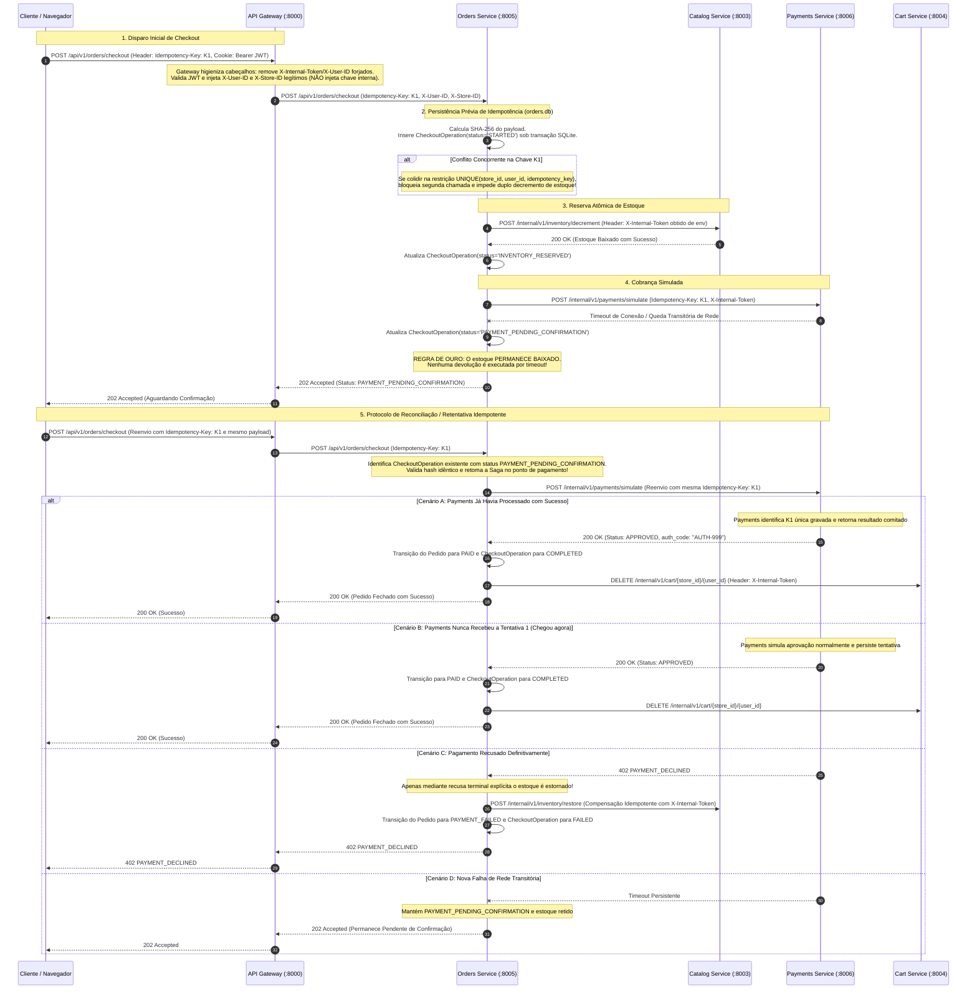

# VitrineFlex — Arquitetura em Camadas da Linha de Produto de Software

**Documento:** 02_LAYERED_ARCHITECTURE.md  
**Versão:** 1.1.3 (Homologação Final da Modelagem — Etapa 1.3)  
**Disciplina:** Tópicos em Engenharia de Software — Projetando Linhas de Produto de Software (UFAL 2026.2)  
**Artefato Editável Associado:** `docs/modeling/diagrams/layered-architecture.mmd`

---

## 1. Visão Geral e Princípios Arquiteturais

A arquitetura do **VitrineFlex** adota o estilo arquitetural de **Microsserviços Desacoplados com Camada de Borda (*Edge API Gateway*)**, combinado a uma **Arquitetura em Camadas Lógicas** no interior de cada subsistema.

### Princípios Norteadores:
1. **Database-per-Service:** Nenhum microsserviço acessa direta ou indiretamente as tabelas de outro serviço. Toda troca de dados ocorre via contratos REST.
2. **Gateway como Único Ponto de Entrada Externo:** Apenas o API Gateway (porta `8000`) recebe requisições vindas da interface SPA. Os microsserviços de negócio comunicam-se de forma direta apenas internamente na rede privada Docker.
3. **Segurança e Higienização de Cabeçalhos Internos (ADR-007):**
   - **Remoção de Forjamento pelo Gateway:** O API Gateway remove sumariamente qualquer cabeçalho interno enviado pelo cliente (`X-Internal-Token`, `X-User-ID`, `X-User-Role`).
   - **Não-Injeção Indiscriminada de Segredo:** O API Gateway **NÃO** injeta `INTERNAL_SERVICE_KEY` em requisições públicas normais encaminhadas aos microsserviços; ele injeta unicamente a identidade autenticada confiável decodificada do JWT (`X-User-ID`, `X-User-Role`), o contexto de loja (`X-Store-ID`) e o trace (`X-Request-ID`).
   - **Isolamento de Segredo nos Microsserviços:** Cada microsserviço obtém a chave compartilhada `INTERNAL_SERVICE_KEY` de sua própria variável de ambiente (`os.environ["INTERNAL_SERVICE_KEY"]`).
   - **Anexação Restrita a Chamadas Internas:** Os clientes HTTP internos dos microsserviços anexam o cabeçalho `X-Internal-Token: <INTERNAL_SERVICE_KEY>` **exclusivamente** em chamadas serviço-a-serviço direcionadas a endpoints privados sob o prefixo `/internal/v1/*`.
   - **Sigilo Total:** O segredo `INTERNAL_SERVICE_KEY` nunca é exposto ao frontend ou retornado em respostas de API.
4. **Composição em Tempo de Execução Guiada por Manifesto:** O frontend carrega o manifesto em `/loja/{slug}` e monta a interface dinamicamente através de pontos de extensão (*extension points*).
5. **Isolamento Lógico Multitenant:** Todas as operações comerciais e de persistência exigem escopo de `store_id`.

---

## 2. Diagrama da Arquitetura em Camadas

```mermaid
flowchart TB
    %% ==========================================
    %% VITRINEFLEX — ARQUITETURA EM CAMADAS v1.1.3
    %% ==========================================

    subgraph L1["1. Camada de Apresentação (SPA React + TypeScript — Porta 5173)"]
        direction TB
        subgraph SHELL["Storefront Shell Comum & Layout"]
            HEADER["StoreHeader / SearchBar / CartBadge"]
            NAV["CategoryNavigation / Breadcrumbs"]
            FOOTER["StoreFooter / ServiceDiagnosticsBadge"]
        end
        subgraph COMPS["Componentes Reutilizáveis de Comércio"]
            PCARD["ProductCard"]
            PGRID["ProductGrid"]
            CART_D["CartDrawer"]
            CHK_STEP["CheckoutSteps"]
            REC_CAR["RecommendationCarousel"]
        end
        subgraph EXT_POINTS["Pontos de Extensão Variáveis (Extension Points)"]
            FASH_VAR["FashionVariantSelector (Moda)"]
            TECH_SPEC["TechnicalSpecificationsTable (Tech)"]
            BOOK_META["BookMetadataPanel (Livros)"]
            COMP_SLOT["ProductComparisonSlot (Tech)"]
            FAV_SLOT["FavoritesSlot (Todos)"]
        end
    end

    subgraph L2["2. Camada de Borda e Roteamento (API Gateway FastAPI — Porta 8000)"]
        direction TB
        GW_CORE["Roteador Reverso por Prefixos Determinísticos (/api/v1/*)"]
        GW_SEC["Sanitização: Remove X-Internal-Token & Cabeçalhos Forjados pelo Navegador"]
        GW_AUTH["Validação JWT & Injeção de Identidade Confiável (X-User-ID, X-User-Role)"]
        GW_CTX["Validação de Formato UUID de X-Store-ID & Injeção de X-Request-ID"]
        GW_HLTH["Endpoint Agregador de Estado dos Serviços (/api/v1/system/services)"]
    end

    subgraph L5["5. Camada de Engenharia de Domínio da LPS"]
        direction TB
        LPS_SVC["LPS Configuration Service (:8002)"]
        FM_ENGINE["Motor de Validação do Feature Model (XOR, OR, Requires, Excludes)"]
        MANIFEST_REG["Gerador & Repositório de ProductManifest Versionado"]
        LPS_DB[(lps.db — SQLite WAL)]
        LPS_SVC --- FM_ENGINE
        LPS_SVC --- MANIFEST_REG
        LPS_SVC --> LPS_DB
    end

    subgraph L3["3. Camada de Aplicação e Negócio (Microsserviços Autônomos FastAPI)"]
        direction TB
        AUTH["Auth Service (:8001)\nUsuários, JWT, Perfis, Interesses"]
        CATALOG["Catalog Service (:8003)\nProdutos, Variantes, Atributos, Estoque, Favoritos"]
        CART["Cart Service (:8004)\nCarrinhos e Itens (user_id, store_id)"]
        ORDERS["Orders Service (:8005)\nSaga Checkout, Idempotência, Pedidos"]
        PAYMENTS["Payments Service (:8006)\nSimulador de Pagamentos (PIX, Card, Boleto)"]
        SHIPPING["Shipping Service (:8007)\nCálculo Simulado de Frete & Retirada"]
        REC["Recommendation Service (:8008)\nRanking Explicável, Afinidade, Cold Start"]

        subgraph PKG["Pacote Compartilhado: packages/python-common"]
            COMMON_CACHE["FeatureManifestProvider (Cache TTL 30s)"]
            COMMON_SEC["Validador X-Internal-Token & SecurityContext"]
            COMMON_DB["DatabaseEngineFactory (SQLite WAL busy_timeout=5000)"]
            COMMON_ERR["Formato Padronizado APIErrorResponse"]
        end
    end

    subgraph L4["4. Camada de Persistência (Database-per-Service — SQLite WAL)"]
        direction TB
        DB_AUTH[(auth.db)]
        DB_CAT[(catalog.db)]
        DB_CART[(cart.db)]
        DB_ORD[(orders.db)]
        DB_PAY[(payments.db)]
        DB_SHIP[(shipping.db)]
        DB_REC[(recommendations.db)]
    end

    %% Conexões entre Apresentação e Gateway
    SHELL -->|HTTP / JSON com X-Store-ID| GW_CORE
    COMPS -->|HTTP / JSON com X-Store-ID| GW_CORE
    EXT_POINTS -->|HTTP / JSON com X-Store-ID| GW_CORE

    %% Inicialização da LPS
    SHELL -.->|1. GET /api/v1/lps/stores/:slug/manifest| GW_CORE
    GW_CORE -.->|Encaminha /api/v1/lps/*| LPS_SVC

    %% Roteamento do Gateway para Microsserviços
    GW_CORE -->|/api/v1/auth/*| AUTH
    GW_CORE -->|/api/v1/catalog/*| CATALOG
    GW_CORE -->|/api/v1/cart/*| CART
    GW_CORE -->|/api/v1/orders/*| ORDERS
    GW_CORE -->|/api/v1/shipping/*| SHIPPING
    GW_CORE -->|/api/v1/recommendations/* & /interactions| REC

    %% Comunicações Internas Serviço-a-Serviço (via rede Docker privada com X-Internal-Token)
    ORDERS -->|GET /internal/v1/cart/:store_id/:user_id| CART
    ORDERS -->|DELETE /internal/v1/cart/:store_id/:user_id| CART
    ORDERS -->|POST /internal/v1/inventory/decrement| CATALOG
    ORDERS -->|POST /internal/v1/inventory/restore| CATALOG
    ORDERS -->|POST /internal/v1/payments/simulate| PAYMENTS
    ORDERS -->|POST /internal/v1/recommendations/interactions| REC
    CART -->|GET /internal/v1/catalog/products/:id| CATALOG
    REC -->|GET /internal/v1/catalog/stores/:id/products/active| CATALOG
    REC -->|GET /internal/v1/auth/users/:id/preferences| AUTH

    %% Consultas de Manifesto para Validação de Features/Opções (com Cache TTL 30s)
    CATALOG -->|GET /internal/v1/lps/stores/:id/manifest| LPS_SVC
    ORDERS -->|GET /internal/v1/lps/stores/:id/manifest| LPS_SVC
    PAYMENTS -->|GET /internal/v1/lps/stores/:id/manifest| LPS_SVC
    SHIPPING -->|GET /internal/v1/lps/stores/:id/manifest| LPS_SVC
    CART -->|GET /internal/v1/lps/stores/:id/manifest| LPS_SVC

    %% Ligação dos Microsserviços aos seus Bancos Isolados
    AUTH --> DB_AUTH
    CATALOG --> DB_CAT
    CART --> DB_CART
    ORDERS --> DB_ORD
    PAYMENTS --> DB_PAY
    SHIPPING --> DB_SHIP
    REC --> DB_REC

    %% Injeção de componentes de python-common
    PKG -.-> AUTH
    PKG -.-> CATALOG
    PKG -.-> CART
    PKG -.-> ORDERS
    PKG -.-> PAYMENTS
    PKG -.-> SHIPPING
    PKG -.-> REC
    PKG -.-> LPS_SVC
```



---

## 3. Especificação Completa dos Contratos de Comunicação

### 3.1 Contrato Interno: Validação de Carrinho (`Cart Service` $\rightarrow$ `Catalog Service`)
- **Operação:** `GET /internal/v1/catalog/products/{product_id}`
- **Finalidade:** O `Cart Service` consulta se o produto está ativo, seu preço atual e existência no catálogo da loja antes de inseri-lo ou alterá-lo no carrinho.
- **Protocolo & Rede:** HTTP/JSON síncrono via rede Docker privada (`http://catalog-service:8003`).
- **Autenticação & Headers Obrigatórios:**
  - `X-Internal-Token: {INTERNAL_SERVICE_KEY}` (Segredo compartilhado entre microsserviços).
  - `X-Store-ID: {UUID}` (Contexto da loja ativa).
  - `X-Request-ID: {UUID}` (Tracing distribuído).
- **Parâmetros de Path:** `product_id` (UUID do produto).
- **Payload de Requisição:** Nenhum (requisição GET).
- **Resposta de Sucesso (`200 OK`):**
  ```json
  {
    "id": "prod-101",
    "store_id": "store-moda-1",
    "name": "Camiseta Algodão Básica",
    "price": 79.90,
    "active": true,
    "has_variants": true,
    "variants": [
      {"id": "var-1", "sku": "CAM-AZUL-M", "price_override": null, "stock": 15}
    ]
  }
  ```
- **Tratamento de Erros:**
  - `400 STORE_CONTEXT_REQUIRED`: Se `X-Store-ID` estiver ausente.
  - `403 INVALID_INTERNAL_TOKEN`: Se `X-Internal-Token` for inválido ou omitido.
  - `404 NOT_FOUND`: Produto inexistente ou inativo na loja especificada.

---

### 3.2 Contrato Interno: Candidatos de Recomendação (`Recommendation` $\rightarrow$ `Catalog`)
- **Operação:** `GET /internal/v1/catalog/stores/{store_id}/products/active`
- **Finalidade:** O `Recommendation Service` obtém a listagem de produtos ativos com estoque e categoria para calcular a pontuação de afinidade do usuário.
- **Protocolo & Rede:** HTTP/JSON via rede privada (`http://catalog-service:8003`).
- **Autenticação & Headers Obrigatórios:**
  - `X-Internal-Token: {INTERNAL_SERVICE_KEY}`
  - `X-Store-ID: {store_id}`
  - `X-Request-ID: {UUID}`
- **Parâmetros de Query:** `limit=50&category_id={UUID}` (opcionais para paginação/filtro).
- **Resposta de Sucesso (`200 OK`):**
  ```json
  {
    "store_id": "store-tech-2",
    "total": 35,
    "items": [
      {
        "id": "prod-201",
        "name": "Notebook Gamer Pro 16",
        "category_id": "cat-notebooks",
        "price": 6499.00,
        "available_stock": 8,
        "popularity_score": 0.85
      }
    ]
  }
  ```
- **Tratamento de Erros:**
  - `403 INVALID_INTERNAL_TOKEN`: Token interno ausente ou incorreto.
  - `404 STORE_NOT_FOUND`: Loja não encontrada no catálogo.

---

### 3.3 Contratos Públicos: Gestão de Favoritos (`Catalog Service`)
Funcionalidade opcional transversal suportada no MVP, protegida pelo middleware de feature (`ADR-004`).

#### 3.3.1 Listar Favoritos do Cliente
- **Operação:** `GET /api/v1/catalog/favorites`
- **Headers:** `Authorization: Bearer <JWT>`, `X-Store-ID: {UUID}`.
- **Resposta (`200 OK`):** Lista de produtos favoritados pelo cliente autenticado naquela loja.
- **Erros:** `401 Unauthorized` (não logado); `403 FEATURE_NOT_ENABLED` (se `favorites: false` na loja).

#### 3.3.2 Adicionar Produto aos Favoritos
- **Operação:** `POST /api/v1/catalog/favorites`
- **Headers:** `Authorization: Bearer <JWT>`, `X-Store-ID: {UUID}`.
- **Payload:** `{ "product_id": "prod-101" }`.
- **Resposta (`201 Created`):** `{ "message": "Produto favoritado com sucesso.", "product_id": "prod-101" }`.
- **Efeito Colateral:** O Catalog Service envia notificação interna para o `Recommendation Service` registrando o evento `FAVORITE`.
- **Erros:** `401 Unauthorized`; `403 FEATURE_NOT_ENABLED`; `404 NOT_FOUND` (produto inexistente).

#### 3.3.3 Remover Produto dos Favoritos
- **Operação:** `DELETE /api/v1/catalog/favorites/{product_id}`
- **Headers:** `Authorization: Bearer <JWT>`, `X-Store-ID: {UUID}`.
- **Resposta (`200 OK`):** `{ "message": "Produto desfavoritado com sucesso." }`.
- **Efeito Colateral:** Notifica o Recommendation com evento `UNFAVORITE`.
- **Erros:** `401 Unauthorized`; `403 FEATURE_NOT_ENABLED`.

---

### 3.4 Contrato Público: Comparação de Produtos (`Catalog Service`)
- **Operação:** `GET /api/v1/catalog/products/compare`
- **Parâmetros de Query:** `product_ids=id1,id2,id3` (mínimo 2, máximo 4 IDs).
- **Headers:** `X-Store-ID: {UUID}`.
- **Autenticação:** Aberta a visitantes e clientes na vitrine.
- **Validação de LPS Obrigatória:**
  1. O Catalog consulta o manifesto da loja ativa via `FeatureManifestProvider`.
  2. Se `manifest.store.segment != "TECH"` $\rightarrow$ retorna `422 INVALID_FEATURE_CONFIGURATION`.
  3. Se `manifest.features.product_comparison != True` $\rightarrow$ retorna `403 FEATURE_NOT_ENABLED`.
- **Resposta de Sucesso (`200 OK`):**
  ```json
  {
    "segment": "TECH",
    "compared_products": [
      {
        "id": "prod-201",
        "name": "Notebook Gamer Pro",
        "price": 6499.00,
        "attributes": {
          "processor": "Intel Core i7-13700H",
          "ram": "16GB DDR5",
          "gpu": "RTX 4060 8GB",
          "storage": "1TB SSD NVMe",
          "warranty_months": 24
        }
      },
      {
        "id": "prod-202",
        "name": "Ultrabook Slim 14",
        "price": 5299.00,
        "attributes": {
          "processor": "AMD Ryzen 7 7840U",
          "ram": "16GB LPDDR5",
          "gpu": "Radeon 780M Integrada",
          "storage": "512GB SSD NVMe",
          "warranty_months": 12
        }
      }
    ]
  }
  ```
- **Tratamento de Erros:**
  - `400 BAD_REQUEST`: Menos de 2 produtos informados.
  - `403 FEATURE_NOT_ENABLED`: Feature desligada no manifesto.
  - `422 INVALID_FEATURE_CONFIGURATION`: Segmento da loja incompatível com comparação.

---

## 4. Orquestração da Saga de Checkout, Idempotência e Protocolo de Timeout

A orquestração do checkout executada pelo `Orders Service` segue o padrão **Saga com Compensação Síncrona e Idempotência Rigorosa (ADR-003)**. Não são introduzidas filas ou sistemas de cache distribuído (como RabbitMQ ou Redis); a consistência e o controle de concorrência são assegurados através de entidades persistentes no SQLite WAL com transações imediatas (`BEGIN IMMEDIATE`).

---

### 4.1 Entidade Persistente `CheckoutOperation` no Orders Service

Para garantir que nenhuma requisição duplicada ou concorrente execute efeitos colaterais repetidos, o `Orders Service` formaliza a entidade `CheckoutOperation` na tabela `checkout_operations` de `orders.db`:

#### 4.1.1 Esquema Relacional de `checkout_operations`:
```sql
CREATE TABLE checkout_operations (
    id VARCHAR(36) PRIMARY KEY,
    store_id VARCHAR(36) NOT NULL,
    user_id VARCHAR(36) NOT NULL,
    idempotency_key VARCHAR(255) NOT NULL,
    request_payload_hash VARCHAR(64) NOT NULL, -- Hash SHA-256 do corpo JSON recebido
    order_id VARCHAR(36) NULL,                 -- Associado após a emissão do pedido
    saga_status VARCHAR(32) NOT NULL,          -- STARTED, INVENTORY_RESERVED, PAYMENT_PENDING_CONFIRMATION, COMPLETED, FAILED
    created_at TIMESTAMP NOT NULL DEFAULT CURRENT_TIMESTAMP,
    updated_at TIMESTAMP NOT NULL DEFAULT CURRENT_TIMESTAMP,
    CONSTRAINT uq_checkout_op UNIQUE (store_id, user_id, idempotency_key)
);
CREATE INDEX idx_checkout_op_lookup ON checkout_operations(store_id, user_id, idempotency_key);
```

#### 4.1.2 Regras de Idempotência e Tratamento de Concorrência em Orders:
1. **Persistência Prévia Obrigatória:** Antes de executar qualquer efeito colateral (antes de consultar carrinho ou decrementar estoque), o serviço calcula o SHA-256 do payload recebido e inicia uma transação `BEGIN IMMEDIATE` para inserir a `CheckoutOperation` com status `STARTED`.
2. **Mesmo Identificador e Mesmo Payload Hash:**
   - Se a operação já existe com o mesmo hash e status `COMPLETED`: recupera e retorna imediatamente o pedido gravado com status HTTP `200 OK`, sem tocar no estoque ou chamar serviços externos.
   - Se já existe com status `FAILED`: retorna o erro terminal registrado originalmente.
   - Se estiver em andamento (`STARTED`, `INVENTORY_RESERVED` ou `PAYMENT_PENDING_CONFIRMATION`): retoma a Saga existente no ponto em que parou, prevenindo duplicação de reservas.
3. **Mesmo Identificador e Payload Hash Divergente:** Se a chave é idêntica mas o payload hash é diferente (ex.: itens, endereço ou valor alterados), o serviço rejeita sumariamente a operação com HTTP `409 IDEMPOTENCY_CONFLICT` sem alterar o banco ou acionar o Catálogo.
4. **Requisições Simultâneas Concorrentes:** Se duas requisições paralelas chegarem com a mesma chave e mesmo payload no mesmo milissegundo:
   - A primeira requisição obtém o lock de escrita do SQLite WAL e insere o registro com sucesso.
   - A segunda requisição intercepta o erro de colisão `UNIQUE constraint failed: checkout_operations.store_id, checkout_operations.user_id, checkout_operations.idempotency_key`. O serviço captura a exceção e aguarda a conclusão da operação em andamento, **impedindo estritamente a execução de dois decrementos de estoque**.

---

### 4.2 Entidade Persistente `PaymentAttempt` no Payments Service

O `Payments Service` gerencia a idempotência de simulação de cobrança na tabela `payment_attempts` em `payments.db`:

#### 4.2.1 Esquema Relacional de `payment_attempts`:
```sql
CREATE TABLE payment_attempts (
    id VARCHAR(36) PRIMARY KEY,
    store_id VARCHAR(36) NOT NULL,
    idempotency_key VARCHAR(255) NOT NULL,
    request_payload_hash VARCHAR(64) NOT NULL,
    amount DECIMAL(10, 2) NOT NULL,
    payment_method VARCHAR(32) NOT NULL,       -- PIX, CARD, BOLETO
    status VARCHAR(32) NOT NULL,               -- APPROVED, DECLINED
    authorization_code VARCHAR(64) NULL,
    created_at TIMESTAMP NOT NULL DEFAULT CURRENT_TIMESTAMP,
    CONSTRAINT uq_payment_attempt UNIQUE (store_id, idempotency_key)
);
```

#### 4.2.2 Regras de Idempotência e Concorrência em Payments:
1. **Verificação de Chave:** Em `POST /internal/v1/payments/simulate`, verifica se já existe registro para `(store_id, idempotency_key)`.
2. **Mesma Chave e Mesmo Payload:** Retorna o resultado já persistido (`APPROVED` ou `DECLINED`) com HTTP `200 OK`, sem recalcular a simulação.
3. **Mesma Chave e Payload Diferente:** Emite HTTP `409 IDEMPOTENCY_CONFLICT`.
4. **Duas Requisições Simultâneas:** Em concorrência perfeita, a transação SQLite `BEGIN IMMEDIATE` garante que apenas uma inserção seja executada. A colisão de chave única é capturada, fazendo com que a segunda chamada retorne o resultado da primeira que acabou de ser comitada.

---

### 4.3 O Problema da Incerteza de Timeout e Rejeição de 404 Precoce

Em uma chamada HTTP com timeout ou falha de socket entre `Orders` e `Payments`:
- O request de pagamento pode ter chegado ao `Payments Service` e sido processado com sucesso, mas a resposta de confirmação foi perdida na rede.
- Uma consulta imediata subsequente que recebesse `404 NOT_FOUND` **NÃO PODE provocar a devolução do estoque**, pois o request original pode estar em trânsito lento ou aguardando gravação no banco. Devolver o estoque prematuramente geraria *overbooking* (duas pessoas comprando o mesmo item).

---

### 4.4 Protocolo Seguro da Saga e Diagrama de Sequência

O diagrama abaixo detalha a orquestração segura com higienização de borda no Gateway, persistência prévia da `CheckoutOperation` e retomada da Saga em cenários de incerteza de rede:



---

### 4.5 Garantias Formais de Engenharia:
1. **Prevenção de Duplo Decremento de Estoque:** `CheckoutOperation` persistida antes da chamada ao Catálogo e protegida por `UNIQUE(store_id, user_id, idempotency_key)` impede qualquer concorrência de checkout de disparar baixas duplicadas.
2. **Proibição de Cobrança Duplicada:** No `Payments Service`, a tabela `payment_attempts` garante atomicidade e unicidade via `(store_id, idempotency_key)`.
3. **Não Liberação Prematura de Estoque:** Enquanto o estado for `PAYMENT_PENDING_CONFIRMATION`, o estoque permanece reservado no Catálogo.
4. **Compensação Estrita após Falha Terminal:** O Catálogo só recebe ordem de restauração (`/internal/v1/inventory/restore`) quando o Payments responder expressamente com código de recusa (`PAYMENT_DECLINED`).
5. **Reconciliação Administrativa:** Se o cliente não reenviar a requisição, o endpoint interno protegido no Orders (`POST /internal/v1/orders/{order_id}/reconcile`) pode ser disparado para sincronização determinística.
