# VitrineFlex — Modelo de Variabilidade da Linha de Produto de Software

**Documento:** 03_VARIABILITY_MODEL.md  
**Versão:** 1.1.3 (Homologação Final da Modelagem — Etapa 1.3)  
**Disciplina:** Tópicos em Engenharia de Software — Projetando Linhas de Produto de Software (UFAL 2026.2)  
**Artefato Editável Associado:** `docs/modeling/diagrams/variability.mmd`

---

## 1. Visão Geral do Modelo de Variabilidade

O modelo de variabilidade do **VitrineFlex** formaliza os mecanismos que permitem a especialização dos produtos derivados a partir do núcleo comum da plataforma (`store_core`). Na Engenharia de Linhas de Produto de Software (LPS), a variabilidade descreve **onde** o sistema pode mudar (*Pontos de Variação - Variation Points*), **quais** escolhas estão disponíveis (*Variantes - Variants*), **quando** a decisão é tomada (*Binding Time*) e **como** a escolha impacta as diferentes camadas do software (Interface, Regras de Negócio e Persistência).

### Tempo de Vinculação (*Binding Time*):
O VitrineFlex adota vinculação em **Tempo de Execução (*Runtime Binding*)**. A derivação não gera arquivos-fonte nem recompila imagens Docker; em vez disso, a composição de componentes e o comportamento dos microsserviços são configurados dinamicamente com base no `ProductManifest` versionado da loja ativa.

---

## 2. Diagrama de Mapeamento de Variabilidade

O diagrama abaixo ilustra o fluxo que liga os Pontos de Variação às suas Variantes e ao impacto concreto gerado na Interface, no Backend e na Persistência:

```mermaid
flowchart LR
    %% ==========================================
    %% VITRINEFLEX — MODELO DE VARIABILIDADE (v1.1.3)
    %% Mapeamento entre Pontos de Variação, Variantes e Camadas Afetadas
    %% ==========================================

    subgraph VP["Pontos de Variação (VP)"]
        VP1["VP-01: Atributos & Detalhes do Segmento\n[Mandatory — 1 de N]"]
        VP2["VP-02: Mecanismo de Comparação\n[Optional — 0..1 (Exclusiva TECH)]"]
        VP3["VP-03: Lista de Favoritos\n[Optional — 0..1 (Transversal)]"]
        VP4["VP-04: Meios de Pagamento\n[Mandatory Alternative — 1..N]"]
        VP5["VP-05: Modalidades de Atendimento\n[Mandatory Alternative — 1..N]"]
        VP6["VP-06: Identidade Visual & Tema\n[Mandatory Parametric]"]
    end

    subgraph VARIANTS["Variantes Disponíveis"]
        %% Variantes VP1
        VAR_FASHION["Variante Moda:\nGrade Tamanhos, Cores, SKU"]
        VAR_TECH["Variante Tech:\nEspecificações Técnicas, Garantia"]
        VAR_BOOKS["Variante Livros:\nISBN, Autor, Editora, Gênero"]

        %% Variantes VP2
        VAR_COMP_ON["Comparador Ativo\n(Exclusivo TECH)"]
        VAR_COMP_OFF["Comparador Desativado"]

        %% Variantes VP3
        VAR_FAV_ON["Favoritos Ativo\n(Todos os Segmentos)"]
        VAR_FAV_OFF["Favoritos Desativado"]

        %% Variantes VP4
        VAR_PIX["Adaptador PIX Simulado"]
        VAR_CARD["Adaptador Cartão Simulado"]
        VAR_BOLETO["Adaptador Boleto Simulado"]

        %% Variantes VP5
        VAR_DELIV["Adaptador Entrega Domicílio"]
        VAR_PICK["Adaptador Retirada Local"]

        %% Variantes VP6
        VAR_THEME["Paleta de Cores & CSS Variables"]
    end

    subgraph IMPACT_UI["Impacto na Interface (Frontend React)"]
        UI_PCARD["ProductCard (Reutilizado com badges condicionais)"]
        UI_DETAIL["ProductDetailPage (Slot de Atributos)"]
        UI_FASH["FashionVariantSelector.tsx"]
        UI_TECH["TechnicalSpecificationsTable.tsx"]
        UI_BOOKS["BookMetadataPanel.tsx"]
        UI_COMP["ProductComparisonDrawer.tsx & CompareButton"]
        UI_FAV["FavoriteToggleButton.tsx & FavoritesPage"]
        UI_PAY["PaymentMethodSelector.tsx"]
        UI_SHIP["ShippingMethodSelector.tsx"]
    end

    subgraph IMPACT_BE["Impacto em Regras de Negócio (Microsserviços)"]
        BE_VAL["LPS Config: Validador de Regras Cross-tree"]
        BE_CAT["Catalog: Validação de Atributos Tipados por Segmento"]
        BE_COMP["Catalog: Rota GET /products/compare (Guarda 403)"]
        BE_FAV["Catalog: Rotas /favorites (Guarda 403)"]
        BE_PAY["Payments: Validação do Método no Manifesto da Loja"]
        BE_SHIP["Shipping: Cálculo de Frete / Retirada no Manifesto"]
    end

    subgraph IMPACT_DATA["Impacto na Persistência (SQLite)"]
        DB_ATTR["catalog.db: product_attributes (JSON/EAV por segmento)"]
        DB_VAR["catalog.db: product_variants (SKU, tamanho, cor)"]
        DB_FAV["catalog.db: product_favorites (user_id, product_id)"]
        DB_PAY_ATT["payments.db: payment_attempts (payment_method)"]
        DB_SHIP_CFG["shipping.db: shipping_methods (method_type)"]
        DB_MAN["lps.db: product_manifests (features JSON, theme)"]
    end

    %% Ligações VP -> Variantes
    VP1 --> VAR_FASHION
    VP1 --> VAR_TECH
    VP1 --> VAR_BOOKS

    VP2 --> VAR_COMP_ON
    VP2 --> VAR_COMP_OFF

    VP3 --> VAR_FAV_ON
    VP3 --> VAR_FAV_OFF

    VP4 --> VAR_PIX
    VP4 --> VAR_CARD
    VP4 --> VAR_BOLETO

    VP5 --> VAR_DELIV
    VP5 --> VAR_PICK

    VP6 --> VAR_THEME

    %% Ligações Variantes -> UI
    VAR_FASHION --> UI_FASH
    VAR_TECH --> UI_TECH
    VAR_BOOKS --> UI_BOOKS
    VAR_COMP_ON --> UI_COMP
    VAR_FAV_ON --> UI_FAV
    VAR_PIX --> UI_PAY
    VAR_CARD --> UI_PAY
    VAR_BOLETO --> UI_PAY
    VAR_DELIV --> UI_SHIP
    VAR_PICK --> UI_SHIP
    VAR_THEME --> UI_PCARD

    %% Ligações Variantes -> Backend
    VAR_FASHION --> BE_CAT
    VAR_TECH --> BE_CAT
    VAR_BOOKS --> BE_CAT
    VAR_COMP_ON --> BE_COMP
    VAR_FAV_ON --> BE_FAV
    VAR_PIX --> BE_PAY
    VAR_CARD --> BE_PAY
    VAR_BOLETO --> BE_PAY
    VAR_DELIV --> BE_SHIP
    VAR_PICK --> BE_SHIP

    %% Ligações Variantes -> Dados
    VAR_FASHION --> DB_VAR
    VAR_TECH --> DB_ATTR
    VAR_BOOKS --> DB_ATTR
    VAR_FAV_ON --> DB_FAV
    VAR_PIX --> DB_PAY_ATT
    VAR_CARD --> DB_PAY_ATT
    VAR_BOLETO --> DB_PAY_ATT
    VAR_DELIV --> DB_SHIP_CFG
    VAR_PICK --> DB_SHIP_CFG
    VAR_THEME --> DB_MAN

    %% Estilos
    classDef vpStyle fill:#1e3a8a,stroke:#3b82f6,stroke-width:2px,color:#ffffff;
    classDef varStyle fill:#0f766e,stroke:#14b8a6,stroke-width:2px,color:#ffffff;
    classDef uiStyle fill:#431407,stroke:#f97316,stroke-width:1px,color:#ffffff;
    classDef beStyle fill:#312e81,stroke:#818cf8,stroke-width:1px,color:#ffffff;
    classDef dbStyle fill:#064e3b,stroke:#22c55e,stroke-width:1px,color:#ffffff;

    class VP1,VP2,VP3,VP4,VP5,VP6 vpStyle;
    class VAR_FASHION,VAR_TECH,VAR_BOOKS,VAR_COMP_ON,VAR_COMP_OFF,VAR_FAV_ON,VAR_FAV_OFF,VAR_PIX,VAR_CARD,VAR_BOLETO,VAR_DELIV,VAR_PICK,VAR_THEME varStyle;
    class UI_PCARD,UI_DETAIL,UI_FASH,UI_TECH,UI_BOOKS,UI_COMP,UI_FAV,UI_PAY,UI_SHIP uiStyle;
    class BE_VAL,BE_CAT,BE_COMP,BE_FAV,BE_PAY,BE_SHIP beStyle;
    class DB_ATTR,DB_VAR,DB_FAV,DB_PAY_ATT,DB_SHIP_CFG,DB_MAN dbStyle;
```

---

## 3. Especificação Detalhada dos Pontos de Variação (VP)

### VP-01: Atributos e Detalhes Específicos do Segmento
- **Tipo de Variabilidade:** Obrigatória Alternativa (*XOR — exatamente 1*).
- **Variantes Suportadas:**
  1. `VAR_FASHION`: Grade de tamanhos, variações de cor e gestão de SKU por variante.
  2. `VAR_TECH`: Ficha técnica tabular com especificações de hardware/processamento e prazos de garantia.
  3. `VAR_BOOKS`: Ficha bibliográfica catalográfica (ISBN, autores, editora, gênero literário e edição).
- **Impacto Tridimensional:**
  - *Interface (UI):* A página de detalhes do produto (`ProductDetailPage`) define um Ponto de Extensão (`ProductAttributesSlot`). Se `segment == 'FASHION'`, renderiza `FashionVariantSelector.tsx`; se `TECH`, renderiza `TechnicalSpecificationsTable.tsx`; se `BOOKS`, renderiza `BookMetadataPanel.tsx`.
  - *Regras de Negócio (Backend):* O `Catalog Service` possui validadores Pydantic polimórficos (`FashionProductSchema`, `TechProductSchema`, `BookProductSchema`) que rejeitam produtos com campos ausentes ou incongruentes com o segmento da loja.
  - *Persistência (Dados):* O banco `catalog.db` armazena variantes físicas na tabela `product_variants` (para Moda) e atributos tabulares no formato estruturado na tabela `product_attributes` (para Tech e Livros).

### VP-02: Comparador de Produtos (*Product Comparison*)
- **Tipo de Variabilidade:** Opcional (*Optional — 0..1*).
- **Condição de Ativação:** Permitido **exclusivamente** no segmento `TECH` (`CTC-02`). Sem duplicação no modelo conceitual.
- **Variantes Suportadas:**
  1. `VAR_COMP_ON`: Comparador ativado. Permite selecionar até 4 produtos de tecnologia e visualizá-los lado a lado em uma matriz de especificações.
  2. `VAR_COMP_OFF`: Comparador desativado. Nenhuma opção de comparação é visível ou executável.
- **Impacto Tridimensional:**
  - *Interface (UI):* Injeta o botão `AddToCompareButton.tsx` no `ProductCard` e na página de detalhes, além do drawer flutuante `ProductComparisonDrawer.tsx`.
  - *Regras de Negócio (Backend):* O endpoint `GET /api/v1/catalog/products/compare` possui middleware de guarda (ADR-004) que consulta o manifesto no cache local via `FeatureManifestProvider`. Se desabilitado, responde com `403 FEATURE_NOT_ENABLED`.
  - *Persistência (Dados):* Consome os atributos já persistidos na tabela `product_attributes`.

### VP-03: Lista de Produtos Favoritos (*Favorites*)
- **Tipo de Variabilidade:** Opcional Transversal (*Optional — 0..1*).
- **Condição de Ativação:** Aplicável a qualquer segmento, exige cliente autenticado (`CTC-05`).
- **Variantes Suportadas:**
  1. `VAR_FAV_ON`: Ícone de coração no `ProductCard`, página dedicada "Meus Favoritos", envio de eventos de preferência ao `Recommendation Service`.
  2. `VAR_FAV_OFF`: Ícone ocultado; rota `/favoritos` desativada no React Router; tentativas de chamada direta à API rejeitadas com HTTP `403 FEATURE_NOT_ENABLED`.
- **Impacto Tridimensional:**
  - *Interface (UI):* Componente `FavoriteHeartButton.tsx` renderizado no slot do card e da página de detalhe.
  - *Regras de Negócio (Backend):* Rotas `/api/v1/catalog/favorites` protegidas por verificação de feature no `Catalog Service`. Bloqueio com status `403` se a feature estiver desativada na loja. Notificação interna ao `Recommendation Service` ao favoritar/desfavoritar (`UNFAVORITE`).
  - *Persistência (Dados):* Tabela `product_favorites` no `catalog.db` com unicidade sobre `(store_id, user_id, product_id)`.

### VP-04: Meios de Pagamento Disponíveis
- **Tipo de Variabilidade:** Alternativa Inclusiva (*OR — pelo menos 1*).
- **Variantes Suportadas:** `PIX Simulado`, `Cartão de Crédito Simulado`, `Boleto Bancário Simulado`. Métodos desconhecidos provocam rejeição na validação da loja e na simulação.
- **Impacto Tridimensional:**
  - *Interface (UI):* O componente `PaymentMethodSelector.tsx` no checkout renderiza abas/opções de pagamento apenas para os métodos habilitados no manifesto.
  - *Regras de Negócio (Backend):* O `Payments Service` consulta o manifesto via `FeatureManifestProvider`. Se o método solicitado não constar em `manifest.payment_methods`, recusa o processamento com `422 INVALID_PAYMENT_METHOD`.
  - *Persistência (Dados):* Tabela `payment_attempts` no `payments.db` persiste o método efetivamente utilizado.

### VP-05: Modalidades de Atendimento / Entrega
- **Tipo de Variabilidade:** Alternativa Inclusiva (*OR — pelo menos 1*).
- **Variantes Suportadas:** `Entrega em Domicílio (DELIVERY)`, `Retirada no Local (PICKUP)`.
- **Impacto Tridimensional:**
  - *Interface (UI):* O componente `ShippingMethodSelector.tsx` no checkout exibe campos de endereço/CEP apenas se a entrega estiver habilitada; caso apenas retirada esteja habilitada, exibe o endereço do ponto físico.
  - *Regras de Negócio (Backend):* O `Shipping Service` valida `manifest.fulfillment_modes` via `FeatureManifestProvider` antes de calcular a cotação simulada. Se incompatível, recusa com `422 INVALID_FULFILLMENT_MODE`.
  - *Persistência (Dados):* Tabela `shipping_methods` no `shipping.db` define os métodos e taxas cadastrados por loja.

### VP-06: Identidade Visual e Tema Paramétrico
- **Tipo de Variabilidade:** Paramétrica Obrigatória.
- **Variantes Suportadas:** Paletas de cores primárias/secundárias, logotipo e tipografia injetados via tokens CSS.
- **Impacto Tridimensional:**
  - *Interface (UI):* O `StorefrontShell` aplica variáveis CSS raiz (`--primary-color`, `--secondary-color`) baseadas no bloco `theme` do manifesto JSON, alterando botões, cabeçalhos e badges dinamicamente sem duplicação de CSS.
  - *Regras de Negócio (Backend):* O `LPS Configuration Service` valida se a cor é um código hexadecimal válido (`#RRGGBB`).
  - *Persistência (Dados):* Objeto JSON `theme` persistido no registro da loja em `lps.db`.

### VP-07: Guia de Medidas de Moda (*Fashion Size Guide*)
- **Tipo de Variabilidade:** Opcional Específico (*FASHION — 0..1*).
- **Condição de Ativação:** Permitido exclusivamente no segmento `FASHION` e requer `size_grid` (`CTC-14`).
- **Variantes Suportadas:** `VAR_SIZE_GUIDE_ON`, `VAR_SIZE_GUIDE_OFF`.

### VP-08: Filtros Técnicos Avançados (*Technical Filters*)
- **Tipo de Variabilidade:** Opcional Específico (*TECH — 0..1*).
- **Condição de Ativação:** Permitido exclusivamente no segmento `TECH` e requer `technical_specs` (`CTC-15`).
- **Variantes Suportadas:** `VAR_TECH_FILTERS_ON`, `VAR_TECH_FILTERS_OFF`.

### VP-09: Prévia Demonstrativa de Livros (*Book Preview*)
- **Tipo de Variabilidade:** Opcional Específico (*BOOKS — 0..1*).
- **Condição de Ativação:** Permitido exclusivamente no segmento `BOOKS` (`CTC-16`).
- **Variantes Suportadas:** `VAR_BOOK_PREVIEW_ON`, `VAR_BOOK_PREVIEW_OFF`.

### VP-10: Produtos Vistos Recentemente (*Recently Viewed*)
- **Tipo de Variabilidade:** Opcional Transversal (*0..1*).
- **Condição de Ativação:** Requer serviço de recomendações ativo (`CTC-17`).
- **Variantes Suportadas:** `VAR_RECENTLY_VIEWED_ON`, `VAR_RECENTLY_VIEWED_OFF`.

### VP-11: Alerta de Reposição de Estoque (*Back in Stock Alert*)
- **Tipo de Variabilidade:** Opcional Transversal (*0..1*).
- **Condição de Ativação:** Requer cliente autenticado e serviço de catálogo (`CTC-18`).
- **Variantes Suportadas:** `VAR_STOCK_ALERT_ON`, `VAR_STOCK_ALERT_OFF`.

---

## 4. Reúso de Ativos vs. Variantes: Análise Comparativa

| Componente | Classificação na LPS | Moda (Vitrine Moda) | Tecnologia (Vitrine Tech) | Livros (Vitrine Books) |
|---|:---:|:---:|:---:|:---:|
| `StorefrontShell` | **Core Asset (`store_core`)** | Reutilizado 100% | Reutilizado 100% | Reutilizado 100% |
| `ProductGrid` | **Core Asset (`store_core`)** | Reutilizado 100% | Reutilizado 100% | Reutilizado 100% |
| `ProductCard` | **Core Asset com Slots** | Exibe badge de variantes | Exibe botão comparar (se ativo) | Exibe nome do autor |
| `CartDrawer` | **Core Asset (`store_core`)** | Reutilizado 100% | Reutilizado 100% | Reutilizado 100% |
| `CheckoutStepper` | **Core Asset Adaptável** | Pagamento: PIX / Card | Pagamento: PIX / Card / Boleto | Pagamento: PIX / Boleto |
| `FashionVariantSelector` | **Variante de Segmento** | **Ativo** | *Ausente da árvore* | *Ausente da árvore* |
| `TechSpecificationsTable`| **Variante de Segmento** | *Ausente da árvore* | **Ativo** | *Ausente da árvore* |
| `BookMetadataPanel` | **Variante de Segmento** | *Ausente da árvore* | *Ausente da árvore* | **Ativo** |
| `ProductComparisonModal`| **Variante Opcional** | *Bloqueado no Backend* | **Ativo** | *Bloqueado no Backend* |
| `RecommendationCarousel`| **Core Asset (`store_core`)** | Recomenda roupas | Recomenda hardware | Recomenda livros |
