# VitrineFlex — Diagrama de Componentes de Software

**Documento:** 04_COMPONENT_DIAGRAM.md  
**Versão:** 1.1.3 (Homologação Final da Modelagem — Etapa 1.3)  
**Disciplina:** Tópicos em Engenharia de Software — Projetando Linhas de Produto de Software (UFAL 2026.2)  
**Artefato Editável Associado:** `docs/modeling/diagrams/component-diagram.puml`

---

## 1. Visão Geral dos Componentes de Software

O diagrama de componentes do **VitrineFlex** especifica a organização estrutural do monorepo, a modularização de código, as interfaces fornecidas (*provided interfaces*), as interfaces requeridas (*required interfaces*) e os contratos de comunicação entre subsistemas.

A modelagem segue estritamente os padrões:
1. **Database-per-Service:** Nenhum componente de backend acessa diretamente o banco de dados pertencente a outro componente.
2. **Separação de Rede e Visibilidade de Interfaces:**
   - **Interfaces Públicas:** Expostas pelo API Gateway na rota `/api/v1/*` para consumo do frontend.
   - **Interfaces Internas:** Endpoints privados sob `/internal/v1/*` acessíveis unicamente no interior da rede Docker privada, protegidos pelo cabeçalho `X-Internal-Token` (ADR-007).
3. **Regra Definitiva de Segurança e Tokens Internos:**
   - O API Gateway remove sumariamente qualquer cabeçalho interno enviado pelo cliente (`X-Internal-Token`, `X-User-ID`, `X-User-Role`).
   - O API Gateway **NÃO** injeta `INTERNAL_SERVICE_KEY` em requisições públicas normais; injeta unicamente a identidade decodificada do JWT (`X-User-ID`, `X-User-Role`), `X-Store-ID` e `X-Request-ID`.
   - Cada microsserviço obtém a chave compartilhada `INTERNAL_SERVICE_KEY` de sua variável de ambiente.
   - Os clientes HTTP internos dos microsserviços anexam `X-Internal-Token: <INTERNAL_SERVICE_KEY>` **exclusivamente** em chamadas serviço-a-serviço para `/internal/v1/*`.
   - O segredo nunca é exposto ao frontend.
4. **Encapsulamento de Infraestrutura em Pacote Técnico Compartilhado:** Utilitários de cache (`FeatureManifestProvider`), segurança (`SecurityContext`), banco de dados WAL (`DatabaseEngineFactory`) e formatação de erros (`APIErrorResponse`) são centralizados em `packages/python-common`.

---

## 2. Diagrama de Componentes (PlantUML)

```plantuml
@startuml
!theme plain
skinparam componentStyle uml2
skinparam linetype ortho
skinparam packageBackgroundColor #F8FAFC
skinparam packageBorderColor #64748B
skinparam componentBackgroundColor #FFFFFF
skinparam componentBorderColor #334155
skinparam databaseBackgroundColor #ECFDF5
skinparam databaseBorderColor #059669

title VitrineFlex — Diagrama de Componentes de Software v1.1.3 (PlantUML)

package "Cliente & Apresentação (apps/web)" {
  [Storefront Shell\n(React Router + Layout Comum)] as Shell
  [Common Commerce Components\n(ProductCard, ProductGrid, CartDrawer)] as CompsCommon
  [Segment Extension Components\n(FashionVariants, TechSpecs, BookMetadata)] as CompsSegment
  [Feature Slot Components\n(ProductComparison, Favorites)] as CompsFeatures
  [TanStack Query HTTP Client] as WebClient

  Shell --> CompsCommon
  Shell --> CompsSegment
  Shell --> CompsFeatures
  CompsCommon --> WebClient
  CompsSegment --> WebClient
  CompsFeatures --> WebClient
}

package "Camada de Borda (services/api-gateway)" {
  [API Gateway :8000\n(FastAPI Reverse Proxy)] as Gateway
  interface "HTTP /api/v1/*\n(Public API)" as GatewayAPI
  Gateway -up- GatewayAPI
  WebClient ..> GatewayAPI : "JSON over HTTP\n(Bearer JWT + X-Store-ID)"
}

package "Pacotes Compartilhados (packages/python-common)" {
  [FeatureManifestProvider\n(Cache TTL 30s)] as CacheProvider
  [SecurityContext\n(JWT & X-Internal-Token Validator)] as SecContext
  [DatabaseEngineFactory\n(SQLite WAL + busy_timeout=5000)] as DbFactory
  [APIErrorResponse Schema] as ErrSchema
}

package "Serviços de Domínio do Backend (FastAPI)" {

  package "LPS Configuration Service (:8002)" {
    [LPS Controller & Validator] as LPSComp
    database "lps.db" as DB_LPS
    interface "GET /api/v1/lps/stores/:slug/manifest" as LPS_PubAPI
    interface "GET /internal/v1/lps/stores/:id/manifest" as LPS_IntAPI
    LPSComp -up- LPS_PubAPI
    LPSComp -left- LPS_IntAPI
    LPSComp --> DB_LPS
  }

  package "Auth Service (:8001)" {
    [Auth & User Controller] as AuthComp
    database "auth.db" as DB_Auth
    interface "POST /api/v1/auth/login" as Auth_PubAPI
    interface "GET /internal/v1/auth/users/:id/preferences" as Auth_Pref_IntAPI
    AuthComp -up- Auth_PubAPI
    AuthComp -right- Auth_Pref_IntAPI
    AuthComp --> DB_Auth
  }

  package "Catalog Service (:8003)" {
    [Catalog & Inventory Controller] as CatalogComp
    database "catalog.db" as DB_Catalog
    interface "GET /api/v1/catalog/products" as Cat_PubAPI
    interface "GET, POST, DELETE /api/v1/catalog/favorites\n(Requer feature favorites: true)" as Cat_Fav_PubAPI
    interface "GET /api/v1/catalog/products/compare\n(Exclusivo TECH & product_comparison: true)" as Cat_Comp_PubAPI
    interface "GET /internal/v1/catalog/products/:id" as Cat_Prod_IntAPI
    interface "GET /internal/v1/catalog/stores/:id/products/active" as Cat_Active_IntAPI
    interface "POST /internal/v1/inventory/decrement" as Inv_DecAPI
    interface "POST /internal/v1/inventory/restore" as Inv_RestAPI
    CatalogComp -up- Cat_PubAPI
    CatalogComp -up- Cat_Fav_PubAPI
    CatalogComp -up- Cat_Comp_PubAPI
    CatalogComp -left- Inv_DecAPI
    CatalogComp -right- Inv_RestAPI
    CatalogComp -down- Cat_Prod_IntAPI
    CatalogComp -down- Cat_Active_IntAPI
    CatalogComp --> DB_Catalog
  }

  package "Cart Service (:8004)" {
    [Cart Controller] as CartComp
    database "cart.db" as DB_Cart
    interface "GET /api/v1/cart" as Cart_PubAPI
    interface "GET /internal/v1/cart/:store_id/:user_id" as Cart_Get_IntAPI
    interface "DELETE /internal/v1/cart/:store_id/:user_id" as Cart_Del_IntAPI
    CartComp -up- Cart_PubAPI
    CartComp -left- Cart_Get_IntAPI
    CartComp -right- Cart_Del_IntAPI
    CartComp --> DB_Cart
  }

  package "Orders Service (:8005)" {
    [Orders & Checkout Saga Controller\n(CheckoutOperation Idempotency)] as OrdersComp
    database "orders.db" as DB_Orders
    interface "POST /api/v1/orders/checkout\n(Header: Idempotency-Key)" as Orders_PubAPI
    OrdersComp -up- Orders_PubAPI
    OrdersComp --> DB_Orders
  }

  package "Payments Service (:8006)" {
    [Payments Simulation Controller\n(PaymentAttempt Idempotency)] as PayComp
    database "payments.db" as DB_Pay
    interface "POST /internal/v1/payments/simulate" as Pay_IntAPI
    interface "GET /internal/v1/payments/attempts/:idempotency_key" as Pay_Status_IntAPI
    PayComp -up- Pay_IntAPI
    PayComp -left- Pay_Status_IntAPI
    PayComp --> DB_Pay
  }

  package "Shipping Service (:8007)" {
    [Shipping & Fulfillment Controller] as ShipComp
    database "shipping.db" as DB_Ship
    interface "POST /api/v1/shipping/quote" as Ship_PubAPI
    ShipComp -up- Ship_PubAPI
    ShipComp --> DB_Ship
  }

  package "Recommendation Service (:8008)" {
    [Recommendation & Affinity Engine] as RecComp
    database "recommendations.db" as DB_Rec
    interface "GET /api/v1/recommendations" as Rec_PubAPI
    interface "POST /api/v1/recommendations/interactions" as Rec_Pub_InterAPI
    interface "POST /internal/v1/recommendations/interactions" as Rec_IntAPI
    RecComp -up- Rec_PubAPI
    RecComp -up- Rec_Pub_InterAPI
    RecComp -left- Rec_IntAPI
    RecComp --> DB_Rec
  }
}

' Gateway Roteamento Público (com X-Store-ID e JWT confiaveis - sem injetar chave interna)
Gateway ..> LPS_PubAPI : "Proxy /api/v1/lps/*"
Gateway ..> Auth_PubAPI : "Proxy /api/v1/auth/*"
Gateway ..> Cat_PubAPI : "Proxy /api/v1/catalog/*"
Gateway ..> Cat_Fav_PubAPI : "Proxy GET, POST, DELETE /api/v1/catalog/favorites"
Gateway ..> Cat_Comp_PubAPI : "Proxy GET /api/v1/catalog/products/compare (Apenas TECH)"
Gateway ..> Cart_PubAPI : "Proxy /api/v1/cart/*"
Gateway ..> Orders_PubAPI : "Proxy /api/v1/orders/*"
Gateway ..> Ship_PubAPI : "Proxy /api/v1/shipping/*"
Gateway ..> Rec_PubAPI : "Proxy /api/v1/recommendations/*"
Gateway ..> Rec_Pub_InterAPI : "Proxy /api/v1/recommendations/interactions\n(Registra VIEW do navegador)"

' Comunicações Internas Serviço-a-Serviço (anexam X-Internal-Token de env var na rede privada Docker)
CartComp ..> Cat_Prod_IntAPI : "Valida produto e preço (X-Internal-Token)"
OrdersComp ..> Cart_Get_IntAPI : "1. Recupera itens do carrinho (X-Internal-Token)"
OrdersComp ..> Inv_DecAPI : "2. Decremento Atômico de Estoque (X-Internal-Token)"
OrdersComp ..> Pay_IntAPI : "3. Simulação Idempotente de Pagamento (Idempotency-Key + X-Internal-Token)"
OrdersComp ..> Pay_Status_IntAPI : "3a. Consulta status da tentativa em caso de timeout"
OrdersComp ..> Inv_RestAPI : "4a. Restauração Idempotente (apenas após recusa terminal)"
OrdersComp ..> Cart_Del_IntAPI : "4b. Limpeza do carrinho (se pagamento aprovado)"
OrdersComp ..> Rec_IntAPI : "4c. Registro interno de compra (PURCHASE)"

RecComp ..> Auth_Pref_IntAPI : "Consulta preferências declaradas do cliente"
RecComp ..> Cat_Active_IntAPI : "Consulta produtos candidatos ativos para ranking"

CatalogComp ..> LPS_IntAPI : "Consulta Manifesto para Validação de Features"
OrdersComp ..> LPS_IntAPI : "Consulta Manifesto para Validação de Regras"
PayComp ..> LPS_IntAPI : "Valida métodos habilitados no manifesto"
ShipComp ..> LPS_IntAPI : "Valida modalidades habilitadas no manifesto"
CartComp ..> LPS_IntAPI : "Valida contexto de loja ativa"

' Injeção de componentes de python-common nos microsserviços
CacheProvider <.. CatalogComp : "Cache TTL 30s"
CacheProvider <.. OrdersComp : "Cache TTL 30s"
CacheProvider <.. PayComp : "Cache TTL 30s"
CacheProvider <.. ShipComp : "Cache TTL 30s"
CacheProvider <.. CartComp : "Cache TTL 30s"

SecContext <.. Gateway : "Higieniza cabeçalhos (remove forjados)"
SecContext <.. OrdersComp : "Anexa X-Internal-Token em chamadas internas"
SecContext <.. RecComp : "Valida e anexa X-Internal-Token"
SecContext <.. CartComp : "Valida e anexa X-Internal-Token"
SecContext <.. CatalogComp : "Valida X-Internal-Token em rotas /internal/*"
SecContext <.. PayComp : "Valida X-Internal-Token em rotas /internal/*"

DbFactory <.. AuthComp : "Configura SQLite WAL"
DbFactory <.. CatalogComp : "Configura SQLite WAL"
DbFactory <.. CartComp : "Configura SQLite WAL"
DbFactory <.. OrdersComp : "Configura SQLite WAL"
DbFactory <.. PayComp : "Configura SQLite WAL"
DbFactory <.. ShipComp : "Configura SQLite WAL"
DbFactory <.. RecComp : "Configura SQLite WAL"
DbFactory <.. LPSComp : "Configura SQLite WAL"

@enduml
```



---

## 3. Matriz de Interfaces Fornecidas e Requeridas por Componente

| Componente | Interfaces Fornecidas (*Provided Interfaces*) | Interfaces Requeridas (*Required Interfaces*) | Protocolo / Segurança |
|---|---|---|:---:|
| **`Storefront Web App`** (`apps/web`) | Visualização Web (Porta `5173`) | `HTTP /api/v1/*` (exposta pelo Gateway) | HTTP / JSON, Bearer JWT, `X-Store-ID` |
| **`API Gateway`** (`services/api-gateway`) | `/api/v1/*` (Roteamento externo), `/api/v1/system/services` | `/api/v1/*` de todos os microsserviços de backend | Proxy Reverso assíncrono, sanitização de headers |
| **`LPS Configuration Service`** | `GET /api/v1/lps/stores/{slug}/manifest`, `POST /api/v1/lps/stores`, `GET /internal/v1/lps/stores/{id}/manifest` | Nenhuma dependência externa de serviço | REST / JSON, JWT para admin, `X-Internal-Token` em rotas internas |
| **`Auth Service`** | `POST /api/v1/auth/register`, `POST /api/v1/auth/login`, `GET /api/v1/auth/me`, `GET /internal/v1/auth/users/{id}/preferences` | Nenhuma dependência de outros serviços | JWT Argon2id, `X-Internal-Token` para rotas internas |
| **`Catalog Service`** | `GET /api/v1/catalog/products`, `GET /api/v1/catalog/favorites`, `POST /api/v1/catalog/favorites`, `DELETE /api/v1/catalog/favorites/{id}`, `GET /api/v1/catalog/products/compare`, `GET /internal/v1/catalog/products/{id}`, `GET /internal/v1/catalog/stores/{id}/products/active`, `POST /internal/v1/inventory/decrement`, `POST /internal/v1/inventory/restore` | `GET /internal/v1/lps/stores/{id}/manifest` (via `FeatureManifestProvider` com cache TTL 30s) | REST / JSON, `X-Store-ID`, `X-Internal-Token` para estoque e consultas internas |
| **`Cart Service`** | `GET /api/v1/cart`, `POST /api/v1/cart/items`, `GET /internal/v1/cart/{store_id}/{user_id}`, `DELETE /internal/v1/cart/{store_id}/{user_id}` | `GET /internal/v1/catalog/products/{id}` (revalidação de preço e ativo) | REST / JSON, Bearer JWT, `X-Store-ID`, `X-Internal-Token` para chamadas internas |
| **`Orders Service`** | `POST /api/v1/orders/checkout`, `GET /api/v1/orders`, `GET /api/v1/orders/{order_id}` | `Cart` (itens/limpeza interna), `Catalog` (baixa/restauração de estoque), `Payments` (simulação/status), `Recommendation` (evento de compra) | REST / JSON, Saga com `X-Internal-Token` e `Idempotency-Key` |
| **`Payments Service`** | `POST /internal/v1/payments/simulate`, `GET /internal/v1/payments/attempts/{idempotency_key}` | `LPS Configuration` (via `FeatureManifestProvider` para validar métodos habilitados) | REST / JSON interno, `X-Internal-Token`, idempotente |
| **`Shipping Service`** | `POST /api/v1/shipping/quote` | `LPS Configuration` (via `FeatureManifestProvider` para validar modalidades habilitadas) | REST / JSON, cálculo baseado no manifesto |
| **`Recommendation Service`** | `GET /api/v1/recommendations`, `POST /api/v1/recommendations/interactions` (Público: VIEW), `POST /internal/v1/recommendations/interactions` (Interno: PURCHASE) | `Catalog` (`/internal/v1/catalog/stores/{id}/products/active`), `Auth` (`/internal/v1/auth/users/{id}/preferences`) | REST / JSON, algoritmo explicável com fallback |

---

## 4. Detalhamento de Operações e Contratos de Microsserviços

### 4.1 Cart Service $\rightarrow$ Catalog Service (`GET /internal/v1/catalog/products/{product_id}`)
- **Método HTTP:** `GET`
- **URL:** `http://catalog-service:8003/internal/v1/catalog/products/{product_id}`
- **Headers:** `X-Internal-Token: {INTERNAL_SERVICE_KEY}`, `X-Store-ID: {UUID}`, `X-Request-ID: {UUID}`.
- **Payload:** Nenhum.
- **Resposta (`200 OK`):**
  ```json
  {
    "id": "prod-101",
    "store_id": "store-moda-1",
    "name": "Camiseta Algodão Básica",
    "price": 79.90,
    "active": true,
    "has_variants": true,
    "variants": [{"id": "var-1", "sku": "CAM-AZUL-M", "price_override": null, "stock": 15}]
  }
  ```
- **Tratamento de Erros:**
  - `400 STORE_CONTEXT_REQUIRED`: Se `X-Store-ID` for omitido.
  - `403 INVALID_INTERNAL_TOKEN`: Se `X-Internal-Token` for inválido ou ausente.
  - `404 NOT_FOUND`: Produto inexistente ou desativado.

### 4.2 Recommendation Service $\rightarrow$ Catalog Service (`GET /internal/v1/catalog/stores/{store_id}/products/active`)
- **Método HTTP:** `GET`
- **URL:** `http://catalog-service:8003/internal/v1/catalog/stores/{store_id}/products/active`
- **Headers:** `X-Internal-Token: {INTERNAL_SERVICE_KEY}`, `X-Store-ID: {store_id}`, `X-Request-ID: {UUID}`.
- **Query Params:** `limit=50&category_id={UUID}` (opcionais).
- **Payload:** Nenhum.
- **Resposta (`200 OK`):**
  ```json
  {
    "store_id": "store-tech-2",
    "total": 35,
    "items": [
      {
        "id": "prod-201",
        "name": "Notebook Gamer Pro 16",
        "category_id": "cat-notebooks",
        "price": 6499.00,
        "available_stock": 8,
        "popularity_score": 0.85
      }
    ]
  }
  ```
- **Tratamento de Erros:**
  - `403 INVALID_INTERNAL_TOKEN`: Token interno inválido.
  - `404 STORE_NOT_FOUND`: Loja inexistente.

### 4.3 Catalog Service: Favoritos Públicos
- **Listagem:** `GET /api/v1/catalog/favorites`
  - *Headers:* `Authorization: Bearer <JWT>`, `X-Store-ID: {UUID}`.
  - *Erros:* `401 Unauthorized`; `403 FEATURE_NOT_ENABLED` (se `favorites: false` na loja).
- **Criação:** `POST /api/v1/catalog/favorites`
  - *Headers:* `Authorization: Bearer <JWT>`, `X-Store-ID: {UUID}`.
  - *Payload:* `{ "product_id": "prod-101" }`.
  - *Resposta (`201 Created`):* `{ "product_id": "prod-101", "created_at": "..." }`.
  - *Efeito:* Notifica Recommendation com evento `FAVORITE`.
- **Exclusão:** `DELETE /api/v1/catalog/favorites/{product_id}`
  - *Headers:* `Authorization: Bearer <JWT>`, `X-Store-ID: {UUID}`.
  - *Resposta (`200 OK`):* `{ "message": "Favorito removido." }`.
  - *Efeito:* Notifica Recommendation com evento `UNFAVORITE`.

### 4.4 Catalog Service: Comparação de Produtos Exclusiva TECH
- **Método HTTP:** `GET`
- **URL:** `/api/v1/catalog/products/compare`
- **Query Params:** `product_ids=id1,id2` (2 a 4 IDs de produtos de tecnologia).
- **Headers:** `X-Store-ID: {UUID}`.
- **Autenticação:** Pública.
- **Resposta (`200 OK`):** Matriz alinhada de atributos de hardware e garantia.
- **Tratamento de Erros:**
  - `400 BAD_REQUEST`: Menos de 2 produtos informados.
  - `403 FEATURE_NOT_ENABLED`: Feature `product_comparison: false` no manifesto.
  - `422 INVALID_FEATURE_CONFIGURATION`: Segmento da loja diferente de `TECH`.

---

## 5. Decomposição do Pacote Compartilhado (`packages/python-common`)

1. **`FeatureManifestProvider`:**
   - Cliente HTTP interno com cache local em memória indexado por `store_id` (TTL de 30 segundos, ADR-004).
   - Injetado compulsoriamente em: `Catalog`, `Orders`, `Payments`, `Shipping` e `Cart`.
2. **`SecurityContext`:**
   - Middleware de validação que confere o cabeçalho `X-Internal-Token` em rotas `/internal/v1/*`.
   - Rejeita qualquer requisição interna sem o token com `403 INVALID_INTERNAL_TOKEN`.
3. **`DatabaseEngineFactory`:**
   - Inicializador SQLAlchemy com listeners obrigatórios para SQLite WAL (`PRAGMA journal_mode=WAL; PRAGMA busy_timeout=5000;`, ADR-005).
4. **`APIErrorResponse`:**
   - Modelo Pydantic uniforme para envelopes de erro 4xx/5xx (`code`, `message`, `details`, `request_id`).
