# VitrineFlex — Variabilidade dos Componentes de Software

**Documento:** 05_COMPONENT_VARIABILITY.md  
**Versão:** 1.1.3 (Homologação Final da Modelagem — Etapa 1.3)  
**Disciplina:** Tópicos em Engenharia de Software — Projetando Linhas de Produto de Software (UFAL 2026.2)  
**Artefato Editável Associado:** `docs/modeling/diagrams/component-variability.mmd`

---

## 1. Visão Geral da Variabilidade de Componentes

Na Engenharia de Linhas de Produto de Software (LPS), a **Variabilidade dos Componentes** expressa como as decisões de configuração tomadas na Engenharia de Aplicação se traduzem na montagem física e na execução dos módulos de software.

No **VitrineFlex**, a derivação ocorre por **Composição Dinâmica Orientada a Manifesto (*Manifest-driven Component Composition*)**. O frontend e o backend não duplicam arquivos de projeto; em vez disso, a composição de componentes reage dinamicamente aos metadados do manifesto:
1. **No Frontend:** Um *Feature Registry* e o contexto de loja (`StoreContext`) carregam os componentes adequados nos pontos de extensão (*slots*) e ativam as rotas pertinentes no React Router.
2. **No Backend:** Decoradores de validação nos microsserviços apoiados por `FeatureManifestProvider` interceptam chamadas e bloqueiam rotas ou fluxos que pertençam a features inativas naquele tenant com status HTTP `403 FEATURE_NOT_ENABLED` ou `422 INVALID_FEATURE_CONFIGURATION`.

---

## 2. Diagrama de Composição de Componentes por Produto Derivado

```mermaid
flowchart TB
    %% ==========================================
    %% VITRINEFLEX — COMPOSIÇÃO DE COMPONENTES POR PRODUTO DERIVADO (v1.1.3)
    %% ==========================================

    subgraph MANIFESTS["Product Manifests Ativos (lps.db)"]
        M_MODA["Manifesto: Vitrine Moda\nsegment: FASHION\nsize_grid: true, color_variants: true, variant_sku: true\nfavorites: true, product_comparison: false\npayments: PIX, CARD | shipping: DELIVERY, PICKUP"]
        M_TECH["Manifesto: Vitrine Tech\nsegment: TECH\ntechnical_specs: true, warranty_info: true\nfavorites: true, product_comparison: true\npayments: PIX, CARD, BOLETO | shipping: DELIVERY"]
        M_BOOKS["Manifesto: Vitrine Books\nsegment: BOOKS\nisbn: true, author: true, publisher: true, genre: true, edition: true\nfavorites: false, product_comparison: false\npayments: PIX, BOLETO | shipping: DELIVERY, PICKUP"]
    end

    subgraph FE_CORE["Componentes Frontend Comuns (store_core)"]
        CORE_SHELL["StorefrontShell.tsx"]
        CORE_GRID["ProductGrid.tsx"]
        CORE_CARD["ProductCard.tsx"]
        CORE_CART["CartDrawer.tsx"]
        CORE_CHK["CheckoutStepper.tsx"]
        CORE_REC["RecommendationCarousel.tsx"]
    end

    subgraph FE_VAR_MODA["Composição Frontend: Vitrine Moda"]
        MODA_VAR["FashionVariantSelector.tsx (Tamanho / Cor)"]
        MODA_PRICE["PriceRangeDisplay.tsx"]
    end

    subgraph FE_VAR_TECH["Composição Frontend: Vitrine Tech"]
        TECH_SPECS["TechnicalSpecificationsTable.tsx"]
        TECH_COMP_BTN["AddToCompareButton.tsx"]
        TECH_COMP_MODAL["ProductComparisonModal.tsx"]
        TECH_WARRANTY["WarrantyBadge.tsx"]
    end

    subgraph FE_VAR_BOOKS["Composição Frontend: Vitrine Books"]
        BOOK_META["BookMetadataPanel.tsx (ISBN, Autor, Editora, Gênero)"]
        BOOK_PREVIEW["BookCoverGallery.tsx"]
    end

    subgraph FE_SLOTS["Slots de Features Opcionais"]
        SLOT_FAV["FavoriteHeartButton.tsx"]
        SLOT_COMP["ProductComparisonSlot.tsx"]
    end

    subgraph BE_ENFORCE["Enforcement no Backend (HTTP 403 / 422)"]
        BE_MODA_RULE["Catalog: Valida tamanho/cor obrigatórios para variantes"]
        BE_TECH_RULE["Catalog: Libera GET /products/compare"]
        BE_BOOKS_RULE["Catalog: Rejeita chamadas de comparação com 422"]
        BE_FAV_BLOCK["Catalog: Bloqueia POST /favorites na Vitrine Books (403)"]
    end

    %% Ligações de Composição para Moda
    M_MODA --> CORE_SHELL
    CORE_SHELL --> FE_VAR_MODA
    M_MODA --> SLOT_FAV
    M_MODA --> BE_MODA_RULE

    %% Ligações de Composição para Tech
    M_TECH --> CORE_SHELL
    CORE_SHELL --> FE_VAR_TECH
    M_TECH --> SLOT_FAV
    M_TECH --> SLOT_COMP
    M_TECH --> BE_TECH_RULE

    %% Ligações de Composição para Books
    M_BOOKS --> CORE_SHELL
    CORE_SHELL --> FE_VAR_BOOKS
    M_BOOKS --> BE_BOOKS_RULE
    M_BOOKS --> BE_FAV_BLOCK

    %% Estilos
    classDef manifestStyle fill:#1e3a8a,stroke:#60a5fa,stroke-width:2px,color:#ffffff;
    classDef coreStyle fill:#0f172a,stroke:#94a3b8,stroke-width:2px,color:#ffffff;
    classDef modaStyle fill:#831843,stroke:#f472b6,stroke-width:2px,color:#ffffff;
    classDef techStyle fill:#1e3a5f,stroke:#38bdf8,stroke-width:2px,color:#ffffff;
    classDef booksStyle fill:#713f12,stroke:#facc15,stroke-width:2px,color:#ffffff;
    classDef slotStyle fill:#064e3b,stroke:#34d399,stroke-width:2px,color:#ffffff;
    classDef blockStyle fill:#7f1d1d,stroke:#f87171,stroke-width:2px,color:#ffffff;

    class M_MODA,M_TECH,M_BOOKS manifestStyle;
    class CORE_SHELL,CORE_GRID,CORE_CARD,CORE_CART,CORE_CHK,CORE_REC coreStyle;
    class FE_VAR_MODA,MODA_VAR,MODA_PRICE modaStyle;
    class FE_VAR_TECH,TECH_SPECS,TECH_COMP_BTN,TECH_COMP_MODAL,TECH_WARRANTY techStyle;
    class FE_VAR_BOOKS,BOOK_META,BOOK_PREVIEW booksStyle;
    class FE_SLOTS,SLOT_FAV,SLOT_COMP slotStyle;
    class BE_ENFORCE,BE_MODA_RULE,BE_TECH_RULE,BE_BOOKS_RULE,BE_FAV_BLOCK blockStyle;
```



---

## 3. Matriz de Variabilidade dos Componentes

A matriz a seguir detalha o mapeamento exato entre as features do modelo formal, os componentes de interface que as materializam, os serviços de aplicação responsáveis, as entidades de persistência subjacentes, a obrigatoriedade e a compatibilidade com os produtos derivados:

| Feature Formal | Componente Frontend (*UI*) | Serviço Backend (*FastAPI*) | Entidade de Persistência (*SQLite*) | Obrigatoriedade | Produtos Compatíveis |
|---|---|---|---|:---:|---|
| **`store_core`** | `StorefrontShell`, `StoreHeader`, `StoreFooter` | `LPS Configuration Service` | `Store`, `ProductManifest` (`lps.db`) | Obrigatória (Núcleo) | Vitrine Moda, Vitrine Tech, Vitrine Books |
| **`auth`** | `LoginForm`, `RegisterModal`, `UserProfile` | `Auth Service` | `User`, `Role`, `UserPreference` (`auth.db`) | Obrigatória (Núcleo) | Vitrine Moda, Vitrine Tech, Vitrine Books |
| **`catalog`** | `ProductGrid`, `ProductCard`, `SearchBar` | `Catalog Service` | `Product`, `Category`, `Inventory` (`catalog.db`) | Obrigatória (Núcleo) | Vitrine Moda, Vitrine Tech, Vitrine Books |
| **`cart`** | `CartDrawer`, `CartItemRow`, `CartSummary` | `Cart Service` | `ShoppingCart`, `CartItem` (`cart.db`) | Obrigatória (Núcleo) | Vitrine Moda, Vitrine Tech, Vitrine Books |
| **`orders`** | `OrderHistoryPage`, `OrderDetailModal` | `Orders Service` | `Order`, `OrderItemSnapshot`, `OrderStatusHistory` (`orders.db`) | Obrigatória (Núcleo) | Vitrine Moda, Vitrine Tech, Vitrine Books |
| **`checkout`** | `CheckoutStepper`, `AddressForm` | `Orders Service` | `Order` (com `idempotency_key`) (`orders.db`) | Obrigatória (Núcleo) | Vitrine Moda, Vitrine Tech, Vitrine Books |
| **`recommendations`** | `RecommendationCarousel`, `ReasonBadge` | `Recommendation Service` | `UserInteraction`, `CategoryAffinity` (`recommendations.db`) | Obrigatória (Núcleo) | Vitrine Moda, Vitrine Tech, Vitrine Books |
| **`size_grid` & `color_variants`** | `FashionVariantSelector.tsx` | `Catalog Service` | `ProductVariant` (tamanho, cor, SKU) (`catalog.db`) | Obrigatória no Segmento | **Vitrine Moda** (Incompatível com Tech e Books) |
| **`technical_specs` & `warranty_info`** | `TechnicalSpecificationsTable.tsx`, `WarrantyBadge.tsx` | `Catalog Service` | `ProductAttribute` (specs JSON) (`catalog.db`) | Obrigatória no Segmento | **Vitrine Tech** (Incompatível com Moda e Books) |
| **`isbn` & `book_metadata`** | `BookMetadataPanel.tsx`, `BookCoverGallery.tsx` | `Catalog Service` | `ProductAttribute` (isbn, autor, editora) (`catalog.db`) | Obrigatória no Segmento | **Vitrine Books** (Incompatível com Moda e Tech) |
| **`favorites`** | `FavoriteHeartButton.tsx`, `FavoritesPage.tsx` | `Catalog Service` | `ProductFavorite` (`catalog.db`) | Opcional (MVP) | Habilitada em **Vitrine Moda** e **Vitrine Tech**; Desabilitada em **Vitrine Books** |
| **`product_comparison`** | `AddToCompareButton.tsx`, `ProductComparisonModal.tsx` | `Catalog Service` | Consome `ProductAttribute` (`catalog.db`) | Opcional (Exclusiva Tech) | Habilitada exclusivamente em **Vitrine Tech** (Rejeitada em Moda e Books) |
| **`payment_pix`** | `PixPaymentTab.tsx` (QR Code simulado) | `Payments Service` | `PaymentAttempt` (`payments.db`) | Alternativa (OR) | Vitrine Moda, Vitrine Tech, Vitrine Books |
| **`payment_card`** | `CardPaymentTab.tsx` (Formulário simulado) | `Payments Service` | `PaymentAttempt` (`payments.db`) | Alternativa (OR) | Vitrine Moda, Vitrine Tech |
| **`payment_boleto`** | `BoletoPaymentTab.tsx` (Código de barras simulado) | `Payments Service` | `PaymentAttempt` (`payments.db`) | Alternativa (OR) | Vitrine Tech, Vitrine Books |
| **`fulfillment_delivery`** | `DeliveryAddressSection.tsx` | `Shipping Service` | `ShippingQuote` (`shipping.db`) | Alternativa (OR) | Vitrine Moda, Vitrine Tech, Vitrine Books |
| **`fulfillment_pickup`** | `PickupLocationSelector.tsx` | `Shipping Service` | `PickupLocation` (`shipping.db`) | Alternativa (OR) | Vitrine Moda, Vitrine Books |

---

## 4. Mecanismo de Injeção e Composição Dinâmica

### 4.1 Resolução de Componente de Segmento no Frontend
No arquivo `apps/web/src/pages/ProductDetailPage.tsx`, a renderização do ponto de extensão de atributos é implementada por seleção de fábrica de componentes (*Component Factory*):

```tsx
import React from "react";
import { useStoreContext } from "@/contexts/StoreContext";
import { FashionVariantSelector } from "@/segments/fashion/FashionVariantSelector";
import { TechnicalSpecificationsTable } from "@/segments/tech/TechnicalSpecificationsTable";
import { BookMetadataPanel } from "@/segments/books/BookMetadataPanel";

export const ProductAttributesSlot: React.FC<{ product: ProductDetail }> = ({ product }) => {
  const { manifest } = useStoreContext();

  switch (manifest.store.segment) {
    case "FASHION":
      return <FashionVariantSelector variants={product.variants} onSelectVariant={...} />;
    case "TECH":
      return <TechnicalSpecificationsTable specs={product.attributes.specs} warranty={product.attributes.warranty} />;
    case "BOOKS":
      return <BookMetadataPanel metadata={product.attributes} />;
    default:
      return null;
  }
};
```

### 4.2 Guarda de Rota e Enforcement no Backend
No `Catalog Service`, o endpoint de comparação de produtos valida o manifesto da loja ativa utilizando o cache do pacote `python-common`:

```python
@router.get("/api/v1/catalog/products/compare")
async def compare_products(
    product_ids: list[str] = Query(...),
    store_id: str = Header(..., alias="X-Store-ID"),
    manifest_provider: FeatureManifestProvider = Depends(get_manifest_provider)
):
    manifest = await manifest_provider.get_manifest(store_id)
    
    # Validação de Segurança e Restrição de Variabilidade (CTC-02)
    if not manifest.features.get("product_comparison", False):
        raise HTTPException(
            status_code=403,
            detail={"code": "FEATURE_NOT_ENABLED", "message": "Comparação desabilitada para esta loja."}
        )
    if manifest.store.segment != "TECH":
        raise HTTPException(
            status_code=422,
            detail={"code": "INVALID_FEATURE_CONFIGURATION", "message": "Comparação permitida somente para TECH."}
        )

    return await catalog_service.compare_products(store_id, product_ids)
```
Essa abordagem garante total consistência entre a visualização na interface e a proteção rigorosa de domínio no backend.
