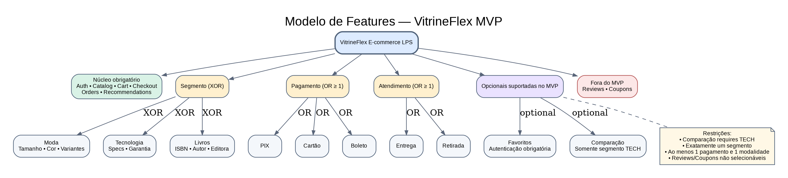
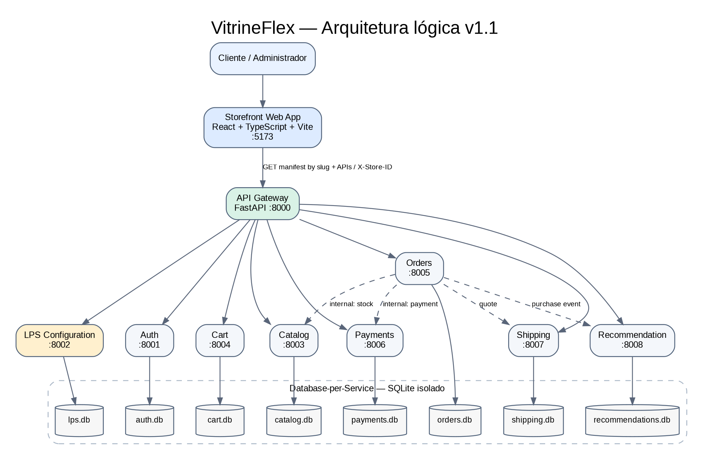
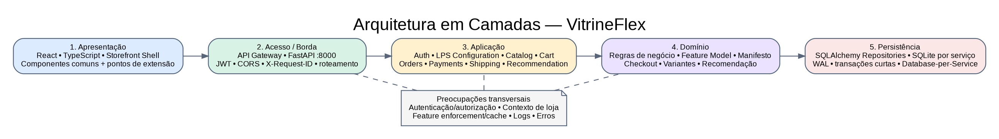
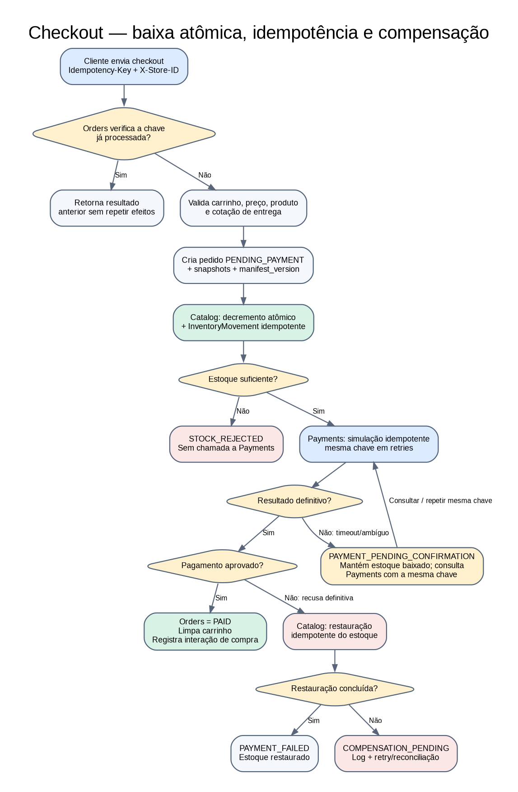
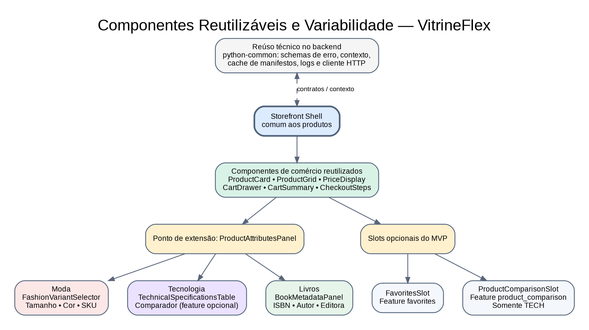
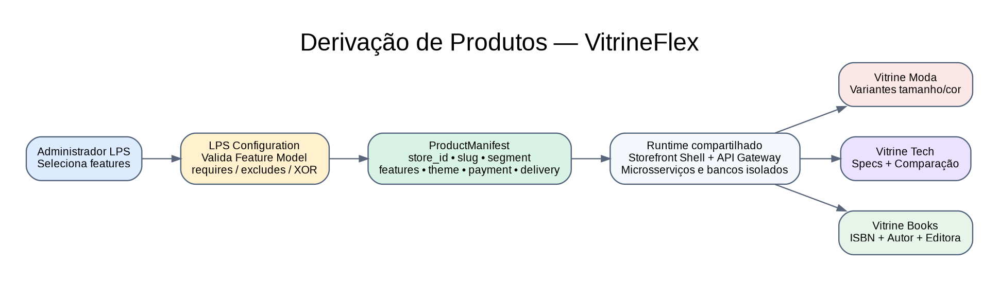

# VitrineFlex — Documento Técnico de Visão e Especificação

**Linha de Produto de Software para Sistemas de E-commerce Multissetoriais Baseada em Microsserviços e Componentes de Software**

- **Versão:** 1.1
- **Data:** 08 de novembro de 2026
- **Status:** baseline técnica v1.1 aprovada pelo responsável pelo projeto; decisões arquiteturais ADR-001 a ADR-008 aceitas; implementação ainda não iniciada
- **Disciplina:** Tópicos em Engenharia de Software — Projetando Linhas de Produto de Software
- **Curso:** Ciência da Computação — Universidade Federal de Alagoas (UFAL)
- **Equipe:** a definir

> **Natureza deste documento.** Esta é a especificação técnica aprovada internamente para orientar a modelagem e a implementação acadêmica. Ela descreve decisões de projeto, não funcionalidades já implementadas. A aprovação interna não substitui eventual validação do docente. A versão 1.0 foi preservada no histórico; mudanças futuras deverão ser registradas no changelog e, quando arquiteturais, em novas ADRs.

## 1. Resumo executivo

O VitrineFlex é uma Linha de Produto de Software (LPS) para e-commerces multissetoriais. Seu núcleo comum e seus pontos de variabilidade permitirão derivar lojas para três segmentos: **Moda**, **Tecnologia/Informática** e **Livros**.

A estratégia aprovada é uma **Dynamic Software Product Line (DSPL)** baseada em composição de componentes e manifesto de produto em tempo de execução. Uma mesma aplicação e uma mesma base de código atenderão várias lojas derivadas, cada uma identificada por `store_id` e `slug`, com `ProductManifest` próprio e versionado. Isso demonstra derivação de produtos sem criar um conjunto independente de containers por loja. Essa escolha é adequada ao escopo acadêmico, mas deverá ser confirmada com o docente caso exista exigência de implantação independente.

O administrador da LPS utilizará um configurador para escolher segmento, identidade visual, métodos de pagamento, modalidades de entrega e funcionalidades opcionais suportadas. O serviço de configuração validará as regras do modelo de features, persistirá o manifesto e disponibilizará a loja em `/loja/{slug}`. O frontend carregará o manifesto, resolverá o `store_id` e comporá a interface com componentes comuns e variantes específicas. O backend também bloqueará operações de features não habilitadas.

A solução será organizada em monorepo com frontend React/TypeScript, API Gateway FastAPI e oito microsserviços de domínio. Cada microsserviço será responsável por sua persistência SQLite independente. O Recommendation Service usará interesses declarados e histórico de visualizações, favoritos e compras. Pagamentos e frete serão simulados. A implementação ainda não começou; esta versão formaliza as decisões aprovadas antes da codificação.

## 2. Base acadêmica e decisões de projeto

### 2.1 Exigências identificadas nos materiais da disciplina

O documento de orientação do projeto 2026.2 exige modelagem e implementação de uma LPS usando microsserviços e componentes de software. O uso de Agentic AI é opcional e Python é sugerido como linguagem. O material lista e-commerce como um dos temas permitidos [1][2].

O roteiro do relatório exige, entre outros itens: metodologia ágil; técnicas de reúso; Product Backlog e Sprint Backlogs; diagrama de features; arquitetura em camadas; diagramas de variabilidade; diagrama de componentes; tela de configuração e derivação de um novo produto; arquitetura de microsserviços; API Gateway; especificação de cada serviço; serviço de recomendação baseado no perfil/histórico; tela que mostre as portas dos serviços em execução; tecnologias; telas da aplicação; GitHub e referências [1].

### 2.2 Referências de trabalhos anteriores

O relatório Guacaloka apresenta um e-commerce de comida mexicana, com catálogo, autenticação, carrinho, pedidos, frete e recomendação, e inclui modelagem de features, camadas, componentes e variabilidade [3]. O relatório SmartClass demonstra uma separação por serviços, API Gateway, documentação de endpoints, Docker, SQLite, JWT e serviço de recomendação [4]. Esses trabalhos são referências de organização e cobertura acadêmica; o VitrineFlex terá domínio, regras, componentes e implementação próprios.

### 2.3 Classificação das decisões

- **Obrigatório pela disciplina:** LPS, microsserviços, componentes reutilizáveis, recomendação baseada no perfil/histórico e itens de modelagem/implementação descritos na seção 2.1.
- **Decisões aprovadas para o VitrineFlex:** três segmentos (Moda, Tecnologia e Livros); composição dinâmica por manifesto; instâncias lógicas de loja com `store_id`; React/TypeScript no frontend; Python/FastAPI no backend; oito microsserviços de domínio e API Gateway; SQLite por serviço; features opcionais do MVP limitadas a Favoritos e Comparação de Produtos (esta última exclusiva de Tecnologia); roteamento por prefixos; enforcement de features por cache local; compensação idempotente de estoque; versionamento de manifesto; autenticação interna por token compartilhado; stack frontend com Tailwind CSS, React Router, TanStack Query e Lucide React.
- **Ainda sujeito a validação externa ou planejamento:** aceitação do tema, da estratégia de derivação por instância lógica e do SQLite pelo docente; composição da equipe; calendário e duração reais das Sprints; versões exatas das dependências, a serem fixadas após verificação de compatibilidade.

### 2.4 Histórico de versão

| Versão | Data | Alterações |
|---|---|---|
| 1.0 | 08/11/2026 | Baseline técnica inicial, preservada sem alterações no arquivo original. |
| 1.1 | 08/11/2026 | Formaliza ADR-001 a ADR-008 aprovadas; limita as features opcionais do MVP; define roteamento, contexto de loja, compensação idempotente de estoque, enforcement com TTL de 30 segundos, parâmetros do SQLite WAL, versionamento do manifesto, segurança interna e stack frontend. |

A revisão da baseline 1.0 permanece registrada em `BASELINE_REVIEW.md`. As decisões aceitas encontram-se individualizadas em `adr/ADR-001` a `adr/ADR-008`.

## 3. Visão, objetivos e escopo

### 3.1 Problema

Pequenos e médios comerciantes de segmentos diferentes precisam de lojas virtuais, mas funcionalidades específicas de um segmento nem sempre são necessárias em outro. Desenvolver lojas separadas aumenta duplicação e esforço de manutenção; por outro lado, uma loja genérica sem variabilidade não demonstra adequadamente o conceito de LPS.

### 3.2 Objetivo geral

Projetar, modelar e implementar uma LPS de e-commerce que permita configurar e derivar lojas virtuais para segmentos comerciais distintos, reutilizando componentes de software e microsserviços, com recomendação personalizada baseada em dados do usuário.

### 3.3 Objetivos específicos

1. Identificar funcionalidades comuns, opcionais e alternativas entre os segmentos.
2. Definir regras de dependência e incompatibilidade entre features.
3. Implementar um configurador que valide e persista a configuração de cada loja derivada.
4. Reutilizar componentes visuais e módulos de domínio no frontend.
5. Implementar serviços REST independentes, acessados externamente por meio de um API Gateway.
6. Manter dados de cada loja logicamente isolados por `store_id`.
7. Implementar recomendações que considerem interesses declarados, visualizações, favoritos e compras.
8. Demonstrar pelo menos três produtos derivados com configurações diferentes.

### 3.4 Escopo incluído

- Painel administrativo da LPS para criar lojas derivadas.
- Três segmentos iniciais: Moda, Tecnologia/Informática e Livros.
- Cadastro/login de clientes e perfil com interesses.
- Catálogo, busca, filtros, detalhes e variantes de produtos.
- Carrinho, checkout, pedidos e histórico.
- Pagamentos simulados: PIX, cartão e boleto.
- Entrega em domicílio e/ou retirada, com cotação simulada.
- Recomendações personalizadas e fallback para produtos populares.
- Recursos opcionais implementados no MVP: favoritos (todos os segmentos) e comparação de produtos (exclusiva de Tecnologia). Avaliações e cupons permanecem como extensões futuras documentadas, mas não poderão ser selecionados nem ativados no MVP.
- Painel de saúde dos serviços e visualização de portas/URLs.
- Dados demonstrativos e instruções locais de execução.

### 3.5 Fora do escopo inicial

- Integração financeira real com bancos, adquirentes ou gateways de pagamento.
- Armazenamento ou processamento de dados reais de cartão.
- Integração com transportadoras, cálculo fiscal ou emissão de nota fiscal.
- Integração real com e-mail, SMS ou WhatsApp.
- Aplicativo nativo para Android/iOS.
- Integração com ERP/estoque de terceiros.
- Recomendação baseada em redes neurais ou modelos generativos.
- Alta disponibilidade, escalabilidade multi-região ou implantação produtiva em nuvem.

## 4. Produtos derivados e usuários

### 4.1 Produtos de referência

| Produto derivado | Segmento | Variabilidade específica |
|---|---|---|
| Vitrine Moda | Vestuário e acessórios | Tamanho, cor, grade de variantes e atributos de vestuário |
| Vitrine Tech | Eletrônicos e informática | Especificações técnicas, garantia e comparação de produtos |
| Vitrine Books | Livros | ISBN, autor, editora, gênero e edição |

Os nomes são identificadores de demonstração. O administrador poderá informar nome comercial, slug e identidade visual ao criar uma loja.

### 4.2 Perfis de usuário

- **Visitante:** navega pelo catálogo e consulta detalhes; precisa autenticar-se para ações pessoais ou finalizar compra.
- **Cliente:** mantém perfil, interesses, carrinho, pedidos e favoritos quando habilitados. Avaliações não fazem parte do MVP.
- **Administrador da loja:** gerencia catálogo, estoque, pedidos e informações da loja à qual possui acesso.
- **Administrador da LPS:** cria produtos derivados por meio do configurador e consulta a saúde da infraestrutura.

No MVP, os papéis de administrador da loja e administrador da LPS poderão ser atribuídos a uma conta de demonstração, mas as permissões serão diferenciadas no backend.

## 5. Requisitos funcionais

| ID | Requisito | Prioridade |
|---|---|---|
| RF-01 | Registrar clientes e autenticar com e-mail e senha | Must |
| RF-02 | Manter perfil e categorias de interesse do cliente | Must |
| RF-03 | Criar uma loja derivada escolhendo segmento, identidade e features suportadas | Must |
| RF-04 | Validar dependências, grupos alternativos e incompatibilidades no configurador | Must |
| RF-05 | Persistir manifesto versionado e disponibilizar a loja em `/loja/{slug}` | Must |
| RF-06 | Exibir catálogo, busca, filtros e detalhes de produtos | Must |
| RF-07 | Manter produtos, categorias, variantes e estoque por loja | Must |
| RF-08 | Adicionar, alterar quantidade e remover itens do carrinho, sempre no contexto da loja | Must |
| RF-09 | Calcular resumo e finalizar compra com chave de idempotência | Must |
| RF-10 | Simular pagamento somente pelos métodos habilitados | Must |
| RF-11 | Calcular cotação de entrega ou disponibilizar retirada conforme manifesto | Must |
| RF-12 | Registrar pedidos, status, versão do manifesto e histórico do cliente | Must |
| RF-13 | Recomendar produtos utilizando interesses e histórico de interações/compras | Must |
| RF-14 | Exibir status, portas e estado de saúde dos microsserviços | Must |
| RF-15 | Habilitar/desabilitar favoritos por configuração e impedir acesso quando desabilitados | Should (MVP) |
| RF-16 | Comparar produtos somente na loja de Tecnologia e quando a feature estiver habilitada | Should (MVP) |
| RF-17 | Permitir ao administrador gerenciar catálogo, estoque e pedidos de sua loja | Must |
| RF-18 | Exibir visualmente features e módulos ativos no produto derivado | Must |
| RF-19 | Preservar isolamento de dados entre lojas em todas as operações comerciais | Must |
| RF-20 | Compensar a baixa de estoque quando o pagamento simulado falhar, sem duplicar operações | Must |

**Fora do MVP:** `reviews` (avaliações) e `coupons` (cupons) são extensões futuras. Não estarão presentes no seletor de features, no manifesto ativo do MVP ou em endpoints funcionais. Só poderão ser reintroduzidas por alteração formal do modelo de features, entidades, APIs, testes e documentação.

### 5.1 Requisitos não funcionais

- **RNF-01 — Usabilidade:** interface responsiva para desktop e dispositivos móveis, com navegação consistente.
- **RNF-02 — Manutenibilidade:** separar frontend, gateway e serviços por responsabilidade e manter documentação de execução.
- **RNF-03 — Segurança:** armazenar senhas com hash Argon2id; autenticar por JWT; aplicar autorização por papel, usuário e loja; remover cabeçalhos de identidade enviados pelo cliente e reconstruí-los somente após validar o token.
- **RNF-04 — Isolamento:** toda consulta a dados comerciais deve considerar `store_id`; o cabeçalho `X-Store-ID` é contexto solicitado, não prova de autorização, e deve ser validado; um usuário não deve acessar dados de outra loja sem autorização.
- **RNF-05 — Contratos:** APIs REST versionadas em `/api/v1`, com validação de entrada e documentação OpenAPI.
- **RNF-06 — Testabilidade:** regras de variabilidade, cálculo, autorização e recomendação devem possuir testes automatizados.
- **RNF-07 — Observabilidade:** cada serviço deve expor `/health` e registrar logs com identificador de requisição.
- **RNF-08 — Configuração:** segredos e URLs devem ser fornecidos por variáveis de ambiente; não versionar `.env` real.
- **RNF-09 — Portabilidade local:** subir o ambiente acadêmico por Docker Compose com um comando documentado.
- **RNF-10 — Desempenho de demonstração:** operações comuns devem responder em tempo adequado em ambiente local e com volume de dados de demonstração; limites quantitativos serão definidos após teste de carga simples.

## 6. Modelo de features e variabilidade

O modelo abaixo representa as features efetivamente suportadas na primeira versão implementável da LPS. A existência de uma feature no modelo de domínio não implica que ela esteja ativa em todos os produtos; a ativação é governada pelo `ProductManifest` e validada no frontend e no backend.

### 6.1 Features obrigatórias

- Núcleo da loja, identidade visual e manifesto.
- Cadastro, autenticação e perfil do cliente.
- Catálogo, busca e detalhes de produtos.
- Carrinho, checkout, pedidos e histórico.
- Pelo menos um método de pagamento simulado.
- Pelo menos uma modalidade de atendimento/entrega.
- Recommendation Service e recomendação personalizada (obrigatório para atender ao enunciado).
- Painel administrativo básico e isolamento por loja.

### 6.2 Grupos alternativos e opcionais

**Segmento comercial (XOR — exatamente um):**
- **Moda:** variantes de tamanho/cor e atributos de vestuário.
- **Tecnologia:** especificações técnicas, garantia e possibilidade de comparação de produtos.
- **Livros:** ISBN, autor, editora, gênero e edição.

**Métodos de pagamento (OR — pelo menos um):** PIX simulado, cartão simulado e boleto simulado.

**Modalidades de atendimento (OR — pelo menos uma):** entrega em domicílio e retirada no local.

**Features opcionais suportadas no MVP:**
- `favorites`: favoritos de produtos por cliente e loja; exige autenticação.
- `product_comparison`: comparação de produtos; permitida somente no segmento `TECH`.

**Extensões futuras, não selecionáveis no MVP:**
- `reviews`: avaliações de produtos; exige entidade, política de moderação e endpoints ainda não implementados.
- `coupons`: cupons de desconto; exige entidade, regras de validade, aplicação e auditoria ainda não implementadas.



### 6.3 Restrições de variabilidade

1. Exatamente um segmento deve ser selecionado.
2. Autenticação, catálogo, carrinho, pedidos, checkout e recomendação são obrigatórios no produto acadêmico mínimo.
3. Pelo menos um método de pagamento deve estar habilitado.
4. Pelo menos uma modalidade de atendimento/entrega deve estar habilitada.
5. `product_comparison` exige `segment = TECH`.
6. Atributos de tamanho/cor e variantes de vestuário são aplicáveis a `segment = FASHION`.
7. ISBN/autor/editora são aplicáveis a `segment = BOOKS`.
8. Especificações técnicas/garantia são aplicáveis a `segment = TECH`.
9. `favorites` exige cliente autenticado.
10. `reviews` e `coupons` não podem ser selecionadas na configuração do MVP; pedidos enviados com essas features devem ser rejeitados pelo validador.
11. Retirada não exige endereço de entrega; entrega em domicílio exige endereço/CEP válido no escopo simulado.
12. Todas as operações comerciais devem carregar contexto de loja e filtrar dados por `store_id`.

### 6.4 Estratégia de derivação

A derivação será baseada em **configuração e composição em tempo de execução**, sem geração de código-fonte nem criação de um container por loja no MVP. O configurador produzirá um `ProductManifest` versionado e persistido com identificadores, nome, `slug`, segmento, features suportadas, métodos de pagamento, modalidades de atendimento e tema.

Cada produto derivado será uma instância lógica de loja com `store_id` UUID e `slug` próprios. A mesma aplicação servirá as lojas e os microsserviços consultarão/validarão o contexto da loja. O frontend acessará `/loja/{slug}`, carregará o manifesto público por meio do LPS Configuration Service e obterá o `store_id`. As requisições subsequentes enviarão `X-Store-ID`. O cabeçalho é apenas contexto: os serviços devem validar que a loja existe e está ativa e aplicar autorização por usuário, papel e associação administrativa.

O LPS Configuration Service é a fonte de verdade para o manifesto e para o modelo de features. Cada microsserviço que protege operações opcionais utilizará o pacote técnico `python-common` para manter cache local do manifesto com **TTL de 30 segundos**. Ao expirar, o serviço buscará a versão atual do manifesto. A ativação de uma feature deverá habilitar comportamento concreto; uma feature desabilitada deverá ser bloqueada no backend mesmo que a requisição seja enviada diretamente.

A configuração é persistida, versionada e recuperável após reinício. O segmento comercial é imutável depois da criação da loja. Features comportamentais opcionais podem ser alteradas gerando nova versão do manifesto, respeitando compatibilidade com dados existentes. A derivação será demonstrada por três lojas ativas na mesma base de código, com manifests, catálogos, identidade e experiência diferentes.

### 6.5 Exemplo de manifesto do produto

Exemplo simplificado para uma loja de tecnologia. `schema_version` identifica o formato do documento; `manifest_version` identifica a revisão da configuração da loja:

```json
{
  "schema_version": "1.0",
  "manifest_version": 1,
  "store": {
    "id": "<uuid-da-loja>",
    "name": "Vitrine Tech",
    "slug": "vitrine-tech",
    "segment": "TECH"
  },
  "features": {
    "auth": true,
    "catalog": true,
    "cart": true,
    "checkout": true,
    "recommendations": true,
    "favorites": true,
    "product_comparison": true
  },
  "payment_methods": ["PIX", "CARD"],
  "fulfillment_modes": ["DELIVERY", "PICKUP"],
  "theme": {"primary_color": "#245B8F"}
}
```

`reviews` e `coupons` foram omitidas por não integrarem o conjunto de features suportadas no MVP. O backend deve rejeitar chaves de feature desconhecidas ou explicitamente fora do conjunto implementado.

## 7. Arquitetura geral

### 7.1 Estilo arquitetural

- Frontend SPA em React + TypeScript + Vite.
- Backend organizado em oito microsserviços REST independentes e um API Gateway.
- API Gateway como único ponto de entrada do navegador para APIs de backend.
- Comunicação síncrona HTTP/JSON entre serviços no MVP; eventos podem ser enviados por chamadas internas síncronas para registrar compra/interação.
- Padrão Database-per-Service, com um banco SQLite de propriedade exclusiva de cada microsserviço.
- Monorepo para simplificar desenvolvimento, integração e avaliação acadêmica.
- Produtos derivados como instâncias lógicas multi-tenant isoladas por `store_id`, não como containers independentes no MVP.

### 7.2 Diagrama lógico



Fonte editável: `diagrams/architecture-v1.1.dot`.

O browser obtém primeiro o manifesto por `slug` por meio do Gateway. Em seguida, as requisições de domínio passam pelo Gateway com `X-Store-ID`. O Gateway roteia por prefixo determinístico de serviço, valida presença e formato do contexto de loja, remove cabeçalhos de identidade enviados pelo cliente e injeta `X-User-ID` e `X-User-Role` somente após validar o JWT. O Gateway também injeta `X-Internal-Token` nas chamadas encaminhadas à rede privada. Cada serviço valida a existência/estado da loja e o escopo por meio do manifesto obtido pela cache TTL; isso evita uma consulta da borda ao LPS em toda requisição. Chamadas internas diretas utilizam o mesmo segredo. Nenhum serviço acessa diretamente o banco de outro.

### 7.3 Microsserviços e responsabilidade

| Serviço | Porta local | Responsabilidade | Banco inicial |
|---|---:|---|---|
| API Gateway | 8000 | Roteamento, validação de JWT, CORS, contexto confiável, correlação e health agregado | Sem banco |
| Auth | 8001 | Usuários, senha, login, papéis, memberships e preferências/interesses | `auth.db` |
| LPS Configuration | 8002 | Modelo de features, validação, lojas e manifestos versionados | `lps.db` |
| Catalog | 8003 | Produtos, categorias, atributos por segmento, variantes, favoritos e estoque | `catalog.db` |
| Cart | 8004 | Carrinhos e itens por cliente/loja | `cart.db` |
| Orders | 8005 | Checkout, pedidos, idempotência, snapshots e histórico de status | `orders.db` |
| Payments | 8006 | Tentativas e resultados de pagamentos simulados | `payments.db` |
| Shipping | 8007 | Métodos disponíveis, retirada e cotação simulada de entrega | `shipping.db` |
| Recommendation | 8008 | Interações, afinidade por categoria e ranking de recomendações | `recommendations.db` |

As portas são propostas para execução local. Para inspeção acadêmica, as portas dos serviços poderão ser mapeadas apenas para `127.0.0.1`; em ambiente público, somente o Gateway deverá ser exposto. O frontend de desenvolvimento usa a porta `5173`.

### 7.4 Detalhamento dos serviços

**API Gateway**
- Encaminha os prefixos determinísticos `/api/v1/auth/*`, `/api/v1/lps/*`, `/api/v1/catalog/*`, `/api/v1/cart/*`, `/api/v1/orders/*`, `/api/v1/payments/*`, `/api/v1/shipping/*` e `/api/v1/recommendations/*`.
- Para rotas autenticadas, valida assinatura, expiração e claims do JWT. Remove `X-User-ID`, `X-User-Role` e cabeçalhos internos fornecidos pelo cliente antes de injetar o contexto validado.
- Exige `X-Store-ID` em rotas de domínio que operam no contexto de loja e valida formato UUID; o cabeçalho é contexto solicitado, não autorização. A validação de loja ativa/manifesto é feita pelos serviços por meio do provedor de manifesto com cache, evitando consulta central a cada requisição.
- Remove `X-Internal-Token` recebido externamente e injeta o segredo interno ao encaminhar chamadas para a rede privada; não expõe rotas `/internal/v1/*` ao browser.
- Gera/propaga `X-Request-ID`, padroniza erros de upstream e disponibiliza `/health` e consulta agregada de serviços.
- Não implementa regras de catálogo, checkout ou recomendação.

**Auth Service**
- Registra clientes e administradores; autentica e emite JWT de acesso.
- Retorna usuário e papéis; mantém interesses/categorias preferidas e associações `StoreMembership`.
- Implementa hash Argon2id, validação e autorização de recursos próprios.
- Não aceita cabeçalhos de identidade como prova de autenticação; identidade confiável chega do Gateway/serviço interno protegido.

**LPS Configuration Service**
- Mantém definição versionada de features, constraints e catálogo de features suportadas no MVP.
- Valida segmento exclusivo, dependências, métodos de pagamento, modalidades de atendimento e combinações obrigatórias.
- Cria `store_id`, `slug` e `ProductManifest`; mantém histórico de versões.
- Expõe consulta pública do manifesto por slug para inicialização da loja e operações administrativas autenticadas para validar/criar/alterar configuração.
- Impede mudança de segmento após criação e valida compatibilidade antes de gerar uma nova versão de manifesto.

**Catalog Service**
- Gerencia produtos, categorias, imagens, variantes, atributos específicos, estoque e favoritos.
- Usa núcleo comum de produto e atributos validados segundo o segmento.
- Moda: tamanhos, cores e SKU por variante. Tecnologia: fabricante, modelo, especificações e garantia. Livros: ISBN, autor, editora, gênero e edição.
- Filtra todas as consultas e comandos por `store_id`.
- Executa decremento atômico e restauração idempotente de estoque por operações internas; mantém registro das movimentações para impedir repetição da mesma operação.

**Cart Service**
- Mantém carrinho identificado pela combinação `(user_id, store_id)`.
- Adiciona, atualiza e remove itens; cada requisição exige contexto de loja.
- Consulta o Catalog para conferir produto, preço e disponibilidade ao inserir/atualizar.
- Não é a fonte oficial de preço/estoque; Orders revalida os dados no checkout.

**Orders Service**
- Orquestra o checkout como fluxo de compensação simples (Saga orquestrada localmente, sem transação ACID distribuída).
- Exige `Idempotency-Key` no checkout e mantém unicidade no escopo adequado (`store_id` + cliente + chave).
- Recupera o carrinho, revalida produtos e preço no Catalog e solicita cotação ao Shipping quando aplicável.
- Solicita baixa atômica de estoque ao Catalog antes da simulação do pagamento. Se o pagamento falhar, solicita restauração idempotente do estoque.
- Persiste pedido, `manifest_version` e snapshot imutável dos itens (nome, SKU, variante, quantidade e preço) para preservar histórico.
- Só marca pedido como `PAID` e limpa carrinho após pagamento aprovado. Se o Catalog informar estoque insuficiente, encerra a tentativa com `STOCK_REJECTED`, sem solicitar pagamento. Se Payments retornar timeout ou resultado ambíguo, mantém `PAYMENT_PENDING_CONFIRMATION`, conserva a baixa de estoque e consulta/reexecuta a mesma chave idempotente até obter resultado definitivo. Se a compensação de estoque falhar após recusa definitiva, mantém `COMPENSATION_PENDING`, registra o erro e disponibiliza operação administrativa de reconciliação/retry.

**Payments Service**
- Aceita apenas métodos habilitados no manifesto da loja.
- Simula aprovação ou recusa com dados fictícios; não captura, transmite ou armazena número real de cartão.
- Persiste identificador, pedido, chave de idempotência, método, valor e status da tentativa; uma mesma chave não deve produzir múltiplas tentativas efetivas.

**Shipping Service**
- Retorna modalidades habilitadas para a loja.
- Calcula cotação fictícia usando faixas/zonas de CEP e regras locais definidas no sistema; disponibiliza retirada quando habilitada.
- Não consulta transportadora nem promete prazo real de entrega.

**Recommendation Service**
- Recebe eventos de visualização, favoritar, desfavoritar e compra; a remoção de favorito é registrada como `UNFAVORITE` para atualizar a afinidade sem manter sinal obsoleto.
- Consulta interesses do perfil no Auth e produtos candidatos no Catalog.
- Calcula pontuação por categoria/interesse e histórico, retornando produtos e justificativas simples.
- Para cliente sem histórico, usa popularidade por segmento/categoria (cold start).
- Não utiliza IA generativa nem rede neural no MVP.

### 7.5 Arquitetura em camadas

A organização em camadas complementa a decomposição em microsserviços. Dentro de cada serviço, rotas/API, casos de uso, regras de domínio e repositórios devem permanecer separados. A camada de apresentação não acessa bancos diretamente; o Gateway não concentra regras específicas de negócio.



Fonte editável: `diagrams/layers-v1.1.dot`.

## 8. Fluxos principais

### 8.1 Derivação de loja

1. Administrador acessa o painel da LPS.
2. Informa nome, slug, segmento e identidade visual.
3. Seleciona métodos de pagamento e modalidades de entrega.
4. Ativa/desativa features opcionais.
5. O LPS Configuration Service valida as restrições.
6. Se válido, persiste o manifesto e cria a instância lógica da loja.
7. O frontend acessa `/loja/{slug}`, recupera a configuração por meio de `GET /api/v1/lps/stores/{slug}/manifest` via Gateway, guarda o `store_id` e monta a navegação, rotas e componentes correspondentes.
8. O administrador cadastra produtos ou utiliza catálogo demonstrativo do segmento.

### 8.2 Checkout

1. Cliente autenticado envia `POST /api/v1/orders/checkout` com `X-Store-ID` e `Idempotency-Key`.
2. Orders verifica se a mesma chave já foi processada; em caso afirmativo, retorna o resultado anterior sem repetir efeitos.
3. Orders recupera o carrinho no Cart e revalida produto, variante, preço, disponibilidade e feature no Catalog.
4. Se houver entrega em domicílio, consulta Shipping; se retirada, valida a modalidade no manifesto.
5. Orders cria o pedido em estado `PENDING_PAYMENT` e registra snapshots e versão do manifesto.
6. Orders solicita ao Catalog o decremento **atômico** de estoque. O Catalog executa atualização condicional (`stock >= quantity`) dentro de transação e registra uma movimentação identificada pela operação idempotente. Se não houver saldo suficiente, o pedido termina em `STOCK_REJECTED` e nenhum pagamento é solicitado.
7. Com estoque baixado, Orders solicita ao Payments a simulação idempotente do método habilitado.
8. Se aprovado, Orders muda o pedido para `PAID`, registra o histórico, limpa o carrinho e envia a interação de compra ao Recommendation.
9. Se Payments retornar recusa definitiva, Orders registra `PAYMENT_FAILED` e solicita ao Catalog a restauração idempotente do estoque.
10. Se Payments retornar timeout ou resposta ambígua, Orders mantém `PAYMENT_PENDING_CONFIRMATION`, não restaura o estoque e consulta/reexecuta a operação com a mesma chave idempotente até conhecer o resultado definitivo.
11. Se a restauração após falha definitiva não concluir, o pedido permanece em `COMPENSATION_PENDING`, com erro registrado e possibilidade de reconciliação/retry administrativo. Nenhuma operação de pagamento ou estoque poderá ser duplicada ao repetir a requisição com a mesma chave.



Não haverá transação distribuída ACID entre bancos. O fluxo é uma orquestração síncrona com compensação explícita, estados auditáveis e idempotência. A garantia de estoque depende da operação atômica no Catalog; a estratégia não promete disponibilidade ou consistência de uma plataforma de produção de grande porte.

### 8.3 Recomendação personalizada

O cliente terá preferências por categoria no perfil. O Recommendation armazenará interações com tipo, produto, categoria, data, usuário e loja. Uma pontuação inicial e explicável poderá ser: `score = 4I + min(5P, 15) + min(3F, 9) + min(V, 5) + 2T`, onde I indica correspondência com interesse declarado (0 ou 1), P é a quantidade de compras na categoria, F a quantidade de favoritos, V as visualizações recentes e T é popularidade normalizada entre 0 e 1. Os pesos e janelas temporais são parâmetros iniciais, sujeitos a teste e ajuste. Produtos inativos, sem estoque ou de outra loja serão excluídos. Para cliente sem histórico, usa-se popularidade por segmento/categoria (cold start). Não será apresentado como modelo de machine learning treinado. O endpoint retornará produtos, pontuação e motivo resumido da recomendação.

## 9. Contratos de API propostos

Todas as APIs públicas do frontend serão acessadas pelo Gateway sob `/api/v1`. Cada rota de domínio utiliza prefixo determinístico do serviço responsável. As rotas internas serviço-a-serviço usam `/internal/v1/*`, exigem `X-Internal-Token` e não são publicadas pelo Gateway para acesso do navegador.

| Serviço | Endpoint no Gateway | Finalidade / observação |
|---|---|---|
| Auth | `POST /api/v1/auth/register` | Criar usuário |
| Auth | `POST /api/v1/auth/login` | Autenticar e emitir token |
| Auth | `GET /api/v1/auth/me` | Consultar perfil autenticado |
| Auth | `PUT /api/v1/auth/me/preferences` | Atualizar interesses |
| LPS Config | `POST /api/v1/lps/stores/validate` | Validar configuração antes da derivação |
| LPS Config | `POST /api/v1/lps/stores` | Criar/derivar loja (LPS_ADMIN) |
| LPS Config | `GET /api/v1/lps/stores/{slug}/manifest` | Obter manifesto público e `store_id` para iniciar a loja |
| LPS Config (interno) | `GET /internal/v1/lps/stores/{store_id}/manifest` | Obter manifesto para cache/enforcement nos serviços; exige `X-Internal-Token` |
| LPS Config | `PATCH /api/v1/lps/stores/{store_id}/features` | Criar nova versão de features opcionais (administrador autorizado) |
| Catalog | `GET /api/v1/catalog/products` | Listar/filtrar produtos; exige `X-Store-ID` |
| Catalog | `GET /api/v1/catalog/products/{product_id}` | Consultar detalhe no escopo da loja |
| Catalog | `POST /api/v1/catalog/products` | Cadastrar produto (STORE_ADMIN autorizado) |
| Catalog | `GET /api/v1/catalog/favorites` | Listar favoritos; exige feature e autenticação |
| Catalog | `POST /api/v1/catalog/favorites` | Favoritar produto; exige feature e autenticação |
| Catalog | `DELETE /api/v1/catalog/favorites/{product_id}` | Remover favorito |
| Catalog | `GET /api/v1/catalog/products/compare` | Comparar produtos; somente TECH + feature ativa |
| Cart | `GET /api/v1/cart` | Consultar carrinho no `X-Store-ID` atual |
| Cart | `POST /api/v1/cart/items` | Adicionar item |
| Cart | `PATCH /api/v1/cart/items/{item_id}` | Atualizar quantidade/variante |
| Cart | `DELETE /api/v1/cart/items/{item_id}` | Remover item |
| Orders | `POST /api/v1/orders/checkout` | Finalizar compra; exige `Idempotency-Key` |
| Orders | `GET /api/v1/orders` | Listar histórico da loja/cliente |
| Orders | `GET /api/v1/orders/{order_id}` | Consultar pedido no escopo autorizado |
| Payments | `POST /internal/v1/payments/simulate` | Simulação interna idempotente; não exposta ao browser |
| Shipping | `POST /api/v1/shipping/quote` | Cotar entrega/retirada conforme manifesto |
| Recommendation | `GET /api/v1/recommendations` | Listar recomendações personalizadas |
| Recommendation | `POST /api/v1/recommendations/interactions` | Registrar visualização ou interação autorizada |
| Gateway | `GET /api/v1/system/services` | Estado agregado e portas dos serviços |
| Catalog (interno) | `POST /internal/v1/inventory/decrement` | Baixa atômica/idempotente de estoque, chamada por Orders |
| Catalog (interno) | `POST /internal/v1/inventory/restore` | Compensação idempotente do estoque, chamada por Orders |

Os nomes são contratos aprovados para orientar a implementação; o detalhamento de schemas, códigos de status e exemplos request/response deverá ser documentado no OpenAPI de cada serviço antes ou durante a implementação. Os estados de pedido têm semântica explícita: `STOCK_REJECTED` encerra o fluxo antes do pagamento; `PAYMENT_PENDING_CONFIRMATION` mantém o estoque baixado até resolver uma resposta ambígua; `PAYMENT_FAILED` indica recusa definitiva com compensação solicitada; `COMPENSATION_PENDING` indica que a restauração ainda exige reconciliação; `PAID` é terminal de sucesso. Todas as operações comerciais exigem contexto `X-Store-ID`. Para rotas autenticadas, o Gateway valida JWT, elimina cabeçalhos de identidade fornecidos pelo navegador e encaminha contexto derivado do token.

As respostas de erro seguirão formato JSON padronizado (`code`, `message`, `details`, `request_id`). Exemplos importantes: `FEATURE_NOT_ENABLED` (403), `INVALID_FEATURE_CONFIGURATION` (422), `STORE_CONTEXT_REQUIRED` (400), `STORE_NOT_FOUND` (404), `IDEMPOTENCY_KEY_REUSED` (409) e `INSUFFICIENT_STOCK` (409). Listas terão paginação com `page`, `page_size` e `total`.

## 10. Dados e isolamento

### 10.1 Entidades lógicas por serviço

| Serviço | Entidades principais |
|---|---|
| Auth | User, Role, StoreMembership, UserPreference, UserAddress |
| LPS Configuration | Store, ProductManifest (com `manifest_version`), FeatureDefinition, FeatureConstraint |
| Catalog | Product, Category, ProductVariant, ProductAttribute, Inventory, InventoryMovement, ProductFavorite |
| Cart | ShoppingCart (único por cliente/loja), CartItem |
| Orders | Order (com `manifest_version`, `idempotency_key` e estados `PENDING_PAYMENT`, `PAID`, `PAYMENT_FAILED`, `PAYMENT_PENDING_CONFIRMATION`, `COMPENSATION_PENDING`, `STOCK_REJECTED`), OrderItemSnapshot, OrderStatusHistory |
| Payments | PaymentAttempt (com chave idempotente), PaymentResult |
| Shipping | ShippingMethod, ShippingQuote, PickupLocation |
| Recommendation | UserInteraction, CategoryAffinity, RecommendationResult |

### 10.2 Estratégia de persistência

No MVP, cada serviço terá um arquivo SQLite próprio, isolado em volume Docker. A separação por serviço evita que um serviço dependa do esquema interno do outro. IDs de usuário, loja e produto serão referências externas (UUID/string), sem chaves estrangeiras cruzando bancos. Cada serviço validará referências por API quando necessário.

Todas as tabelas de domínio comercial devem incluir `store_id` ou ser relacionadas a um registro que o contenha. Consultas e comandos sempre aplicarão escopo de loja. Carrinhos e pedidos são identificados no mínimo por `user_id` e `store_id`; lojas diferentes nunca compartilham o mesmo carrinho lógico.

**Configuração SQLite obrigatória:** `PRAGMA journal_mode=WAL`, `PRAGMA busy_timeout=5000` (milissegundos), transações curtas, índices para `store_id` e chaves de consulta, e tratamento limitado de `SQLITE_BUSY` nas operações que possam ser repetidas com segurança. O WAL permite que leitores coexistam com um escritor, mas **não permite múltiplos escritores simultâneos**: o SQLite mantém um único escritor por vez. Operações de estoque serão atômicas, condicionais e protegidas por idempotência; os testes deverão validar concorrência e contenção.

Para evolução além do ambiente acadêmico, a migração natural é PostgreSQL por serviço ou instâncias/schemas isolados, conforme a escala. SQLite é uma escolha de simplicidade para execução local e demonstração, não uma afirmação de adequação para produção multiusuário de grande porte.

## 11. Componentes e estratégia de reúso

### 11.1 Reúso no frontend

**Componentes de interface:** Button, Input, Select, Modal, Badge, Alert, Skeleton, EmptyState, Pagination.

**Componentes de layout:** StoreHeader, CategoryNavigation, SearchBar, Breadcrumbs, StoreFooter, AdminSidebar.

**Componentes de comércio:** ProductCard, ProductGrid, PriceDisplay, ProductGallery, QuantitySelector, CartDrawer, CartSummary, AddressForm, CheckoutSteps, OrderStatusBadge, RecommendationCarousel.

**Pontos de extensão variáveis no MVP:** ProductAttributesPanel por segmento; ProductVariantSelector para Moda; TechnicalSpecificationsPanel para Tecnologia; BookMetadataPanel para Livros; PaymentMethodSelector conforme métodos ativados; ShippingMethodSelector conforme modalidades; FavoritesSlot e ProductComparisonSlot (somente Tecnologia). Reviews e Coupons são extensões futuras e não terão slots operacionais no MVP.

### 11.2 Reúso no backend

Será permitido compartilhar bibliotecas técnicas pequenas: configuração, logging, correlação de requisições, validação de token, cliente HTTP interno e formato de erros. Regras de negócio e modelos de persistência permanecem nos serviços proprietários para evitar acoplamento indevido.

### 11.3 Feature Registry

O frontend terá um registro central de features, alimentado pelo manifesto. Guardas de rota e componentes condicionais usarão esse registro. O backend terá verificadores equivalentes para proteger endpoints e operações. A definição de features e restrições no serviço LPS Configuration será a fonte de verdade.

### 11.4 Componentes e pontos de variabilidade

A seleção de segmento habilita exatamente um painel de atributos. Pagamento e entrega utilizam seletores compostos por adaptadores; opcionais ocupam slots de extensão. A mesma estrutura de página e componentes comuns é compartilhada entre produtos derivados.



Fonte editável: `diagrams/components-v1.1.dot`.

## 12. Tecnologias e ferramentas

| Área | Tecnologia proposta | Motivo |
|---|---|---|
| Linguagem backend | Python 3.12 ou superior compatível | Linguagem sugerida pela disciplina e ecossistema de APIs |
| API | FastAPI + Pydantic | APIs REST, validação e OpenAPI |
| Persistência | SQLAlchemy 2.x + SQLite | ORM e banco leve para ambiente acadêmico |
| Migrações | Alembic | Evolução controlada de esquema |
| Autenticação | JWT + Argon2id | Tokens de acesso e hash de senha |
| Frontend | React + TypeScript + Vite | Interface modular e tipagem |
| Navegação/estado remoto | React Router + TanStack Query | Rotas, cache e sincronização com APIs |
| Estilo | Tailwind CSS | Consistência visual e temas dinâmicos por variáveis/classes |
| Containers | Docker + Docker Compose | Execução reproduzível de serviços |
| Testes backend | Pytest + HTTPX | Testes unitários e de API |
| Testes frontend | Vitest + React Testing Library | Componentes e comportamento de features |
| Ícones | Lucide React | Ícones consistentes e reutilizáveis |
| E2E | Playwright (desejável) | Fluxos completos do usuário |
| Documentação API | OpenAPI/Swagger | Contratos navegáveis |
| Versionamento | Git + GitHub | Histórico, branches e entrega acadêmica |

As tecnologias do frontend estão aprovadas: React, TypeScript, Vite, Tailwind CSS, React Router, TanStack Query e Lucide React. As versões exatas serão fixadas no início da implementação em arquivos de dependências/lock, após verificar compatibilidade entre Python, FastAPI, Pydantic, SQLAlchemy, Node e bibliotecas do frontend. Não se deve adotar automaticamente a versão mais recente sem teste de compatibilidade.

## 13. Segurança e privacidade

- Hash Argon2id para senhas; jamais armazenar senha em texto puro.
- JWT com expiração e segredo configurado por ambiente.
- Papéis `CUSTOMER`, `STORE_ADMIN` e `LPS_ADMIN`.
- Conferência de propriedade do recurso, `store_id` e associação administrativa no backend.
- O Gateway deve remover `X-User-ID`, `X-User-Role` e `X-Internal-Token` fornecidos externamente; os cabeçalhos de identidade serão reconstruídos somente a partir do JWT validado.
- `X-Store-ID` enviado pelo frontend é contexto não confiável; cada serviço deve validar loja ativa e aplicar filtro de tenant/autorizações.
- Chamadas internas usam `X-Internal-Token` em rotas `/internal/v1/*`; segredo via variável de ambiente, não exposto ao navegador. Essa proteção é adequada ao protótipo acadêmico em rede Docker privada, não substitui mTLS ou identidade de serviço em produção.
- Validação de features habilitadas no servidor, não apenas no frontend.
- Segredos em `.env` local não versionado; fornecer somente `.env.example`.
- CORS restrito às origens necessárias no ambiente de execução.
- Chamadas serviço-a-serviço autenticadas por credencial interna em variável de ambiente; não confiar em cabeçalhos de identidade enviados livremente pelo navegador.
- Em desenvolvimento, serviços poderão ter portas publicadas somente em loopback (`127.0.0.1`) para inspeção acadêmica; em implantação pública, apenas o Gateway será exposto.
- Logs sem senha, token ou informação de pagamento sensível.
- Pagamentos exclusivamente simulados; nenhuma captura de cartão real.
- Dados sintéticos para usuários, pedidos e catálogo de demonstração.

## 14. Interface e telas previstas

1. **Página inicial da loja:** identidade, categorias, destaques e recomendações.
2. **Catálogo:** busca, filtros, paginação e ProductCard reutilizado.
3. **Detalhe do produto:** galeria, preço, atributos do segmento, variante e disponibilidade.
4. **Carrinho:** quantidade, remoção e resumo.
5. **Checkout:** endereço/retirada, cotação, método de pagamento e confirmação simulada.
6. **Pedidos:** histórico, status e detalhes.
7. **Perfil:** dados e interesses do cliente.
8. **Painel administrativo:** catálogo, estoque e pedidos.
9. **Configurador da LPS:** seleção de segmento, identidade, features suportadas no MVP (Favoritos e Comparação em Tech), pagamentos e entrega; validação e criação. Reviews e Coupons não serão selecionáveis.
10. **Painel de serviços:** lista de serviços, portas, URLs, estado de saúde e horário da última verificação.

A interface principal deverá identificar de forma discreta os módulos/microsserviços utilizados, por exemplo em uma área de diagnóstico/rodapé técnico, para facilitar a demonstração e atender ao roteiro da disciplina.

## 15. Derivação de produto — passo a passo demonstrável

1. Executar a plataforma e autenticar como `LPS_ADMIN`.
2. Abrir “Criar nova loja”.
3. Informar nome comercial e slug único.
4. Selecionar exatamente um segmento: Moda, Tecnologia ou Livros.
5. Escolher features opcionais.
6. Selecionar um ou mais métodos de pagamento simulados.
7. Selecionar uma ou mais modalidades de atendimento/entrega.
8. Solicitar validação; exibir erros e dependências caso a configuração seja inválida.
9. Confirmar criação; o serviço persiste o manifesto e retorna a URL da loja.
10. Abrir a loja derivada e verificar que navegação, atributos, páginas e ações correspondem às features selecionadas.
11. Cadastrar produtos ou carregar dados de demonstração do segmento.
12. Realizar uma compra simulada e observar a atualização do histórico/recomendação.



A comprovação acadêmica deverá incluir pelo menos três lojas derivadas com manifests distintos e evidência de que as diferenças alteram o produto em execução.

## 16. Metodologia e plano de entregas

Será utilizada uma adaptação de Scrum, com Product Backlog priorizado, Sprints curtas, incremento demonstrável e revisão ao final de cada ciclo. O tamanho e a duração serão ajustados ao calendário real e à quantidade de integrantes. O uso de Antigravity será apoio à implementação; as decisões, revisões e validações permanecem sob responsabilidade da equipe.

### 16.1 Macro-backlog inicial

| Épico | Conteúdo | Prioridade |
|---|---|---|
| E1 — Fundação | monorepo, ambiente, padrões, Docker Compose | Must |
| E2 — Identidade e acesso | Auth, papéis, perfil e interesses | Must |
| E3 — LPS Configurator | modelo de features, regras, manifesto e loja derivada | Must |
| E4 — Catálogo variável | catálogo comum e atributos dos três segmentos | Must |
| E5 — Compra | carrinho, checkout, pedidos e histórico | Must |
| E6 — Serviços auxiliares | pagamentos e entrega simulados | Must |
| E7 — Recomendação | eventos, perfil, ranking e fallback | Must |
| E8 — Interface e reúso | design system, componentes e telas | Must |
| E9 — Opcionais do MVP | favoritos e comparação de produtos (somente Tech) | Should |
| E9.1 — Extensões futuras | avaliações e cupons, fora do MVP e sem ativação no configurador | Future |
| E10 — Qualidade e entrega | testes, documentação, painel de portas e GitHub | Must |

### 16.2 Sprints propostas

- **Sprint 0 — Modelagem:** detalhar feature model, diagramas, contratos OpenAPI, arquitetura em camadas/componentes e critérios de aceite. As ADRs 001–008 já foram aprovadas internamente. Esta etapa continua sem implementação até a revisão da modelagem formal.
- **Sprint 1 — Fundação:** monorepo, Docker Compose, API Gateway, Auth, shell React e health checks.
- **Sprint 2 — LPS e catálogo:** configurador, validação de features, criação de lojas, Catalog e três modelos de atributos por segmento.
- **Sprint 3 — Fluxo de compra:** Cart, Orders, interface de catálogo/detalhe/carrinho/checkout e histórico.
- **Sprint 4 — Pagamento, entrega e recomendação:** Payments, Shipping, interesses, eventos e ranking de recomendações.
- **Sprint 5 — Produto derivado e qualidade:** demonstrar três produtos, recursos opcionais, painel de serviços, testes integrados, documentação e GitHub.

## 17. Estrutura sugerida do repositório

```text
vitrineflex/
├── apps/
│   └── web/                       # React + TypeScript
├── services/
│   ├── api-gateway/
│   ├── auth-service/
│   ├── lps-config-service/
│   ├── catalog-service/
│   ├── cart-service/
│   ├── orders-service/
│   ├── payments-service/
│   ├── shipping-service/
│   └── recommendation-service/
├── packages/
│   └── python-common/             # utilidades técnicas compartilhadas
├── infra/
│   └── docker-compose.yml
├── scripts/                       # seed, smoke tests e utilitários
├── tests/
│   ├── integration/
│   └── e2e/
├── docs/
│   ├── adr/                       # ADRs aceitas
│   ├── diagrams/                  # diagramas da LPS e arquitetura
│   └── VitrineFlex_Documento_Tecnico_v1.1.md
├── .env.example
├── .gitignore
├── Makefile
└── README.md
```

Cada serviço terá seu próprio `pyproject.toml`, configuração, modelos, schemas, rotas, camada de serviço, repositório e testes. O frontend manterá componentes compartilhados em `src/components` e módulos de feature/segmento em `src/features` e `src/segments`.

## 18. Execução local e operação

- Pré-requisitos: Git, Docker Engine/Desktop com Compose, Node.js em versão LTS compatível e Python conforme versão definida no projeto.
- Configuração: copiar `.env.example` para `.env` e preencher segredos locais de desenvolvimento.
- Inicialização proposta: `docker compose -f infra/docker-compose.yml up --build`.
- Verificação: consultar `GET /api/v1/system/services` e os endpoints `/health` de cada serviço. O painel deve exibir a porta local e o estado de saúde de cada container.
- Frontend e documentação: URLs serão registradas no README; portas locais propostas: frontend `5173`, Gateway `8000`, serviços `8001` a `8008`. No Compose local, os serviços poderão ser publicados somente em `127.0.0.1` para inspeção; em implantação pública, apenas o Gateway será exposto.
- Encerramento: `docker compose -f infra/docker-compose.yml down`.

Os comandos finais poderão mudar quando os arquivos reais forem criados. O README deverá registrar os comandos efetivamente testados, não apenas os planejados.

## 19. Estratégia de testes e critérios de aceite

### 19.1 Testes

- **Unitários:** regras de feature, dependências, validação/versionamento de manifesto, enforcement de feature com manifesto válido/inválido, cálculo de frete, total do carrinho, transições de status, idempotência e pontuação do recomendador.
- **Integração:** endpoints de cada serviço, acesso ao próprio banco, autenticação, autorização, comunicação interna, rotas do Gateway, proteção contra cabeçalhos forjados, filtro por `store_id`, cache TTL e operações internas de estoque.
- **Frontend:** renderização condicional por feature, campos específicos do segmento, formulários e estados de erro/loading.
- **Ponta a ponta:** derivar loja, cadastrar/logar cliente, navegar, adicionar item, checkout simulado, consultar pedido e observar recomendação.
- **Regressão de variabilidade:** garantir que uma feature desabilitada não apareça na interface e não possa ser invocada diretamente via API (403 `FEATURE_NOT_ENABLED`). Garantir que Reviews/Coupons sejam rejeitadas como não suportadas no MVP.
- **Concorrência/idempotência:** testar duas compras concorrentes para a última unidade, rejeição `STOCK_REJECTED` sem pagamento, repetição do checkout com a mesma `Idempotency-Key`, recusa definitiva e restauração única, timeout ambíguo com estado `PAYMENT_PENDING_CONFIRMATION` e compensação pendente/reconciliação.

### 19.2 Critérios de aceite do projeto

1. O ambiente sobe por Docker Compose conforme README.
2. Gateway e todos os microsserviços respondem em suas portas e possuem health check.
3. O painel lista nome, porta e status de todos os serviços.
4. O configurador rejeita combinações inválidas e explica o motivo.
5. Pelo menos três lojas são derivadas com manifests e features distintos.
6. Cada loja apresenta atributos próprios do segmento e dados isolados.
7. Cliente consegue completar fluxo de compra com pagamento simulado.
8. Histórico é persistido e aparece no perfil do cliente.
9. Recommendation altera resultados com base em interesses e compras registradas.
10. Componentes compartilhados são usados pelos três produtos; variantes não duplicam a aplicação inteira.
11. Há testes automatizados para regras centrais e fluxos integrados.
12. Repositório GitHub contém código, documentação, `.env.example` e instruções verificadas.
13. Requisições a features desabilitadas são bloqueadas no backend com erro padronizado.
14. Repetir o mesmo checkout com a mesma chave não duplica pedido, pagamento ou movimentação de estoque.
15. Falha definitiva de pagamento restaura estoque uma única vez; falha de compensação gera estado `COMPENSATION_PENDING` rastreável.
16. Estoque insuficiente gera `STOCK_REJECTED` sem tentativa de pagamento; timeout ambíguo gera `PAYMENT_PENDING_CONFIRMATION` e não libera estoque até resultado definitivo.

## 20. Riscos, limitações e mitigação

| Risco | Impacto | Mitigação proposta |
|---|---|---|
| Escopo grande para o prazo | Alto | Priorizar núcleo obrigatório e limitar features opcionais |
| Microsserviços com acoplamento excessivo | Alto | Definir propriedade dos dados e contratos REST antes de codificar |
| Configurador apenas visual | Alto | Testar criação de manifesto e diferença real no produto derivado |
| Vazamento entre lojas | Alto | Testes de isolamento por `store_id` em todos os serviços de domínio |
| Falhas parciais no checkout | Médio/alto | Status explícitos, idempotência e tratamento de falhas |
| Recomendação sem histórico suficiente | Médio | Fallback de popularidade e interesses iniciais |
| Muitas bibliotecas/versões incompatíveis | Médio | Fixar versões compatíveis e evitar dependências desnecessárias |
| SQLite sob concorrência elevada | Médio | WAL, timeout, transações curtas, retry limitado e testes; documentar que existe um único escritor por vez |
| Features desabilitadas acessíveis por chamada direta | Alto | Guardas backend com manifesto em cache TTL de 30 segundos e testes HTTP 403 |
| Requisição repetida no checkout | Alto | `Idempotency-Key` persistida em Orders e operações internas idempotentes no Catalog/Payments |

## 21. Registro de decisões arquiteturais (ADR)

As decisões arquiteturais abaixo foram **aprovadas pelo responsável pelo projeto em 08/11/2026** e formalizadas em documentos independentes na pasta `docs/adr/`. Elas orientam a baseline v1.1 e não devem ser alteradas informalmente.

| ADR | Decisão | Estado |
|---|---|---|
| ADR-001 | Escopo das features opcionais no MVP: Favoritos e Comparação Tech; Reviews/Coupons fora do MVP | Accepted |
| ADR-002 | Roteamento determinístico por prefixo no Gateway; frontend resolve manifesto e envia `X-Store-ID` | Accepted |
| ADR-003 | Baixa atômica de estoque antes do pagamento simulado, com compensação idempotente | Accepted |
| ADR-004 | Enforcement backend de features via cache local em `python-common`, TTL de 30 segundos | Accepted |
| ADR-005 | SQLite por serviço com WAL, `busy_timeout=5000`, transações curtas e tratamento de contenção | Accepted |
| ADR-006 | Segmento imutável; features opcionais versionadas no `ProductManifest` | Accepted |
| ADR-007 | Token interno compartilhado em rotas `/internal/v1/*`, com rede Docker privada e contexto confiável | Accepted |
| ADR-008 | Stack frontend: React, TypeScript, Vite, Tailwind CSS, React Router, TanStack Query e Lucide React | Accepted |

As ADRs contêm contexto, alternativas consideradas, decisão, justificativa, consequências, orientações de implementação e verificações esperadas. Ver `adr/ADR-INDEX.md`.

### 21.1 Itens externos ainda pendentes

Os itens abaixo não são decisões arquiteturais internas já aprovadas; dependem de alinhamento com docente, equipe ou calendário:

1. Validação do tema e da estratégia de derivação por instâncias lógicas pelo docente.
2. Confirmação de que SQLite por serviço atende às expectativas da disciplina.
3. Quantidade de integrantes, responsáveis e duração real das Sprints.
4. Fixação das versões exatas das dependências após teste de compatibilidade.
5. Definição final de identidade visual e conteúdo de demonstração.

Qualquer alteração posterior a uma ADR aceita deverá criar nova ADR ou registrar formalmente sua substituição, mantendo o histórico.

## 22. Mapeamento para o relatório da disciplina

| Item do roteiro | Evidência prevista no VitrineFlex |
|---|---|
| Enunciado e objetivos | Seções 1 e 3 |
| Metodologia ágil e reúso | Seções 11 e 16 |
| Product/Sprint Backlog | Seção 16 |
| Diagrama de Features | Seção 6 e diagrama do projeto |
| Arquitetura em camadas/variabilidade | Seções 6 e 7; diagrama específico a detalhar |
| Componentes/variabilidade | Seção 11 e catálogo de componentes |
| Seletor e novo produto | Seções 6, 15 e tela do configurador |
| Arquitetura de microsserviços | Seção 7 |
| API Gateway e especificação dos serviços | Seções 7 e 9; OpenAPI e código comentado |
| Recomendação por perfil/histórico | Seções 7.4 e 8.3 |
| Portas dos serviços | Seções 7.3 e 18; painel de saúde |
| Tecnologias e bancos por serviço | Seções 7.3 e 12 |
| Telas e funcionamento | Seção 14 e capturas da aplicação implementada |
| GitHub e referências | README e seção 23 |

O roteiro também solicita que a capa do relatório contenha título, nomes da equipe e link do GitHub. O vídeo de demonstração é obrigatório para LPS de jogos e opcional para os demais temas; o link do site é opcional conforme aviso complementar da disciplina [5].

## 23. Referências e materiais consultados

[1] UNIVERSIDADE FEDERAL DE ALAGOAS. **Elementos do Relatório do Projeto — Tópicos em Engenharia de Software: Projetando Linhas de Produto de Software.** Material de orientação da disciplina, 2026.2.

[2] UNIVERSIDADE FEDERAL DE ALAGOAS. **Temas do Projeto de 2026.2.** Material de orientação da disciplina. Lista de temas permitidos e tecnologias sugeridas.

[3] SILVA, Leonardo Vinicius Wanderley Jatobá da; HOLANDA, Vinícius Maia de. **Linha de Produto de Software para E-commerce — Guacaloka!** Relatório de projeto, Universidade Federal de Alagoas, 2025.

[4] DUARTE, Abraão Melo Santana; SILVA, Gustavo Alexandre dos Santos; SENA, Mariáh Lins. **Projeto SmartClass: Relatório do Projeto.** Engenharia de Software 2024.2, 2025.

[5] UNIVERSIDADE FEDERAL DE ALAGOAS. **Aviso — elementos obrigatórios da capa do Relatório do Projeto.** Material complementar da disciplina.

